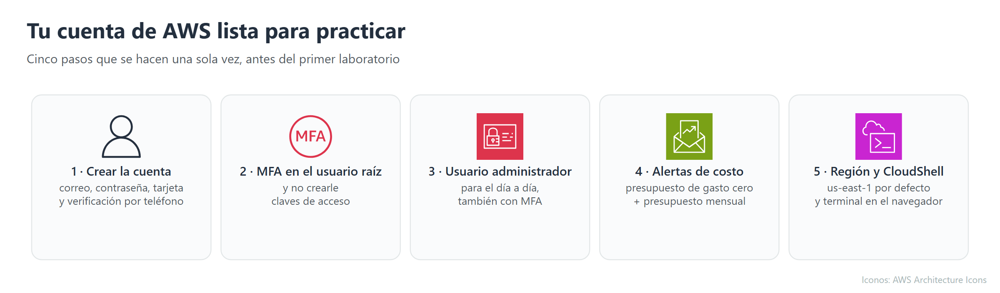

# 1 · Crear tu cuenta de AWS

!!! abstract "Objetivo"
    Crear tu cuenta de AWS entendiendo cada paso y qué implica el plan que eliges. **Tiempo:** 20 minutos.

<figure markdown="span">
  
  <figcaption>Los cinco pasos para dejar tu cuenta lista; esta página cubre el primero.</figcaption>
</figure>

## 1. Qué necesitas

- Un **correo electrónico que no vayas a perder**: será la identidad del usuario raíz. Si usas el de tu universidad o trabajo, podrías perder el acceso al irte.
- Un **número de teléfono** para verificar tu identidad por SMS o llamada.
- Una **tarjeta de crédito o débito válida**. AWS la pide incluso para el plan gratuito, como verificación.

## 2. Plan gratuito o plan de pago

Desde 2025, las cuentas nuevas eligen un plan al registrarse y reciben **créditos de la capa gratuita**: 100 USD al crear la cuenta y hasta 100 USD más al completar actividades guiadas.

|  | Plan gratuito | Plan de pago |
| --- | --- | --- |
| Cobros | Ninguno mientras dure el plan | Se usan los créditos y luego se cobra a precio normal |
| Duración | Hasta 6 meses o hasta agotar los créditos, lo que ocurra primero | Sin límite |
| Servicios | Algunos servicios no están disponibles | Todos |
| Cambio de plan | Puedes pasar al plan de pago cuando quieras | No se puede volver al plan gratuito |

!!! tip "Recomendación para estudiar"
    El **plan gratuito** es ideal para los laboratorios de este curso porque no genera cobros. Antes de que termine el plan, decide si pasas al plan de pago; revisa en la página oficial qué ocurre con la cuenta y sus recursos al vencer.

!!! note "Fuentes y vigencia"
    Estas condiciones vienen de las páginas oficiales de AWS: [capa gratuita](https://aws.amazon.com/free/), [planes de la capa gratuita](https://docs.aws.amazon.com/awsaccountbilling/latest/aboutv2/free-tier-plans.html) y [términos](https://aws.amazon.com/free/terms). AWS puede cambiarlas; revísalas antes de registrarte.

## 3. Paso a paso

1. Entra a [aws.amazon.com](https://aws.amazon.com/) y elige **Crear una cuenta de AWS** (*Create an AWS Account*).
2. Escribe el **correo del usuario raíz** y un **nombre para la cuenta** (por ejemplo, `lab-clf-c02`; se puede cambiar después). Ingresa el **código de verificación** que llega a tu correo.
3. Crea una **contraseña segura** para el usuario raíz y guárdala en un gestor de contraseñas.
4. Elige el **plan** (gratuito o de pago).
5. Completa la **información de contacto**: tipo **Personal**, nombre, teléfono con código de país (por ejemplo, +593 para Ecuador o +52 para México) y dirección. Lee y acepta el acuerdo de cliente.
6. Ingresa la **tarjeta**. AWS puede hacer una autorización temporal pequeña para validarla.
7. **Confirma tu identidad** por SMS o llamada: resuelve el CAPTCHA y escribe el código que recibes.
8. Elige el plan de soporte **Basic (gratuito)**.
9. Termina el registro y entra a la consola como **usuario raíz** (correo + contraseña). La activación puede tardar desde minutos hasta 24 horas; te llegará un correo de confirmación.

## 4. Dos formas de iniciar sesión

| Identidad | Cómo entra | Cuándo usarla |
| --- | --- | --- |
| **Usuario raíz** | Correo y contraseña en [console.aws.amazon.com](https://console.aws.amazon.com/) | Solo para tareas de cuenta: cambiar el plan, cerrar la cuenta, ciertos ajustes de facturación |
| **Usuario de IAM** | ID o alias de la cuenta + usuario + contraseña, en `https://<alias-o-ID>.signin.aws.amazon.com/console` | Para el día a día (lo creas en la [configuración base](03-configuracion-base.md)) |

## 5. Problemas frecuentes

- **No llega el código de verificación:** revisa spam y vuelve a pedirlo.
- **La tarjeta es rechazada:** prueba con otra o pide a tu banco habilitar compras internacionales en línea. Algunas tarjetas prepago no se aceptan.
- **Falla la verificación por teléfono:** revisa el código de país o prueba con llamada de voz.
- **La cuenta sigue "pendiente de activación":** espera y revisa tu correo; si pasan más de 24 horas, abre un caso de soporte de **Cuenta y facturación**, que es gratuito en todos los planes.

## Siguiente paso

Sigue con [2 · Recorrido por la consola](02-consola.md) y luego con [3 · Configuración base](03-configuracion-base.md), donde proteges el usuario raíz y creas tu usuario administrador.
