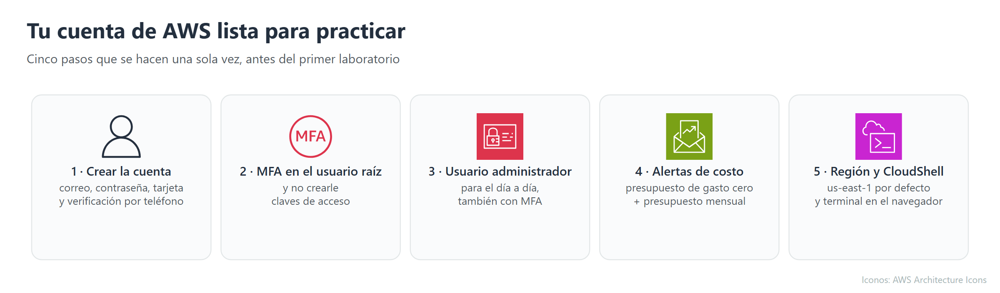

# 3 · Configuración base (una sola vez)

!!! abstract "Objetivo"
    Dejar tu cuenta segura y con alertas de costo antes del primer laboratorio. Cada paso tiene una **prueba** para confirmar que quedó bien, y al final un script revisa todo de una vez. **Tiempo:** 30 minutos.

<figure markdown="span">
  
  <figcaption>Los cinco pasos de la configuración segura de la cuenta.</figcaption>
</figure>

## Paso 1 · MFA en el usuario raíz

1. Como usuario raíz: menú de la cuenta → **Credenciales de seguridad** → **Asignar dispositivo MFA**.
2. Elige **aplicación de autenticación** (Google Authenticator, Microsoft Authenticator u otra) o una **llave de acceso o de seguridad**.
3. Escanea el código QR y escribe dos códigos consecutivos.
4. No crees **claves de acceso** para el usuario raíz.

✅ **Prueba:** cierra sesión y vuelve a entrar como usuario raíz: debe pedirte el código MFA. En **IAM → Panel**, las recomendaciones de seguridad deben mostrar el MFA del usuario raíz en verde.

## Paso 2 · Permitir que IAM vea la facturación

Como usuario raíz: menú de la cuenta → **Cuenta** → **Acceso de usuarios y roles de IAM a la información de facturación** → **Editar** → activar. Sin esto, tu usuario administrador no podrá ver la facturación aunque tenga todos los permisos.

✅ **Prueba:** después del paso 3, entra con tu usuario administrador a Billing and Cost Management: no debe aparecer "Acceso denegado".

## Paso 3 · Tu usuario administrador

1. **IAM → Usuarios → Crear usuario** → nombre `admin-lab` → marca **Proporcionar acceso a la consola**. Si la consola pregunta, elige **crear un usuario de IAM**.
2. Contraseña personalizada.
3. **Adjuntar políticas directamente** → `AdministratorAccess` → **Crear usuario**. Guarda la **URL de inicio de sesión** que aparece.
4. **IAM → Panel → Alias de la cuenta → Crear**: así la URL será `https://<alias>.signin.aws.amazon.com/console`.
5. Entra como `admin-lab` y asigna **MFA** también a ese usuario.

!!! tip "En una empresa"
    Lo recomendado es **IAM Identity Center** (inicio de sesión único para varias cuentas). Para una cuenta personal de estudio, un usuario de IAM con MFA es suficiente.

✅ **Prueba:** en CloudShell, `aws sts get-caller-identity` debe mostrar un ARN que termina en `:user/admin-lab`, no en `:root`.

## Paso 4 · Alertas de costo

Tienes dos caminos. Elige uno.

=== "Con la plantilla de CloudFormation (recomendado)"

    La plantilla [`labs/comunes/presupuestos.yaml`](https://github.com/CesarLoor/aws-cloud-practitioner-es/blob/main/labs/comunes/presupuestos.yaml) crea los dos presupuestos con sus alertas por correo. Desde CloudShell, con tu usuario administrador:

    ```bash
    curl -sO https://raw.githubusercontent.com/CesarLoor/aws-cloud-practitioner-es/main/labs/comunes/presupuestos.yaml
    aws cloudformation deploy \
      --stack-name lab-presupuestos \
      --template-file presupuestos.yaml \
      --parameter-overrides Correo=tu-correo@ejemplo.com LimiteMensual=5
    ```

    Cambia `tu-correo@ejemplo.com` por tu correo y `5` por el límite mensual en USD que quieras. CloudFormation no cobra por la pila; si piensas crear muchos presupuestos, revisa los [precios de AWS Budgets](https://aws.amazon.com/aws-cost-management/aws-budgets/pricing/). AWS te enviará un correo para **confirmar la suscripción** a las alertas: acéptalo.

=== "A mano en la consola"

    1. **Billing and Cost Management → Presupuestos (Budgets) → Crear presupuesto → Usar una plantilla → Presupuesto de gasto cero** (*Zero spend budget*) → tu correo.
    2. Crea otro con la plantilla **Presupuesto de costo mensual** (por ejemplo, 5 USD), que avisa por gasto real y pronosticado.

Después, en **Preferencias de facturación**, activa las **alertas de la capa gratuita**.

✅ **Prueba:**

```bash
aws budgets describe-budgets \
  --account-id $(aws sts get-caller-identity --query Account --output text) \
  --query "Budgets[].[BudgetName,BudgetLimit.Amount]" --output table
```

## Paso 5 · Región, etiquetas y CloudShell

- **Región de trabajo:** us-east-1 (Norte de Virginia), con más servicios y la que usan los laboratorios. Defínela como predeterminada en **Configuración**.
- **Convención de nombres:** prefijo `lab-` en todos los recursos y la etiqueta **`Proyecto = lab-clf`**. Te permite encontrar todo con **Resource Groups y Tag Editor**.
- **CLI:** usa **CloudShell** para todos los comandos de los laboratorios. Si quieres la CLI en tu computadora, instálala desde la [guía oficial](https://docs.aws.amazon.com/cli/latest/userguide/getting-started-install.html) y configúrala siguiendo la [guía de autenticación](https://docs.aws.amazon.com/cli/latest/userguide/cli-chap-authentication.html).

✅ **Prueba:** en CloudShell, `echo $AWS_REGION` muestra la región de la consola y `aws --version` muestra la versión 2 de la CLI.

## Verificación automática

Este script revisa en un solo paso lo que se puede comprobar desde la CLI: que no uses el usuario raíz, que el raíz tenga MFA y no tenga claves de acceso, que existan presupuestos y que la CLI sea la versión 2.

```bash
curl -s https://raw.githubusercontent.com/CesarLoor/aws-cloud-practitioner-es/main/labs/comunes/verificar-configuracion.sh | bash
```

## Lista final

- [ ] MFA en el usuario raíz
- [ ] Acceso de IAM a la facturación activado
- [ ] Usuario `admin-lab` con MFA y alias de cuenta
- [ ] Presupuesto de gasto cero y presupuesto mensual
- [ ] Alertas de la capa gratuita activadas
- [ ] Región predeterminada us-east-1
- [ ] CloudShell probado y verificación automática en verde
