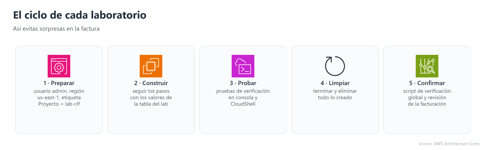

# 4 · Limpieza y control de costos

!!! abstract "Objetivo"
    Confirmar después de cada laboratorio que no quedó nada cobrando, y saber qué hacer si aparece un cargo.

<figure markdown="span">
  
  <figcaption>Preparar → construir → probar → limpiar → confirmar.</figcaption>
</figure>

## 1. Los recursos que más sorprenden en la factura

| Recurso | Por qué cobra | Cómo eliminarlo |
| --- | --- | --- |
| Instancias EC2 en ejecución | Cómputo por segundo u hora | Terminarlas (detener no basta si no las usarás) |
| Volúmenes EBS sueltos | Almacenamiento aunque la instancia ya no exista | EC2 → Volúmenes → eliminar los *disponibles* |
| Instantáneas y AMI | Almacenamiento de las copias | Anular el registro de la AMI y borrar sus instantáneas |
| Direcciones IPv4 públicas e IP elásticas | Se cobran por hora | Liberar las IP elásticas que no uses |
| NAT Gateway | Por hora y por GB procesado | VPC → Puertas de enlace NAT → eliminar |
| Balanceadores de carga | Por hora | EC2 → Balanceadores de carga → eliminar |
| Bases de datos RDS | Por hora y almacenamiento | Eliminar la base y las instantáneas manuales |
| Entornos de Elastic Beanstalk | Crean EC2 y otros recursos | Terminar el entorno |

## 2. Verificación global en CloudShell

El script [`labs/comunes/verificar-limpieza.sh`](https://github.com/CesarLoor/aws-cloud-practitioner-es/blob/main/labs/comunes/verificar-limpieza.sh) revisa **todas las regiones habilitadas** en busca de instancias, NAT Gateways, IP elásticas, balanceadores y volúmenes sueltos. Solo lee: no borra nada.

```bash
curl -s https://raw.githubusercontent.com/CesarLoor/aws-cloud-practitioner-es/main/labs/comunes/verificar-limpieza.sh | bash
```

Si no aparece ninguna línea con `ATENCION`, no hay recursos de cómputo o red cobrando. Al final lista tus buckets de S3 (son globales): revisa que solo queden los que quieres.

??? info "Ver el contenido del script"
    ```bash
    --8<-- "labs/comunes/verificar-limpieza.sh"
    ```

## 3. Otras formas de comprobar

- **Resource Groups y Tag Editor:** busca en **todas las regiones** los recursos con la etiqueta `Proyecto = lab-clf`.
- **EC2 Global View:** muestra instancias, VPC y volúmenes de todas las regiones en una sola pantalla.
- **Billing and Cost Management → Facturas:** cargos del mes por servicio y región.
- **Cost Explorer:** evolución diaria del gasto (se activa una vez y tarda unas horas en mostrar datos).

## 4. Si aparece un cargo inesperado

1. En **Facturas**, identifica el servicio y la región del cargo.
2. Ve a esa región y elimina el recurso.
3. Si el cargo vino de un error, abre un caso de soporte de **Cuenta y facturación** (gratuito en todos los planes) y explícalo.
4. Revisa que tus presupuestos y alertas estén activos para enterarte antes la próxima vez.

## 5. Al terminar el curso

Si ya no usarás la cuenta, puedes cerrarla desde **Cuenta → Cerrar cuenta** (como usuario raíz). Antes, elimina tus recursos y descarga lo que quieras conservar. Si creaste la pila `lab-presupuestos`, bórrala con `aws cloudformation delete-stack --stack-name lab-presupuestos`. Lee la [guía oficial para cerrar una cuenta](https://docs.aws.amazon.com/accounts/latest/reference/manage-acct-closing.html): hay un período de espera después del cierre.
