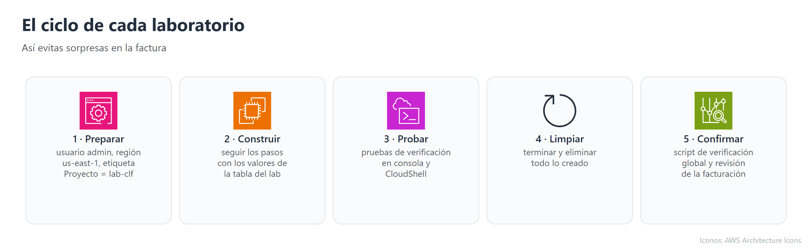

# Entorno de práctica en AWS

Todo lo que necesitas para practicar en AWS sin sorpresas: crear la cuenta, conocer la consola, dejarla configurada una sola vez, seguir el mismo ciclo en cada laboratorio y saber dónde consultar la documentación oficial.

## Ruta recomendada

| Paso | Qué haces | Tiempo | Cuándo |
| --- | --- | --- | --- |
| 1 | [Crear tu cuenta de AWS](01-crear-cuenta.md) | 20 min | Una sola vez |
| 2 | [Recorrido por la consola](02-consola.md) | 20 min | Una sola vez |
| 3 | [Configuración base](03-configuracion-base.md) | 30 min | Antes del primer laboratorio |
| 4 | Laboratorio de cada módulo | 25 a 45 min | En cada módulo |
| 5 | [Limpieza y control de costos](04-limpieza.md) | 5 min | Al terminar cada laboratorio |

<figure markdown="span">
  
  <figcaption>El ciclo que se repite en cada laboratorio.</figcaption>
</figure>

!!! danger "Regla de oro"
    Lo que creas, lo borras el mismo día. Al terminar cada laboratorio ejecuta la [verificación global](04-limpieza.md#2-verificacion-global-en-cloudshell) para confirmar que no quedó nada encendido.

## Laboratorios del curso

| Laboratorio | Módulo | Servicios | Costo estimado |
| --- | --- | --- | --- |
| [Laboratorio 1 · Explora la infraestructura global y tu parte de la seguridad](../modulo-01/laboratorio.md) | 1 · Introducción a la nube | Consola, CloudShell, IAM | 0 USD |
| [Laboratorio 2 · Servidor web en EC2 y mensajería con SQS y SNS](../modulo-02/laboratorio.md) | 2 · Cómputo en la nube | EC2, AMI, SQS, SNS | Capa gratuita o créditos |
| [Laboratorio 3 · Función Lambda con desencadenador de S3 (+ Elastic Beanstalk)](../modulo-03/laboratorio.md) | 3 · Servicios de cómputo | Lambda, S3, Elastic Beanstalk | Capa gratuita o créditos |
| [Laboratorio 4 · Infraestructura como código con CloudFormation](../modulo-04/laboratorio.md) | 4 · Hacia la globalización | CloudFormation, S3 | 0 USD |
| [Laboratorio 5 · VPC con subred pública y privada, grupos de seguridad y ACL de red](../modulo-05/laboratorio.md) | 5 · Redes | VPC, EC2, grupos de seguridad, ACL de red | Capa gratuita o créditos |
| Laboratorios 6 a 13 | 6 a 13 | Se publican junto con cada módulo | — |

## Scripts y plantillas

La carpeta [`labs/`](https://github.com/CesarLoor/aws-cloud-practitioner-es/tree/main/labs) del repositorio tiene los archivos que usan los laboratorios. Puedes descargarlos directamente desde **AWS CloudShell** con `curl`; cada página indica el comando exacto.
