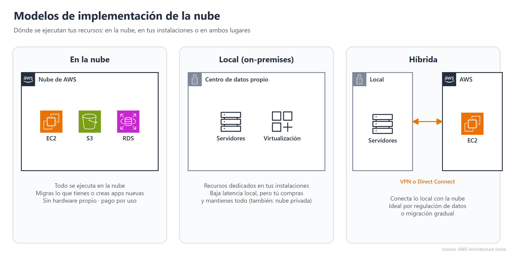
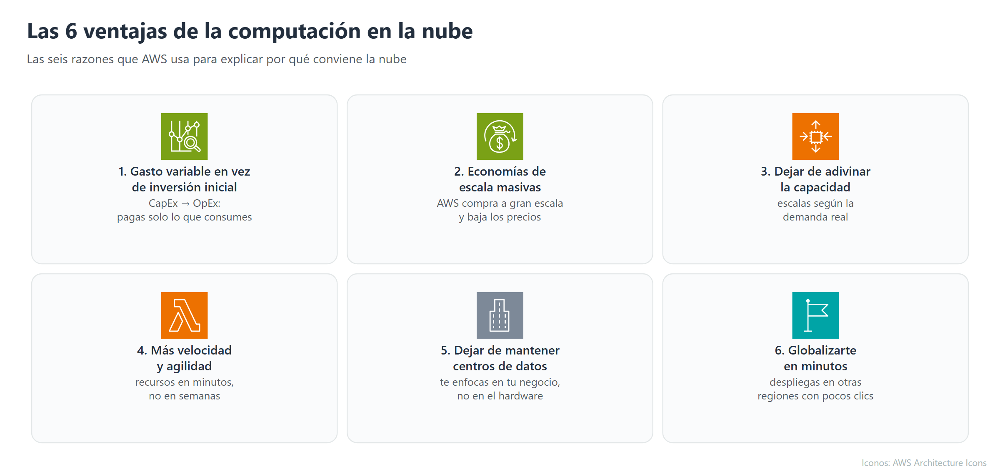

# 1.1 ¿Qué es la computación en la nube?

!!! abstract "En esta lección aprenderás a"
    Definir la computación en la nube · explicar el pago por uso · diferenciar los modelos de implementación (nube, local e híbrida) · reconocer las 6 ventajas de la nube · distinguir IaaS, PaaS y SaaS.

## 1. Definición

> **Computación en la nube:** entrega **bajo demanda** de recursos de TI a través de **internet** con un modelo de **pago por uso**.

En lugar de **comprar, instalar y mantener** servidores propios (con su inversión, espacio, energía y personal), **alquilas capacidad** a un proveedor que ya tiene esa infraestructura funcionando. Es parecido a dejar de tener una planta eléctrica propia para pagar la luz según lo que consumes.

| Parte de la definición | Qué significa | Ejemplo |
| --- | --- | --- |
| **Bajo demanda** | Pides recursos cuando los necesitas y los liberas cuando ya no, sin esperar compras ni instalaciones. | Lanzas un servidor en 2 minutos para una prueba y lo eliminas al terminar. |
| **Recursos de TI** | Cómputo, almacenamiento, bases de datos, redes, analítica, inteligencia artificial y más. | Un servidor virtual (Amazon EC2), un bucket de archivos (Amazon S3), una base de datos (Amazon RDS). |
| **A través de internet** | Lo administras todo de forma remota: consola web, línea de comandos o código. | Gestionas tus servidores desde la Consola de AWS en el navegador. |
| **Pago por uso** | Pagas solo lo que consumes (por segundo, por GB o por solicitud), sin inversión inicial ni contratos obligatorios. | Si eliminas un servidor, dejas de pagarlo. |

!!! note "Nota rápida"
    Entre los primeros servicios de AWS, lanzados en 2006, están **Amazon S3** (almacenamiento de datos) y **Amazon EC2** (capacidad de cómputo escalable). Hoy siguen siendo dos de los pilares de internet.

### Desaprovisionar: la otra mitad del pago por uso

**Aprovisionar** es crear o asignar un recurso; **desaprovisionar** es retirarlo cuando ya no se necesita: eliminar el servidor, borrar configuraciones, revocar permisos o accesos. En la nube, lo que desaprovisionas deja de cobrarse, así que no repercute en tu factura final. Por eso cada laboratorio de esta guía tiene un paso de **limpieza**.

## 2. Modelos de implementación

<figure markdown="span">
  
  <figcaption>Los tres modelos de implementación: en la nube, local (on-premises) e híbrido.</figcaption>
</figure>

| Modelo | Qué es | Ventajas | Desventajas | Ejemplo |
| --- | --- | --- | --- | --- |
| **En la nube** (cloud-based) | Todo se ejecuta en la nube. Puedes **migrar** tus recursos actuales o **diseñar y crear** aplicaciones nuevas directamente en ese entorno. | Sin inversión en hardware, escalado inmediato, acceso a servicios administrados. | Dependes de la conectividad y debes aprender a operar en la nube. | Una startup que lanza su app 100 % en AWS. |
| **Local** (on-premises, también llamada nube privada) | Recursos en tu propio centro de datos usando herramientas de **virtualización** y de **administración de recursos**. No es lo mismo que la nube, pero se parece en la forma de asignar recursos. | **Recursos dedicados** y **baja latencia** local, control total del hardware. | Compras, instalas y mantienes todo (CapEx), y tu capacidad es fija. | Un banco con su propio centro de datos. |
| **Híbrido** | Conecta la infraestructura local con recursos en la nube para que trabajen como un solo entorno. | Cumples regulaciones que obligan a dejar datos en sitio, aprovechas lo que ya compraste y migras poco a poco. | Hay que administrar dos entornos y su conexión. | Hospital con historias clínicas en local y portal de citas en AWS. |

!!! info "Lo verás más adelante"
    Los servicios que hacen posible el modelo híbrido son **AWS Outposts** (módulo 3), **AWS Site-to-Site VPN** y **AWS Direct Connect** (módulo 5) y **AWS Storage Gateway** (módulo 6).

## 3. Las 6 ventajas de la computación en la nube

AWS resume los beneficios de la nube en seis ventajas. Aparecen con frecuencia en el examen, normalmente dentro de un caso de negocio.

<figure markdown="span">
  
  <figcaption>Las seis ventajas de la computación en la nube.</figcaption>
</figure>

| # | Ventaja | Explicación | Cómo reconocerla en una pregunta |
| --- | --- | --- | --- |
| 1 | **Cambiar gasto de capital (CapEx) por gasto variable (OpEx)** | En vez de invertir de antemano en centros de datos y servidores, pagas solo por lo que consumes. | "Evitar una gran inversión inicial", "pagar solo lo que se usa". |
| 2 | **Beneficiarse de economías de escala masivas** | El uso agregado de cientos de miles de clientes le permite a AWS comprar más barato y bajar sus precios. | "Precios más bajos de los que lograría la empresa por sí sola". |
| 3 | **Dejar de adivinar la capacidad** | No compras de más "por si acaso" ni te quedas corto: escalas según la demanda real. | Picos de tráfico, temporadas altas, demanda impredecible. |
| 4 | **Aumentar la velocidad y la agilidad** | Los recursos están a un clic: experimentar cuesta poco y tarda minutos. | "Reducir el tiempo de aprovisionamiento de semanas a minutos". |
| 5 | **Dejar de gastar dinero en operar centros de datos** | Te enfocas en tus clientes y productos, no en racks, energía ni refrigeración. | "Enfocarse en el negocio y no en la infraestructura". |
| 6 | **Globalizarse en minutos** | Despliegas en otras regiones del mundo con pocos clics y das baja latencia a clientes lejanos. | "Expandirse a otro continente rápidamente". |

## 4. Modelos de servicio: IaaS, PaaS y SaaS

Los modelos de servicio indican **cuánto administras tú y cuánto el proveedor**.

| Modelo | Qué te da el proveedor | Qué administras tú | Ejemplos en AWS |
| --- | --- | --- | --- |
| **IaaS** (infraestructura como servicio) | Servidores virtuales, red y almacenamiento | Sistema operativo, parches, aplicaciones y datos | Amazon EC2, Amazon VPC, Amazon EBS |
| **PaaS** (plataforma como servicio) | La plataforma lista para ejecutar tu código | Tu código y tus datos | AWS Elastic Beanstalk, AWS Lambda |
| **SaaS** (software como servicio) | Una aplicación completa y lista para usar | Solo su uso y tus datos | Amazon QuickSight, Amazon WorkSpaces |

!!! tip "Analogía de la pizza"
    **Local** es hacer la pizza en casa con tus propios ingredientes · **IaaS** es alquilar una cocina equipada y cocinar tú · **PaaS** es pedir la masa lista y solo poner tus ingredientes · **SaaS** es pedir la pizza a domicilio y solo comerla.

## 5. Conceptos clave para el resto del curso

- **CapEx (gasto de capital):** inversión inicial en activos físicos, como comprar servidores.
- **OpEx (gasto operativo):** gasto variable del día a día, como pagar por uso.
- **Escalabilidad:** capacidad de crecer cuando aumenta la carga (lo verás en el módulo 2).
- **Elasticidad:** crecer y reducirse **automáticamente** según la demanda (módulo 2).
- **Aprovisionar / desaprovisionar:** crear un recurso / retirarlo cuando ya no hace falta.

## Comprueba lo aprendido

**1.** Una empresa quiere evitar comprar servidores por adelantado y pagar solo lo que consuma. ¿Qué ventaja de la nube aplica?

**2.** Un hospital debe mantener sus historias clínicas en su propio centro de datos, pero quiere publicar su portal de citas en AWS. ¿Qué modelo de implementación usa?

**3.** ¿En qué modelo de servicio el cliente sigue siendo responsable de parchear el sistema operativo?

??? success "Ver respuestas"
    1. **Cambiar CapEx por gasto variable (OpEx).**
    2. **Híbrido:** combina infraestructura local y nube.
    3. **IaaS**, por ejemplo Amazon EC2.

## Para profundizar

- [¿Qué es la computación en la nube?](https://aws.amazon.com/es/what-is-cloud-computing/)
- [Seis ventajas de la computación en la nube (whitepaper)](https://docs.aws.amazon.com/whitepapers/latest/aws-overview/six-advantages-of-cloud-computing.html)
- [Tipos de computación en la nube](https://aws.amazon.com/types-of-cloud-computing/)
