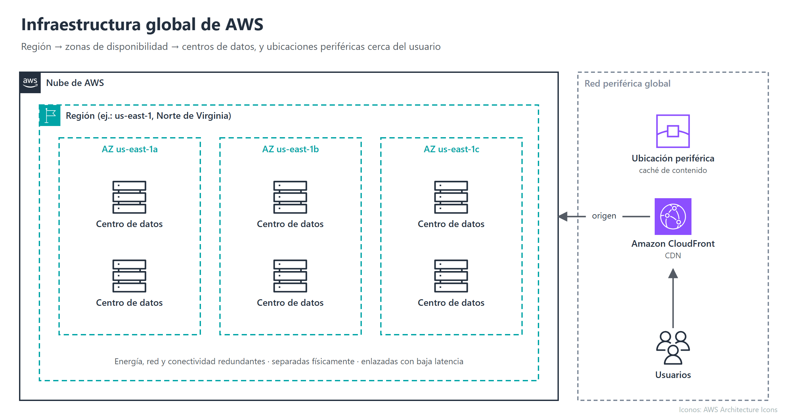

# 1.2 Infraestructura global de AWS

!!! abstract "En esta lección aprenderás a"
    Explicar qué son las regiones, las zonas de disponibilidad y las ubicaciones periféricas · diferenciar alta disponibilidad y tolerancia a fallos · entender por qué una aplicación seria no depende de un solo centro de datos.

## 1. El problema: un solo centro de datos es un punto único de falla

Si toda tu aplicación vive en **un solo centro de datos**, cualquier incidente la deja fuera de servicio: un corte de energía, una inundación, un incendio, un error de red o un mantenimiento. Para evitarlo, AWS no tiene "una nube" en un solo lugar: tiene una **red global** de centros de datos agrupados en distintos niveles.

!!! tip "Analogía"
    Es como una **cadena de sucursales**. Si una sucursal cierra, el cliente va a otra y sigue recibiendo el servicio. AWS hace lo mismo con sus centros de datos.

## 2. Los componentes

<figure markdown="span">
  
  <figcaption>Región → zonas de disponibilidad → centros de datos, y la red periférica que acerca el contenido al usuario.</figcaption>
</figure>

### Regiones de AWS

- Son **ubicaciones físicas en distintas partes del mundo** que contienen grupos de centros de datos.
- Cada región está **aislada** de las demás y es independiente: tus datos **no salen de la región** que elegiste salvo que tú los muevas. Eso ayuda a cumplir leyes de residencia de datos.
- Cada región tiene un nombre y un código. Por ejemplo, **us-east-1** es *Norte de Virginia*, **eu-west-1** es *Irlanda*, **sa-east-1** es *São Paulo* y **mx-central-1** es *México (Central)*.
- AWS elige regiones en áreas geográficas para estar **cerca de los clientes**: menos distancia significa menos latencia.

### Zonas de disponibilidad (AZ)

- Una AZ es **uno o más centros de datos** con **energía, redes y conectividad redundantes**.
- Cada región tiene **como mínimo 3 AZ**, **separadas físicamente** por una distancia prudente: lo bastante lejos para que un mismo desastre no las afecte a todas, y lo bastante cerca para conectarse con **baja latencia** mediante enlaces de alta velocidad.
- Se nombran con el código de la región más una letra: **us-east-1a**, **us-east-1b**, etc.

### Ubicaciones periféricas (edge locations)

- Sitios más pequeños, distribuidos en muchas ciudades, que **guardan copias en caché** del contenido para entregarlo más rápido.
- Las usan servicios como **Amazon CloudFront** (red de entrega de contenido) y **Amazon Route 53** (DNS). Las verás a fondo en el módulo 4.

| Elemento | Qué es | Para qué sirve | Ejemplo |
| --- | --- | --- | --- |
| **Región** | Área geográfica con varias AZ | Cumplir leyes de datos, estar cerca de los usuarios, aislar fallas | us-east-1 (Norte de Virginia) |
| **Zona de disponibilidad** | Uno o más centros de datos aislados dentro de una región | Alta disponibilidad y tolerancia a fallos dentro de la región | us-east-1a |
| **Ubicación periférica** | Sitio pequeño cerca de los usuarios | Entregar contenido en caché con baja latencia | Una ubicación de CloudFront en tu ciudad |

## 3. Alta disponibilidad y tolerancia a fallos

| Concepto | Definición | Cómo se logra en AWS | Ejemplo |
| --- | --- | --- | --- |
| **Alta disponibilidad** | Que la aplicación **siga accesible** con el mínimo tiempo de inactividad. | Desplegar en **varias AZ** (y regiones) con un balanceador que reparta el tráfico. | Si cae us-east-1a, los usuarios siguen entrando por las instancias de us-east-1b. |
| **Tolerancia a fallos** | Diseñar el sistema para que **siga operando aunque fallen uno o varios componentes**, gracias a la redundancia. | Componentes duplicados y automáticos: varias instancias, réplicas de datos, conmutación por error. | Una base de datos con réplica en otra AZ que toma el control si la principal falla. |

!!! note "Nota rápida"
    **Varias AZ** = alta disponibilidad dentro de una región. **Varias regiones** = recuperación ante desastres y menor latencia para usuarios en otros continentes.

## 4. Servicios regionales y globales

La mayoría de los servicios son **regionales**: lo que creas en us-east-1 no aparece en sa-east-1. Algunos son **globales**, como **AWS IAM**, **Amazon CloudFront** y **Amazon Route 53**; en la consola, el selector de región muestra "Global" cuando entras a ellos.

!!! warning "Error frecuente"
    Las regiones no tienen exactamente 3 AZ: tienen **3 como mínimo**. Por ejemplo, us-east-1 tiene 6. Lo compruebas tú mismo en el [Laboratorio 1](laboratorio.md).

## Comprueba lo aprendido

**1.** ¿Qué es una zona de disponibilidad?

**2.** Una empresa quiere que su sitio siga funcionando si falla un centro de datos completo. ¿Qué debe hacer?

**3.** ¿Qué elemento de la infraestructura global se usa para entregar videos con menor latencia a usuarios lejanos?

??? success "Ver respuestas"
    1. Uno o más centros de datos con energía, red y conectividad redundantes dentro de una región.
    2. Desplegar sus recursos en **varias zonas de disponibilidad**.
    3. Las **ubicaciones periféricas** (con Amazon CloudFront).

## Para profundizar

- [Infraestructura global de AWS (mapa interactivo)](https://aws.amazon.com/about-aws/global-infrastructure/)
- [Regiones y zonas de disponibilidad](https://aws.amazon.com/es/about-aws/global-infrastructure/regions_az/)
