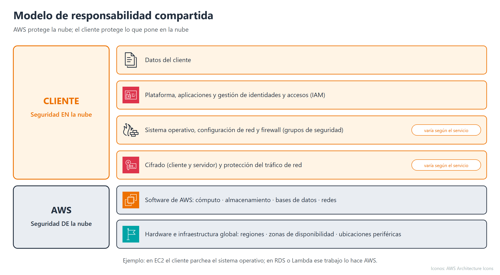

# 1.3 Modelo de responsabilidad compartida

!!! abstract "En esta lección aprenderás a"
    Describir y diferenciar las responsabilidades del cliente, las de AWS y las compartidas · explicar por qué la división cambia según el servicio.

## 1. ¿Quién es responsable de la seguridad?

La respuesta corta es **ambos**: el cliente y AWS. La seguridad en la nube es un trabajo en equipo en el que cada parte protege una capa distinta:

- **AWS es responsable de la seguridad DE la nube:** la infraestructura que ejecuta todos los servicios.
- **El cliente es responsable de la seguridad EN la nube:** todo lo que crea, configura y almacena dentro de AWS.

!!! tip "Analogía de la casa"
    La constructora (AWS) levanta la casa con muros firmes, puertas, ventanas y cerraduras de calidad. Pero es el propietario (tú) quien debe cerrar las puertas con llave, decidir quién recibe una copia y no dejar las ventanas abiertas. Si la constructora encuentra un defecto en la estructura, lo repara y te avisa; si tú dejas la puerta abierta, la responsabilidad es tuya.

## 2. El modelo en un diagrama

<figure markdown="span">
  
  <figcaption>Capas del modelo: lo que protege el cliente (arriba) y lo que protege AWS (abajo).</figcaption>
</figure>

## 3. Quién hace qué

| Responsabilidades del cliente | Responsabilidades compartidas | Responsabilidades de AWS |
| --- | --- | --- |
| Administrar los requisitos de seguridad de **sus datos**: qué datos guarda en AWS y quién accede a ellos. | Depende del servicio: **cifrado del lado del servidor**, **protección del tráfico de red**, **administración de la plataforma y las aplicaciones**, **configuración del sistema operativo, la red y el firewall**. | Proteger la **infraestructura** que ejecuta todos los servicios: **hardware**, **software**, **redes** e **instalaciones** de la nube de AWS. |
| Controlar cómo se **concede, administra y revoca** el acceso (usuarios, permisos, MFA). |  | Seguridad física de los centros de datos, energía, refrigeración y destrucción segura de discos. |
| **Cifrado del lado del cliente** (cifrar los datos antes de subirlos). |  | Mantener y parchear la infraestructura y el software de sus servicios administrados. |

### Tipos de controles

AWS también explica el modelo según **quién implementa cada control de seguridad**:

- **Controles heredados:** el cliente los hereda por completo de AWS. Ej.: controles físicos y ambientales de los centros de datos.
- **Controles compartidos:** cada uno los aplica en su capa. Ej.: **administración de parches** (AWS parchea su infraestructura y tú tu sistema operativo invitado), **administración de configuración** y **capacitación** (AWS capacita a su personal y tú al tuyo).
- **Controles específicos del cliente:** solo el cliente puede aplicarlos. Ej.: decidir en qué región guardar datos sensibles o cómo segmentar su red.

## 4. La división cambia según el tipo de servicio

Cuanto más **administrado** es un servicio, más tareas pasan a AWS. Lo que nunca cambia: **tus datos y quién accede a ellos siempre son tu responsabilidad**.

| Servicio | Tipo | AWS se encarga de | El cliente se encarga de |
| --- | --- | --- | --- |
| **Amazon EC2** | No administrado (IaaS) | Hardware, hipervisor, red física, instalaciones | SO invitado y sus parches, software instalado, grupos de seguridad, cifrado, datos |
| **Amazon RDS** | Administrado | Lo anterior + SO del servidor, instalación y parches del motor de base de datos, copias automáticas | Usuarios y permisos de la base de datos, reglas de red, activar el cifrado, datos |
| **AWS Lambda** | Sin servidor | Servidores, SO, entorno de ejecución, escalado y disponibilidad | Su código, los permisos de la función y los datos |
| **Amazon S3** | Administrado | Almacenamiento, durabilidad, infraestructura | Quién accede a cada bucket, si es público o privado, cifrado y versionado |

!!! note "Nota rápida"
    Si AWS detecta una vulnerabilidad en su infraestructura, la corrige; si afecta algo que tú controlas (por ejemplo, el SO de tu instancia), te notifica para que apliques las medidas correspondientes. Entender en cada servicio qué te toca revisar a ti es parte del trabajo.

## 5. Trampas típicas del examen

- **Parches del SO invitado en EC2** → cliente. **Parches del hardware o del hipervisor** → AWS.
- **Configurar grupos de seguridad, ACL de red e IAM** → cliente.
- **Seguridad física, energía, red global, destrucción de discos** → AWS.
- **Cifrar los datos y gestionar las claves** → normalmente cliente (AWS da las herramientas, como AWS KMS).

## Comprueba lo aprendido

**1.** Según el modelo, ¿quién es el responsable final de la seguridad?

**2.** Una empresa usa Amazon RDS. ¿Quién instala los parches del motor de base de datos?

**3.** ¿Qué tipo de control es la seguridad física de un centro de datos de AWS para el cliente?

??? success "Ver respuestas"
    1. **Ambos:** AWS protege la nube y el cliente lo que pone en ella.
    2. **AWS**, porque RDS es un servicio administrado.
    3. Un **control heredado**: el cliente lo hereda por completo de AWS.

## Para profundizar

- [Modelo de responsabilidad compartida](https://aws.amazon.com/es/compliance/shared-responsibility-model/)
