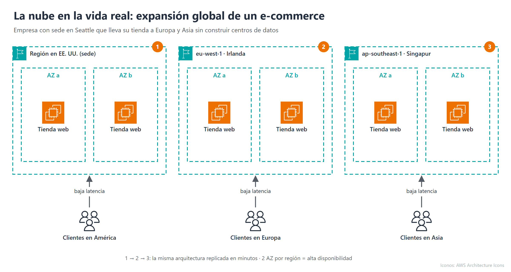

# 1.4 La nube en la vida real

!!! abstract "En esta lección aprenderás a"
    Explicar cómo la infraestructura global y el modelo de responsabilidad compartida trabajan juntos para crear soluciones empresariales reales.

## 1. Caso del curso: expansión global de un e-commerce

<figure markdown="span">
  
  <figcaption>La empresa replica su tienda en Irlanda y Singapur, con dos zonas de disponibilidad por región.</figcaption>
</figure>

### Paso 1 · El problema

Una empresa de comercio electrónico con sede en **Seattle (EE. UU.)** quiere vender en otros continentes. El obstáculo es la **latencia**: cuanto más lejos está la infraestructura de los clientes, más lenta se siente la tienda. La empresa decide usar las **regiones globales de AWS** para acercarse a sus clientes.

### Paso 2 · Primera expansión: Irlanda (eu-west-1)

- Despliega sus recursos en la región **eu-west-1**. Al operar en **varias regiones**, aumenta su **alta disponibilidad**.
- Dentro de esa región usa **dos zonas de disponibilidad**, lo que mejora su **tolerancia a fallos**: si una AZ falla, la otra sigue atendiendo pedidos.
- **Responsabilidad compartida:** la empresa no se preocupa por la seguridad física del centro de datos en Irlanda, porque es tarea de AWS. Se concentra en **proteger y cifrar sus datos** dentro de sus recursos.

### Paso 3 · Segunda expansión: Singapur (ap-southeast-1)

- Como tiene muchos clientes en Asia, despliega en **ap-southeast-1**.
- Montar centros de datos propios a escala internacional le habría tomado **meses o años**. Con AWS lo hizo en **minutos**: esa es la ventaja de *globalizarse en minutos*.

!!! warning "Error frecuente"
    La región de Singapur es **ap-southeast-1**, no *ap-southwest-1* (esa región no existe).

### Qué conceptos del módulo aparecen en el caso

| Decisión de la empresa | Concepto que aplica |
| --- | --- |
| Desplegar cerca de sus clientes | Regiones y latencia |
| Usar dos AZ por región | Alta disponibilidad y tolerancia a fallos |
| No preocuparse por el edificio ni el hardware | Responsabilidad de AWS: seguridad DE la nube |
| Cifrar sus datos y controlar accesos | Responsabilidad del cliente: seguridad EN la nube |
| Abrir en Asia en minutos | Ventaja: globalizarse en minutos |

## 2. Más casos para fijar los conceptos

| Situación | Qué hace en AWS | Concepto |
| --- | --- | --- |
| Una **startup** quiere lanzar su app sin comprar servidores. | Crea todo en la nube y paga por uso. | CapEx → OpEx, modelo en la nube |
| Una **universidad** recibe 10 veces más visitas en época de matrículas. | Aumenta su capacidad solo esas semanas. | Dejar de adivinar la capacidad |
| Un **hospital** debe guardar historias clínicas en sus instalaciones. | Mantiene esos datos en local y publica el portal de citas en AWS. | Modelo híbrido, cumplimiento |
| Una **plataforma de video** tiene usuarios en toda Latinoamérica. | Entrega sus videos desde ubicaciones periféricas. | Infraestructura global, baja latencia |
| Un **banco** necesita que su app nunca deje de responder. | Despliega en varias AZ y tiene otra región para desastres. | Alta disponibilidad, tolerancia a fallos |

## Comprueba lo aprendido

**1.** En el caso del e-commerce, ¿qué aportó usar dos AZ en Irlanda?

**2.** ¿Quién protege físicamente el centro de datos de Singapur?

??? success "Ver respuestas"
    1. **Tolerancia a fallos y alta disponibilidad:** si una AZ falla, la otra sigue atendiendo.
    2. **AWS**, porque es seguridad DE la nube.
