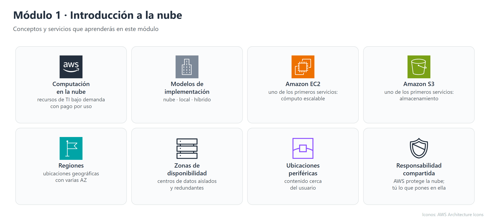

# Módulo 1 · Introducción a la nube

*Introduction to the Cloud* · Dominios del examen: **D1 Conceptos de la nube** y **D2 Seguridad y cumplimiento**

!!! abstract "Resumen del módulo"
    La computación en la nube es la entrega **bajo demanda** de recursos de TI por internet con **pago por uso**. Puedes implementarla **en la nube**, **en tus instalaciones** o de forma **híbrida**. AWS opera una **infraestructura global** de **regiones** (con mínimo 3 **zonas de disponibilidad**) y **ubicaciones periféricas**, que da alta disponibilidad y tolerancia a fallos. La seguridad se reparte con el **modelo de responsabilidad compartida**: AWS protege **la nube** y tú lo que pones **en la nube**.

## Resultados de aprendizaje

Al terminar el módulo podrás:

1. Definir la computación en la nube y explicar el modelo de pago por uso.
2. Comparar los modelos de implementación en la nube, local e híbrido, con sus ventajas y casos.
3. Reconocer las 6 ventajas de la nube y los modelos IaaS, PaaS y SaaS.
4. Describir regiones, zonas de disponibilidad y ubicaciones periféricas, y su relación con la alta disponibilidad y la tolerancia a fallos.
5. Diferenciar las responsabilidades del cliente, las de AWS y las compartidas.
6. Aplicar estos conceptos a un caso empresarial real.

## Mapa del módulo

<figure markdown="span">
  
  <figcaption>Conceptos y servicios del Módulo 1.</figcaption>
</figure>

## Lecciones

| Lección | Tema |
| --- | --- |
| [1.1](1-1-computacion-en-la-nube.md) | ¿Qué es la computación en la nube? |
| [1.2](1-2-infraestructura-global.md) | Infraestructura global de AWS |
| [1.3](1-3-responsabilidad-compartida.md) | Modelo de responsabilidad compartida |
| [1.4](1-4-casos-reales.md) | La nube en la vida real |
| [Laboratorio 1](laboratorio.md) | Explora la infraestructura global y tu parte de la seguridad |

## Servicios y conceptos del módulo

| Concepto o servicio | Qué es | Ejemplo o caso | Lección |
| --- | --- | --- | --- |
| **Computación en la nube** | Recursos de TI bajo demanda por internet con pago por uso | Lanzar un servidor para una prueba y borrarlo al terminar | 1.1 |
| **Modelos de implementación** | En la nube, local (on-premises) e híbrido | Hospital con datos en local y portal en AWS (híbrido) | 1.1 |
| **6 ventajas de la nube** | CapEx→OpEx, economías de escala, no adivinar capacidad, velocidad, no operar centros de datos, globalizarse | Tienda que escala solo en Black Friday | 1.1 |
| **IaaS · PaaS · SaaS** | Cuánto administras tú y cuánto el proveedor | EC2 (IaaS), Elastic Beanstalk (PaaS), QuickSight (SaaS) | 1.1 |
| **Amazon EC2 y Amazon S3** | Entre los primeros servicios de AWS: cómputo y almacenamiento | Servidores virtuales y archivos en buckets | 1.1 |
| **Región** | Área geográfica aislada con varias AZ | us-east-1, eu-west-1, sa-east-1 | 1.2 |
| **Zona de disponibilidad** | Uno o más centros de datos redundantes; mínimo 3 por región | us-east-1a, us-east-1b | 1.2 |
| **Ubicación periférica** | Sitio que guarda contenido en caché cerca del usuario | CloudFront entregando videos | 1.2 |
| **Alta disponibilidad y tolerancia a fallos** | Seguir accesible / seguir operando aunque fallen componentes | Desplegar en 2 AZ | 1.2 |
| **Responsabilidad compartida** | AWS: seguridad DE la nube · Cliente: seguridad EN la nube | El cliente parchea el SO de EC2 | 1.3 |

## Notas rápidas

!!! tip "Para repasar en 2 minutos"
    - Nube = **bajo demanda + internet + pago por uso**. Lo que desaprovisionas deja de cobrarse.
    - **Local** = recursos dedicados y baja latencia, pero CapEx y mantenimiento propios. **Híbrido** = local + nube conectados.
    - **Región ⊃ AZ ⊃ centros de datos.** Mínimo **3 AZ** por región. Las ubicaciones periféricas están fuera de las regiones.
    - **Varias AZ** → alta disponibilidad. **Varias regiones** → recuperación ante desastres y menor latencia global.
    - **AWS = seguridad DE la nube** (hardware, instalaciones, red global). **Cliente = seguridad EN la nube** (datos, IAM, SO invitado, firewall, cifrado).
    - Cuanto más administrado el servicio, menos tareas para ti; **tus datos y accesos siempre son tuyos**.

## Evaluación del módulo

**1. ¿Qué define mejor la computación en la nube?**

- a) Alquilar un centro de datos por varios años
- b) Entrega bajo demanda de recursos de TI por internet con pago por uso
- c) Virtualizar servidores en tu oficina
- d) Comprar hardware directamente a AWS

**2. Una empresa usa Amazon EC2. ¿Quién aplica los parches de seguridad del sistema operativo de sus instancias?**

- a) AWS
- b) El cliente
- c) Ambos por igual
- d) El fabricante del hardware

**3. ¿Quién es responsable de la seguridad física de los centros de datos de AWS?**

- a) El cliente
- b) Un auditor externo
- c) AWS
- d) Depende de la región

**4. ¿Cuántas zonas de disponibilidad tiene como mínimo una región de AWS?**

- a) 1
- b) 2
- c) 3
- d) 6

**5. Una empresa mantiene servidores en su centro de datos y los conecta con recursos en AWS. ¿Qué modelo de implementación usa?**

- a) En la nube
- b) Local
- c) Híbrido
- d) SaaS

**6. Una tienda online ya no compra servidores para el Black Friday: usa más capacidad solo esos días. ¿Qué ventaja de la nube aprovecha?**

- a) Economías de escala
- b) Dejar de adivinar la capacidad
- c) Globalizarse en minutos
- d) Aumentar el CapEx

**7. Para que una aplicación siga funcionando si falla un centro de datos, lo recomendable es:**

- a) Usar una instancia más grande
- b) Desplegar en varias zonas de disponibilidad
- c) Usar una sola AZ con copias de seguridad
- d) Cambiar de región cada mes

**8. ¿Qué modelo de servicio describe mejor a AWS Elastic Beanstalk, donde subes tu código y la plataforma se encarga del resto?**

- a) IaaS
- b) PaaS
- c) SaaS
- d) On-premises

**9. Una empresa en Europa debe mantener los datos de sus clientes dentro de la UE. ¿Qué característica de las regiones le ayuda?**

- a) Los datos no salen de la región elegida salvo que el cliente los mueva
- b) Todas las regiones comparten los mismos datos
- c) Las ubicaciones periféricas almacenan las bases de datos
- d) Las AZ están en distintos continentes

**10. ¿Qué afirmación sobre el modelo de responsabilidad compartida es correcta?**

- a) En los servicios administrados AWS también es dueño de los datos del cliente
- b) El cliente siempre es responsable de sus datos y de quién accede a ellos
- c) AWS configura los grupos de seguridad del cliente
- d) La responsabilidad es igual en todos los servicios

??? success "Ver respuestas y explicaciones"
    1. **b**: es la definición de AWS: bajo demanda, por internet y con pago por uso.
    2. **b**: en EC2 el SO invitado es del cliente (seguridad EN la nube).
    3. **c**: la infraestructura física es seguridad DE la nube.
    4. **c**: mínimo 3 AZ por región; algunas tienen más.
    5. **c**: combinar lo local con la nube es el modelo híbrido.
    6. **b**: escala según la demanda real en lugar de comprar de más.
    7. **b**: varias AZ dan alta disponibilidad y tolerancia a fallos.
    8. **b**: PaaS: tú pones el código y la plataforma administra servidores y escalado.
    9. **a**: las regiones están aisladas y los datos se quedan donde el cliente decide.
    10. **b**: la división cambia según el servicio, pero los datos y los accesos siempre son del cliente.

## Trampas típicas del examen

!!! warning "No te confundas"
    - "Seguridad **DE** la nube" es AWS; "seguridad **EN** la nube" es el cliente.
    - Región ≠ AZ ≠ ubicación periférica. Las AZ están **dentro** de una región; las ubicaciones periféricas, **fuera**.
    - **Alta disponibilidad** (seguir accesible) no es lo mismo que **tolerancia a fallos** (seguir operando aunque algo falle), aunque se logran con técnicas parecidas.
    - CapEx = inversión inicial. OpEx = gasto variable. La nube **cambia CapEx por OpEx**.
    - Las preguntas de ventajas suelen venir como caso de negocio: busca la palabra clave (inversión inicial, picos de demanda, expansión global).

## Recursos

- [¿Qué es la computación en la nube?](https://aws.amazon.com/es/what-is-cloud-computing/)
- [Modelo de responsabilidad compartida](https://aws.amazon.com/es/compliance/shared-responsibility-model/)
- [Regiones y zonas de disponibilidad](https://aws.amazon.com/es/about-aws/global-infrastructure/regions_az/)
