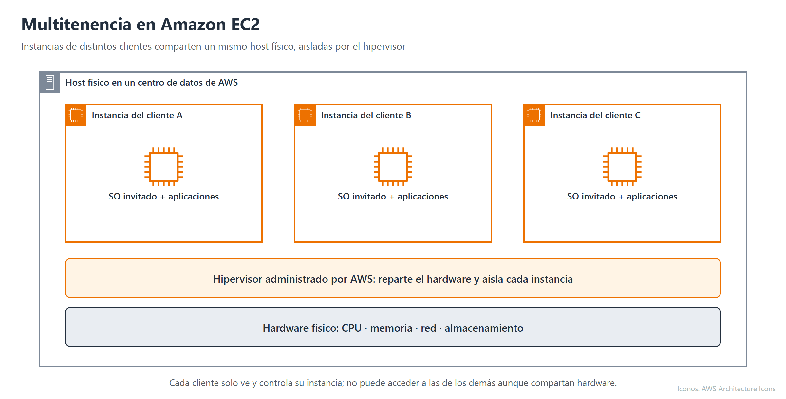
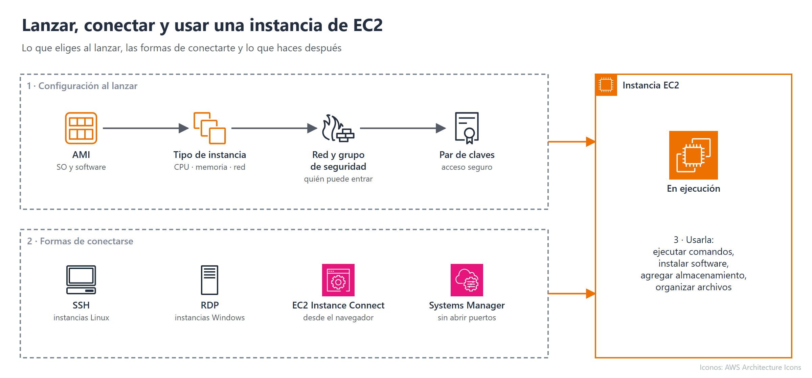

# 2.1 Introducción a Amazon EC2

!!! abstract "En esta lección aprenderás a"
    Describir cómo se aprovisionan y administran los recursos de cómputo en la nube · comparar servidores virtuales con servidores físicos en las instalaciones · identificar la multitenencia en Amazon EC2 · explicar cómo se lanza, se conecta y se usa una instancia.

## 1. ¿Qué es el cómputo?

**Cómputo** (computación) es la **potencia de procesamiento** necesaria para ejecutar aplicaciones, administrar datos y hacer cálculos. En la nube esa potencia está disponible **bajo demanda**: la usas de forma remota sin poseer ni mantener hardware físico. En la práctica, hacer cómputo en la nube significa **crear máquinas virtuales en un proveedor** para ejecutar aplicaciones y tareas a través de internet.

## 2. Amazon EC2 (Elastic Compute Cloud)

**Amazon EC2** te da **servidores virtuales** (llamados **instancias**) en la nube de AWS. La palabra *Elastic* indica que son **redimensionables**: empiezas pequeño y, si tu aplicación crece, cambias a un tamaño mayor (**escalado vertical**) o agregas más instancias (**escalado horizontal**); cuando la demanda baja, reduces.

| Característica | Qué significa |
| --- | --- |
| **Altamente flexible** | Eliges sistema operativo (Linux, Windows o macOS), CPU, memoria, almacenamiento y red. |
| **Rentable** | Solo pagas lo que usas y eliges el modelo de compra que más te convenga ([lección 2.5](2-5-precios-ec2.md)). |
| **Rápido** | Una instancia está lista en minutos, no en semanas. |
| **Control de red** | Decides si la instancia es accesible de forma pública (desde internet) o solo privada. |
| **Infraestructura de AWS** | Corre en centros de datos construidos y protegidos por AWS. |

**Para qué se usa:** aplicaciones internas de negocio, aplicaciones y sitios web, bases de datos autogestionadas, software de terceros, servidores de juegos, procesamiento por lotes, entornos de desarrollo y pruebas.

!!! warning "Error frecuente"
    En el examen, EC2 se clasifica como **IaaS** (infraestructura como servicio), no como "CaaS": AWS te da la infraestructura virtual y tú administras el sistema operativo y lo que corre encima.

## 3. Multitenencia: muchos clientes, un mismo hardware

Las instancias de EC2 son máquinas virtuales que **comparten un host físico** con instancias de otros clientes. Eso se llama **multitenencia** (tenencia múltiple). Lo hace posible el **hipervisor**, un software **administrado por AWS** que reparte CPU, memoria y red entre las instancias y las mantiene **aisladas**: ningún cliente puede ver ni acceder a las instancias de otro.

<figure markdown="span">
  
  <figcaption>Multitenencia: el hipervisor reparte el hardware de un host entre instancias aisladas.</figcaption>
</figure>

!!! note "Nota rápida"
    Si necesitas que **nadie más** use tu hardware (por cumplimiento o licencias), existen las **instancias dedicadas** y los **hosts dedicados** ([lección 2.5](2-5-precios-ec2.md)).

## 4. Servidores virtuales en la nube frente a servidores físicos propios

| Aspecto | Servidor físico en tus instalaciones | Instancia de Amazon EC2 |
| --- | --- | --- |
| Tiempo para tenerlo | Semanas o meses (comprar, recibir, instalar) | Minutos |
| Costo inicial | Alto (CapEx) | Ninguno; pagas por uso (OpEx) |
| Capacidad | Fija: compras de más "por si acaso" o te quedas corto | Ajustable en cualquier momento |
| Mantenimiento del hardware | Tuyo | De AWS |
| Si ya no lo necesitas | Queda como gasto hundido | Lo terminas y dejas de pagar |
| Alcance global | Requiere nuevos centros de datos | Lanzas en otra región con pocos clics |

**Desafíos que siguen existiendo con EC2:** debes administrar y parchear el sistema operativo, configurar la seguridad (grupos de seguridad, claves), vigilar los costos (una instancia olvidada sigue cobrando) y elegir bien el tipo y el modelo de compra.

## 5. Funcionamiento: lanzar, conectar y usar

<figure markdown="span">
  
  <figcaption>Qué eliges al lanzar, cómo te conectas y qué haces después.</figcaption>
</figure>

1. **Lanzar:** eliges una **imagen de máquina de Amazon (AMI)**, que define el sistema operativo y puede incluir software adicional, y un **tipo de instancia**, que define el hardware (CPU, memoria, red). También configuras la red, el **grupo de seguridad** (qué tráfico entra) y el **par de claves**.
2. **Conectar:** las aplicaciones se comunican con la instancia por la red. Tú puedes entrar por **SSH** (Linux), por **RDP** (Windows), con **EC2 Instance Connect** desde el navegador o con **AWS Systems Manager**, que da acceso seguro sin abrir puertos.
3. **Usar:** ejecutas comandos, instalas software, agregas almacenamiento, organizas archivos y despliegas tus aplicaciones.

## 6. Quién hace qué en EC2 (responsabilidad compartida)

- **AWS:** centro de datos, hardware, red física e hipervisor.
- **Tú:** sistema operativo invitado y sus parches, software instalado, grupos de seguridad, cifrado y datos.

## Comprueba lo aprendido

**1.** ¿Qué componente permite que varias instancias de distintos clientes compartan un host sin verse entre sí?

**2.** ¿Qué dos elecciones definen el software y el hardware de una instancia al lanzarla?

**3.** ¿Cómo puedes conectarte a una instancia sin abrir el puerto SSH?

??? success "Ver respuestas"
    1. El **hipervisor**, administrado por AWS.
    2. La **AMI** (software) y el **tipo de instancia** (hardware).
    3. Con **AWS Systems Manager** (Session Manager).

## Para profundizar

- [Amazon EC2](https://aws.amazon.com/ec2/)
- [Guía del usuario de EC2](https://docs.aws.amazon.com/AWSEC2/latest/UserGuide/concepts.html)
