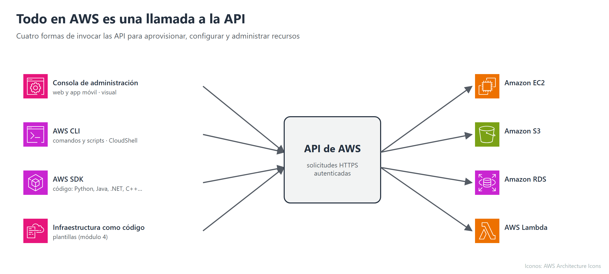

# 2.3 Cómo aprovisionar recursos de AWS

!!! abstract "En esta lección aprenderás a"
    Usar la Consola de administración, la AWS CLI y los AWS SDK para interactuar con AWS · describir las responsabilidades del cliente y de AWS sobre las máquinas virtuales · diferenciar servicios administrados y no administrados.

## 1. Todo en AWS es una llamada a la API

Lanzar una instancia, detenerla o cambiar su configuración son **solicitudes a la API de AWS**. Una **API** (interfaz de programación de aplicaciones) define formas predeterminadas de interactuar con un servicio desde un programa. Puedes llamarla para **aprovisionar, configurar y administrar** recursos de varias formas.

<figure markdown="span">
  
  <figcaption>Consola, CLI, SDK e infraestructura como código terminan llamando a las mismas API.</figcaption>
</figure>

## 2. Consola de administración de AWS

Interfaz **web** para administrar los servicios: acceso rápido, búsqueda, flujos de trabajo guiados y paneles de monitoreo y facturación. Con la **aplicación móvil** puedes revisar recursos, alarmas y facturación. Además, permite que **varias identidades inicien sesión al mismo tiempo** en el mismo navegador.

- **Ideal para:** aprender, configurar entornos de prueba de forma visual, revisar facturas y monitoreo, y para perfiles no técnicos.
- **Limitación:** con experiencia, repetir los mismos clics se vuelve lento y propenso a errores; ahí conviene automatizar.

Recorrido completo: [Recorrido por la consola](../entorno/02-consola.md).

## 3. AWS CLI (interfaz de línea de comandos)

Administras los servicios **desde la terminal** en Windows, macOS o Linux, o desde **AWS CloudShell** (una terminal en el navegador con la CLI ya instalada). Permite **automatizar con scripts**.

```bash
# Listar tus instancias de EC2 en formato tabla
aws ec2 describe-instances --query "Reservations[].Instances[].[InstanceId,State.Name]" --output table

# Listar tus buckets de S3
aws s3 ls
```

- **Ideal para:** desarrolladores y usuarios avanzados que automatizan tareas y administran recursos de forma eficiente.

## 4. AWS SDK (kits de desarrollo de software)

Bibliotecas que integran AWS **dentro del código** de tus aplicaciones, con API específicas para cada lenguaje (Python, Java, .NET, C++, JavaScript, Go, entre otros). AWS ofrece documentación y código de ejemplo.

```python
# Python con el SDK (boto3): listar buckets de S3
import boto3

s3 = boto3.client("s3")
for bucket in s3.list_buckets()["Buckets"]:
    print(bucket["Name"])
```

- **Ideal para:** desarrolladores que necesitan que su aplicación use servicios de AWS (por ejemplo, guardar archivos en S3 cuando un usuario los sube).

!!! tip "Pruébalo"
    CloudShell trae Python y boto3 instalados: escribe `python3`, pega el ejemplo y verás tus buckets.

## 5. Comparación

| Herramienta | Cómo se usa | Ideal para | Ejemplo |
| --- | --- | --- | --- |
| **Consola** | Navegador o app móvil | Aprender, tareas visuales y puntuales | Crear tu primera instancia |
| **AWS CLI** | Comandos y scripts | Automatizar tareas repetitivas | Apagar todas las instancias de prueba cada noche |
| **AWS SDK** | Código de tu aplicación | Integrar AWS en tu software | Tu app guarda fotos en S3 |
| **IaC (CloudFormation)** | Plantillas de código | Crear entornos completos y repetibles | Mismo entorno en 3 regiones (módulo 4) |

## 6. Servicios no administrados y administrados

| Tipo | Ejemplos | Qué haces tú |
| --- | --- | --- |
| **No administrado** | Amazon EC2 | Configurar, proteger y mantener el SO, la red y las aplicaciones. AWS solo se encarga de la infraestructura física. |
| **Administrado** | Elastic Load Balancing, Amazon SNS, Amazon SQS, Amazon RDS | Algo de aprovisionamiento y configuración. AWS se encarga de gran parte de la operación. |
| **Totalmente administrado / sin servidor** | AWS Lambda, AWS Fargate | Solo tu código y sus permisos (módulo 3). |

**Responsabilidades sobre las máquinas virtuales (EC2):** AWS protege el hardware, el hipervisor y las instalaciones; tú eliges la AMI, parcheas el SO invitado, configuras los grupos de seguridad y las claves y proteges tus datos.

## Comprueba lo aprendido

**1.** Un desarrollador quiere que su aplicación en Java suba archivos a S3. ¿Qué usa?

**2.** ¿Qué herramienta conviene para apagar automáticamente las instancias de prueba cada noche?

**3.** ¿Amazon EC2 es un servicio administrado o no administrado?

??? success "Ver respuestas"
    1. El **AWS SDK** para Java.
    2. La **AWS CLI** en un script (o una automatización con código).
    3. **No administrado:** el cliente gestiona el SO y lo que corre encima.

## Para profundizar

- [AWS CLI](https://aws.amazon.com/cli/) · [AWS CloudShell](https://aws.amazon.com/cloudshell/) · [Herramientas y SDK](https://aws.amazon.com/developer/tools/)
