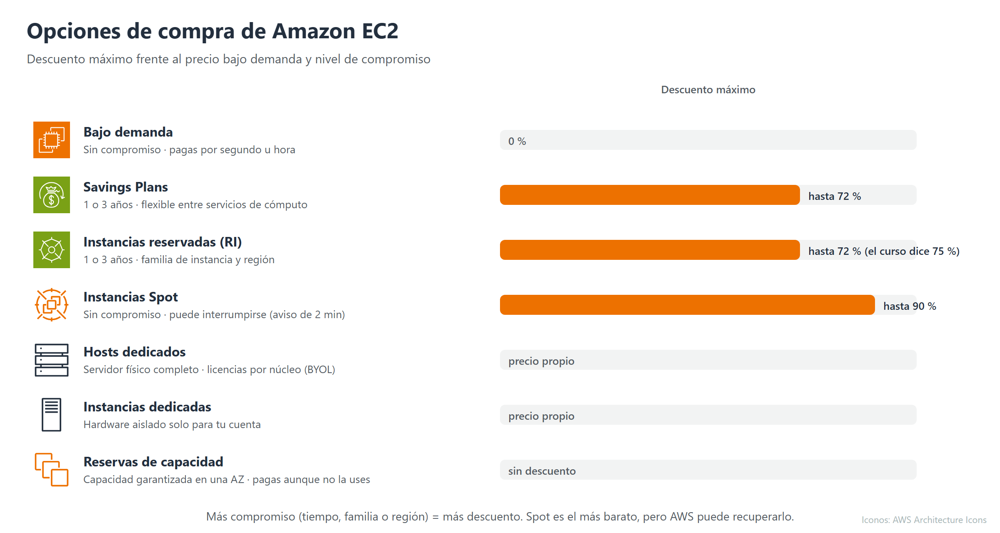

# 2.5 Precios de Amazon EC2

!!! abstract "En esta lección aprenderás a"
    Explicar las opciones de compra de EC2 · decidir cuál usar según el caso · describir las reservas de capacidad y la flexibilidad de las instancias reservadas (RI) · reconocer las formas de pago.

## 1. Panorama

<figure markdown="span">
  
  <figcaption>Descuento máximo y compromiso de cada opción de compra.</figcaption>
</figure>

## 2. Las opciones una por una

### Instancias bajo demanda (On-Demand)

- Pagas por el tiempo de uso, **por segundo o por hora** según el sistema operativo, sin pago anticipado ni compromiso.
- **Ideal para:** autoservicio y exploración, pruebas, cargas cortas, irregulares o impredecibles que no pueden interrumpirse.

### Savings Plans

- Te comprometes a **gastar una cantidad fija por hora** en cómputo durante **1 o 3 años** a cambio de un descuento de **hasta 72 %**.
- Es flexible: el descuento se aplica a **Amazon EC2, AWS Fargate, AWS Lambda y Amazon SageMaker AI**, sin importar el tipo de instancia ni la región (en el *Compute Savings Plan*).
- **Ideal para:** cargas predecibles cuando quieres ahorrar sin atarte a una familia o región.

### Instancias reservadas (Reserved Instances, RI)

- Compromiso de **1 o 3 años** con una familia de instancias y una región específicas. El curso indica un ahorro de **hasta 75 %**; la página de precios actual de AWS dice **hasta 72 %**.
- **Flexibilidad de las RI:** AWS aplica el descuento automáticamente a **otros tamaños de la misma familia** (por ejemplo, una reserva de `m5.xlarge` cubre dos `m5.large`) y a **varias AZ de la misma región**.
- **Ideal para:** cargas estables con uso predecible, como un sistema que corre 24/7.

### Instancias Spot

- Usas la **capacidad sobrante** de EC2 con **hasta 90 %** de descuento.
- AWS puede **recuperar la instancia** cuando necesita esa capacidad y te avisa **2 minutos antes** para que guardes tu progreso.
- **Ideal para:** trabajos flexibles y tolerantes a interrupciones: procesamiento por lotes, análisis de datos, renderizado, CI/CD. **Nunca** para cargas críticas que no pueden detenerse.

### Hosts dedicados

- Reservas un **servidor físico completo** solo para ti, con **visibilidad de sockets y núcleos**.
- **Ideal para:** licencias de software que se cobran por socket o núcleo físico (**BYOL**, traer tu propia licencia) y requisitos estrictos de seguridad o cumplimiento.

### Instancias dedicadas

- Tus instancias se ejecutan en **hardware dedicado a tu cuenta**, aisladas de otros clientes, pero **sin control** sobre el servidor físico.

### Reservas de capacidad

- Reservas **capacidad de cómputo en una AZ específica** para cargas críticas. Se cobran **a tarifa bajo demanda, se usen o no**.
- **No dan descuento por sí solas:** garantizan que habrá capacidad. Puedes combinarlas con Savings Plans o RI regionales para obtener descuento.
- **Ideal para:** eventos o cargas críticas con requisitos estrictos de capacidad, actuales o futuros.

## 3. Formas de pago (Savings Plans y RI)

| Forma de pago | Descuento | Flujo de caja |
| --- | --- | --- |
| **Todo por adelantado** | El mayor | Pagas todo al inicio |
| **Pago parcial por adelantado** | Intermedio | Una parte al inicio y el resto mensual |
| **Sin pago por adelantado** | El menor | Todo mensual |

## 4. Guía de decisión

| Escenario | Opción |
| --- | --- |
| Prueba de 3 horas que no puede interrumpirse | Bajo demanda |
| ERP que corre 24/7 durante los próximos 3 años | Instancias reservadas o Savings Plans |
| Uso constante, pero cambias de familia, de región o usas Lambda/Fargate | Savings Plans |
| Renderizar miles de imágenes que pueden reintentarse | Spot |
| Software con licencia por núcleo físico | Host dedicado |
| Aislamiento de hardware por cumplimiento, sin gestionar el servidor | Instancias dedicadas |
| Garantizar capacidad en una AZ para el lanzamiento de un producto | Reserva de capacidad |

!!! note "Nota rápida"
    A más compromiso (tiempo, familia, región), más descuento. Orden de ahorro máximo: **Spot (90 %) > RI ≈ Savings Plans (~72 %) > bajo demanda (0 %)**.

!!! example "Pruébalo en CloudShell"
    ```bash
    # Historial reciente del precio Spot de t3.micro en us-east-1 (solo consulta)
    aws ec2 describe-spot-price-history --instance-types t3.micro \
      --product-descriptions "Linux/UNIX" --max-items 5 \
      --query "SpotPriceHistory[].[AvailabilityZone,SpotPrice,Timestamp]" --output table
    ```
    Compara el resultado con el precio bajo demanda de la [página de precios de EC2](https://aws.amazon.com/ec2/pricing/on-demand/).

## Comprueba lo aprendido

**1.** ¿Qué opción aplica su descuento también a Lambda y Fargate?

**2.** ¿Con cuánto tiempo de anticipación avisa AWS antes de recuperar una instancia Spot?

**3.** ¿Las reservas de capacidad dan descuento por sí mismas?

??? success "Ver respuestas"
    1. **Savings Plans.**
    2. **2 minutos.**
    3. **No:** garantizan capacidad y se cobran a tarifa bajo demanda, se usen o no.

## Para profundizar

- [Precios de EC2](https://aws.amazon.com/ec2/pricing/) · [¿Qué es Savings Plans?](https://docs.aws.amazon.com/savingsplans/latest/userguide/what-is-savings-plans.html)
- [Reservas de capacidad](https://docs.aws.amazon.com/AWSEC2/latest/UserGuide/ec2-capacity-reservations.html) · [Cómo se aplican los descuentos de las RI](https://docs.aws.amazon.com/AWSEC2/latest/UserGuide/apply_ri.html)
