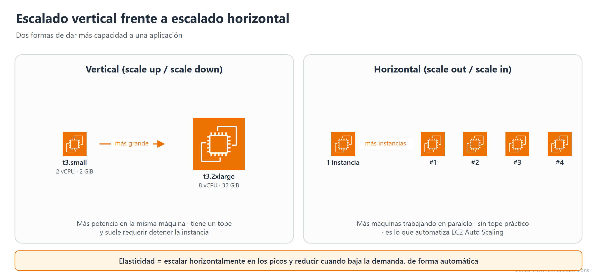

# 2.6 Escalado de Amazon EC2 y EC2 Auto Scaling

!!! abstract "En esta lección aprenderás a"
    Reconocer los conceptos de escalabilidad y elasticidad · describir cómo AWS ajusta la capacidad de cómputo a la demanda · configurar un grupo de Auto Scaling con capacidad mínima, deseada y máxima.

## 1. El problema

Si alguna vez un sitio web no cargó y se agotó el tiempo de espera, probablemente recibía **más solicitudes de las que podía procesar**. Con servidores fijos tienes dos malas opciones: comprar capacidad para el pico (pagando de más el resto del tiempo) o quedarte corto en el pico. La nube resuelve esto con **escalabilidad** y **elasticidad**.

## 2. Escalabilidad

Es la capacidad de un sistema para **manejar más carga agregando recursos**. Se centra en la **planificación de capacidad a largo plazo** para crecer con más usuarios o cargas.

- **Escalar verticalmente (scale up):** dar más potencia a la máquina existente para trabajos pesados. Tiene un tope y no siempre es la mejor opción.
- **Escalar horizontalmente (scale out):** agregar más máquinas al grupo para trabajar en paralelo.

<figure markdown="span">
  
  <figcaption>Escalado vertical frente a horizontal.</figcaption>
</figure>

## 3. Elasticidad

Es la capacidad de **aumentar o reducir recursos automáticamente** según la demanda **en tiempo real**: escalar horizontalmente en los picos y reducir horizontalmente (scale in) cuando la demanda baja. Da **rentabilidad** y un uso óptimo de los recursos en cada momento.

|  | Escalabilidad | Elasticidad |
| --- | --- | --- |
| Pregunta que responde | ¿Puede crecer el sistema? | ¿Se ajusta solo, en tiempo real? |
| Horizonte | Largo plazo | Minuto a minuto |
| Dirección | Normalmente crecer | Crecer **y** reducir |
| Servicio típico | Diseño de la arquitectura | Amazon EC2 Auto Scaling |

## 4. Amazon EC2 Auto Scaling

**Agrega instancias cuando la demanda sube y las retira cuando baja**, para que tengas solo lo necesario. Decide usando **métricas de Amazon CloudWatch** (uso de CPU, latencia, tráfico de red), que indican consumo alto o bajo.

- **Escalado dinámico:** reacciona en tiempo real a los cambios de demanda.
- **Escalado predictivo:** programa de forma anticipada la cantidad correcta de instancias según la demanda prevista (aprende de patrones diarios o semanales).
- **Escalado programado** (complemento): cambia la capacidad en fechas y horas fijas, por ejemplo cada lunes a las 8:00.

### Grupo de Auto Scaling: mínima, deseada y máxima

Un **grupo de Auto Scaling** es un conjunto de instancias de EC2 que crece o se reduce según las necesidades de la aplicación.

| Parámetro | Qué define | Ejemplo |
| --- | --- | --- |
| **Capacidad mínima** | Cantidad mínima de instancias para que la app siga funcionando. Nunca baja de aquí y es lo que se lanza al crear el grupo si no defines la deseada. | 2 |
| **Capacidad deseada** | Cantidad ideal para la carga actual, la que Auto Scaling intenta mantener. Si no la defines, **es igual a la mínima**. | 4 |
| **Capacidad máxima** | Límite superior: evita escalar de más y controla los costos. | 12 |

### Para profundizar en Auto Scaling

- **Plantilla de lanzamiento:** define *qué* lanzar (AMI, tipo, grupo de seguridad, datos de usuario).
- **Políticas de escalado:** por ejemplo, *seguimiento de destino* ("mantén la CPU promedio en 50 %").
- **Autorreparación:** si una instancia falla su comprobación de estado, Auto Scaling la reemplaza sola.
- **Varias AZ:** el grupo reparte las instancias entre zonas de disponibilidad para tener alta disponibilidad.

## Comprueba lo aprendido

**1.** ¿Qué diferencia hay entre escalabilidad y elasticidad?

**2.** Un grupo tiene mínima 2 y máxima 8, sin deseada. ¿Cuántas instancias lanza al crearse?

**3.** ¿Qué tipo de escalado conviene para una tienda que siempre tiene un pico los viernes por la noche?

??? success "Ver respuestas"
    1. Escalabilidad es poder crecer (largo plazo); elasticidad es crecer **y** reducir automáticamente en tiempo real.
    2. **2**, porque la deseada toma el valor de la mínima.
    3. **Predictivo** (o programado), porque el pico es conocido.

## Para profundizar

- [Amazon EC2 Auto Scaling](https://aws.amazon.com/ec2/autoscaling/) · [Guía del usuario](https://docs.aws.amazon.com/autoscaling/ec2/userguide/what-is-amazon-ec2-auto-scaling.html)
