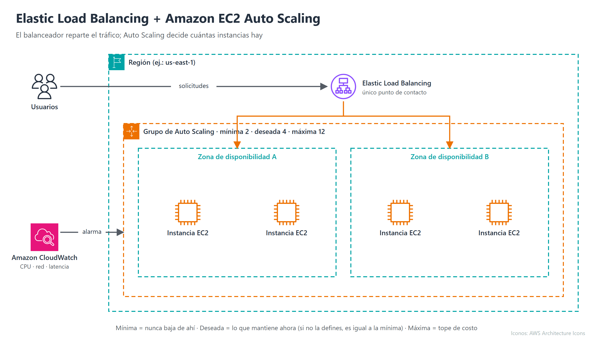

# 2.7 Dirección del tráfico con Elastic Load Balancing

!!! abstract "En esta lección aprenderás a"
    Describir el desafío de distribuir tráfico y escalar · reconocer los beneficios de Elastic Load Balancing (ELB) · explicar cómo trabajan juntos ELB y EC2 Auto Scaling.

## 1. Qué es Elastic Load Balancing

**Elastic Load Balancing (ELB)** distribuye automáticamente el tráfico entrante entre varios recursos, como instancias de EC2, para optimizar el **rendimiento** y la **fiabilidad**. El balanceador es el **único punto de contacto** para todo el tráfico web que entra a un grupo de Auto Scaling: las solicitudes llegan primero a él y él las reparte entre las instancias disponibles, aunque su cantidad cambie.

<figure markdown="span">
  
  <figcaption>ELB reparte el tráfico; Auto Scaling ajusta cuántas instancias hay en cada AZ.</figcaption>
</figure>

**ELB y Auto Scaling son servicios distintos que trabajan juntos:** Auto Scaling agrega o quita instancias, y ELB empieza a enviar tráfico a las nuevas y deja de enviarlo a las que salen. Juntos dan escalado eficaz, rendimiento uniforme y alta disponibilidad.

## 2. Beneficios

| Beneficio | Qué hace |
| --- | --- |
| **Distribución eficiente del tráfico** | Reparte las solicitudes de forma uniforme y evita que una sola instancia se sobrecargue. |
| **Escalado automático** | El propio balanceador escala con el tráfico y se adapta cuando se agregan o retiran instancias. |
| **Administración simplificada** | Desacopla el frontend del backend, reduce la sincronización manual y gestiona mantenimiento, actualizaciones y conmutación por error. |
| **Comprobaciones de estado** (complemento) | Solo envía tráfico a las instancias sanas; si una falla, deja de usarla. |

## 3. Métodos de enrutamiento

| Método | Cómo decide a qué servidor enviar | Bueno para |
| --- | --- | --- |
| **Round Robin** | Por turnos, uno tras otro | Servidores iguales y solicitudes parecidas |
| **Least Connections** | Al que tiene menos conexiones activas | Solicitudes de duración variable |
| **IP Hash** | Según la IP del cliente, que siempre va al mismo servidor | Mantener la sesión de un usuario en un servidor |
| **Least Response Time** | Al que responde más rápido | Priorizar la latencia |

## 4. Tipos de balanceadores (complemento para el examen)

| Tipo | Capa | Para qué |
| --- | --- | --- |
| **Application Load Balancer (ALB)** | 7 (HTTP/HTTPS) | Aplicaciones web; enruta por ruta (`/api`) o por dominio |
| **Network Load Balancer (NLB)** | 4 (TCP/UDP) | Latencia ultrabaja y millones de solicitudes por segundo |
| **Gateway Load Balancer (GWLB)** | 3 | Insertar dispositivos de seguridad de terceros, como firewalls |
| **Classic Load Balancer** | 4 y 7 | Generación anterior |

## 5. Caso del curso: portal de citas de un hospital

Los hospitales que ofrecen citas en línea o portales para pacientes tienen un tráfico que **cambia mucho durante el día**: picos en la mañana y poco movimiento de noche.

1. **Configuración inicial:** un solo servidor web atiende a todos. En el pico se satura y las páginas se vuelven lentas.
2. **Aumento vertical:** se cambia a un servidor más grande. Ayuda un tiempo, pero tiene tope y sigue siendo un punto único de falla.
3. **Equilibrio de carga:** se agregan varios servidores detrás de un balanceador. Si uno recibe demasiadas solicitudes, las nuevas van a un servidor menos ocupado, y ninguno se sobrecarga. Con Auto Scaling, la cantidad de servidores sigue a la demanda del día.

## Comprueba lo aprendido

**1.** ¿Qué servicio reparte el tráfico y cuál cambia la cantidad de instancias?

**2.** ¿Qué tipo de balanceador usarías para una aplicación web que enruta `/api` y `/web` a grupos distintos?

**3.** ¿Por qué el aumento vertical no fue suficiente en el caso del hospital?

??? success "Ver respuestas"
    1. **ELB** reparte el tráfico; **EC2 Auto Scaling** cambia la cantidad de instancias.
    2. Un **Application Load Balancer**.
    3. Porque tiene un tope de capacidad y sigue siendo **un solo punto de falla**.

## Para profundizar

- [Elastic Load Balancing](https://aws.amazon.com/elasticloadbalancing/) · [Guía del usuario](https://docs.aws.amazon.com/elasticloadbalancing/latest/userguide/what-is-load-balancing.html)
