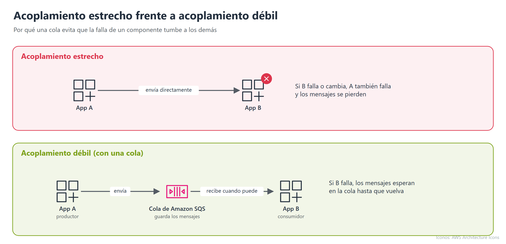
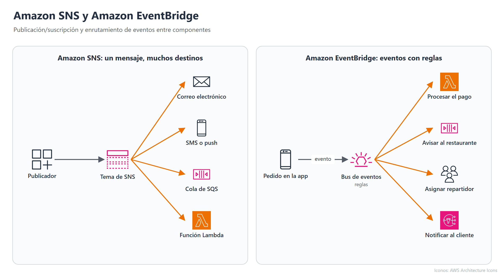

# 2.8 Mensajería, colas y desacoplamiento

!!! abstract "En esta lección aprenderás a"
    Describir cómo Amazon SQS gestiona colas de mensajes · explicar el modelo de publicación y suscripción de Amazon SNS · diferenciar arquitecturas de acoplamiento estrecho y débil · explicar cómo las colas y los eventos mejoran la comunicación entre componentes · conocer Amazon EventBridge.

## 1. La analogía de la cafetería

En una cafetería concurrida, el cajero no espera a que el barista termine cada bebida para tomar el siguiente pedido: anota la orden y la deja en una **fila de pedidos**. Si el barista está en su descanso o desbordado, los pedidos **esperan en la fila** y nadie se queda sin su café. En software ocurre lo mismo: los mensajes y las colas evitan ralentizaciones y errores.

## 2. Acoplamiento estrecho y acoplamiento débil

<figure markdown="span">
  
  <figcaption>Con acoplamiento estrecho la falla se propaga; con una cola, los mensajes esperan.</figcaption>
</figure>

- **Acoplamiento estrecho:** los componentes dependen mucho unos de otros. Si la App A envía mensajes directamente a la App B y B falla o cambia, **A también falla** y puede caer todo el sistema en cascada.
- **Acoplamiento débil:** los componentes funcionan de forma independiente. Si B falla, una **cola** guarda los mensajes hasta que B vuelva, y el resto del sistema sigue operando.

### Aplicaciones monolíticas y microservicios

- **Monolítica:** todos los componentes (base de datos, servidor web, interfaz y lógica de negocio) están estrechamente relacionados; la falla de uno puede tumbar toda la aplicación.
- **Microservicios:** cada componente es un servicio independiente con acoplamiento débil; si uno falla, los demás siguen funcionando. Da más flexibilidad, disponibilidad y resiliencia.

## 3. Amazon SQS (Simple Queue Service)

Servicio de **colas de mensajes** totalmente administrado. Permite **enviar, almacenar y recibir** mensajes entre componentes, a cualquier volumen, sin perderlos.

- **Carga útil (payload):** los datos que lleva el mensaje, por ejemplo cliente, pedido y hora.
- **Cola de SQS:** el lugar donde se guardan los mensajes hasta que se procesan.
- **Funcionamiento:** el productor envía el mensaje a la cola → el consumidor lo **saca (pull)** cuando puede → lo procesa → lo elimina de la cola.

| Dato complementario | Detalle |
| --- | --- |
| Cola estándar | Rendimiento casi ilimitado; entrega al menos una vez; el orden no está garantizado |
| Cola FIFO | Orden garantizado y procesamiento exactamente una vez |
| Tiempo de visibilidad | Mientras un consumidor procesa un mensaje, los demás no lo ven (30 s por defecto) |
| Retención | Los mensajes se guardan 4 días por defecto, hasta 14 |
| Cola de mensajes fallidos (DLQ) | Guarda los mensajes que fallaron varias veces para revisarlos |

## 4. Amazon SNS (Simple Notification Service)

Servicio de **publicación/suscripción (pub/sub)**. Un publicador envía un mensaje a un **tema** y SNS lo **empuja (push)** de inmediato a todos los suscriptores de ese tema. Es un canal para entregar mensajes que necesitan respuesta inmediata.

- **Suscriptores posibles:** correo electrónico, SMS, notificaciones push móviles, endpoints HTTP/HTTPS, colas de SQS y funciones Lambda.
- **Fan-out:** un solo mensaje llega a muchos destinos a la vez.

## 5. Amazon EventBridge

Servicio de **bus de eventos**. Las aplicaciones publican **eventos** ("se creó un pedido") y EventBridge, mediante **reglas**, los envía a los destinos que correspondan. También recibe eventos de servicios de AWS y de aplicaciones SaaS, y puede ejecutar tareas programadas.

<figure markdown="span">
  
  <figcaption>SNS envía un mensaje a muchos suscriptores; EventBridge enruta eventos con reglas.</figcaption>
</figure>

## 6. Comparación rápida

|  | Amazon SQS | Amazon SNS | Amazon EventBridge |
| --- | --- | --- | --- |
| Modelo | Cola (el consumidor **saca**) | Pub/sub (SNS **empuja**) | Bus de eventos con reglas |
| Destinatarios | Un consumidor por mensaje | Todos los suscriptores del tema | Los destinos de cada regla |
| Guarda mensajes | Sí, hasta 14 días | No (entrega inmediata) | No (enruta) |
| Úsalo para | Desacoplar y absorber picos | Notificar a muchos a la vez | Reaccionar a eventos de apps, SaaS y AWS |

## 7. Ejemplos del curso

### EventBridge: entrega de comida a domicilio

Un cliente pide comida en una app móvil. Ese pedido dispara **varias tareas al mismo tiempo**:

1. La app publica el evento *pedido creado* en EventBridge.
2. Las **reglas** de EventBridge identifican qué servicios deben enterarse.
3. El evento llega **en paralelo** a cada servicio: procesar el pago, avisar al restaurante, asignar un repartidor y notificar al cliente.
4. Cada servicio trabaja **de forma independiente**: si uno se demora, los demás no se bloquean.

### SQS: un equipo de atención al cliente que crece

Cuando aumentan los agentes y el volumen de casos, asignar tickets a mano deja de funcionar. Con SQS:

1. Cada caso nuevo se envía como mensaje a una **cola**.
2. Los agentes (o sistemas) **toman el siguiente caso** cuando están libres.
3. En los picos, la cola **absorbe el exceso** y ningún caso se pierde; si hace falta, se suman más agentes que leen de la misma cola.

### SNS: correos segmentados por interés

Una empresa enviaba **un solo correo a todos** con novedades de productos, ofertas y eventos. Los clientes, molestos por recibir lo que no les interesa, dejaron de leerlos. La solución con SNS es crear **un tema por tipo de novedad** (productos nuevos, ofertas especiales, próximos eventos). Cada cliente se **suscribe solo a los temas que le interesan**, y al publicar en un tema solo reciben el mensaje sus suscriptores.

Lo pones en práctica en la parte B del [Laboratorio 2](laboratorio.md).

## Comprueba lo aprendido

**1.** Si la App B falla, ¿qué servicio permite que la App A siga enviando pedidos sin perderlos?

**2.** ¿Qué servicio usarías para enviar el mismo aviso por correo, SMS y a una cola a la vez?

**3.** ¿Qué servicio enruta un evento a distintos destinos según reglas?

??? success "Ver respuestas"
    1. **Amazon SQS.**
    2. **Amazon SNS** (fan-out).
    3. **Amazon EventBridge.**

## Para profundizar

- [Amazon SQS](https://aws.amazon.com/sqs/) · [Amazon SNS](https://aws.amazon.com/sns/) · [Amazon EventBridge](https://aws.amazon.com/eventbridge/)
