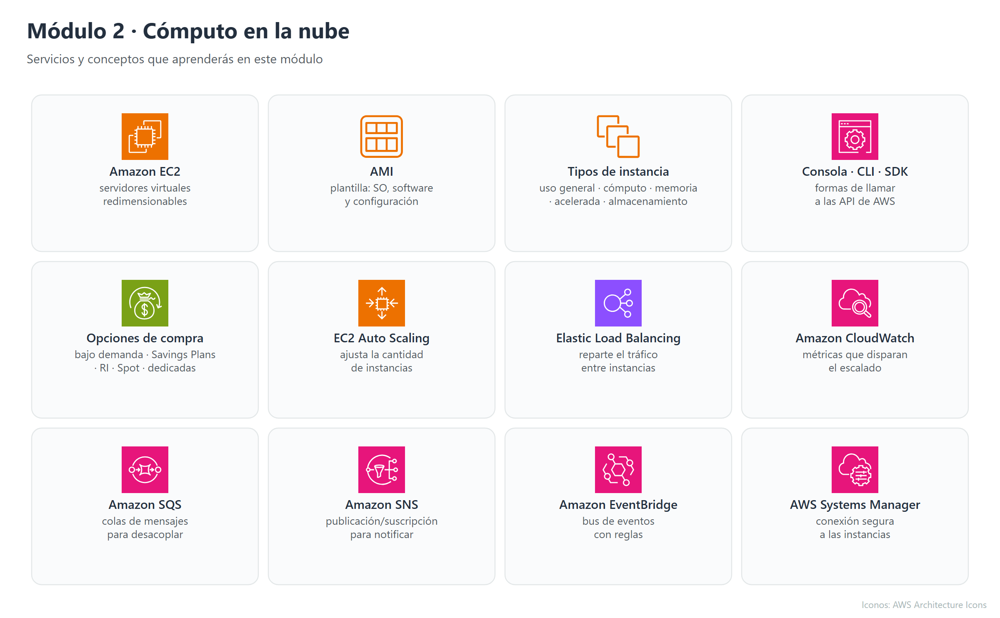

# Módulo 2 · Cómputo en la nube

*Compute in the Cloud* · Dominios del examen: **D3 Tecnología y servicios** y **D4 Facturación y soporte**

!!! abstract "Resumen del módulo"
    **Amazon EC2** da servidores virtuales (instancias) que comparten hardware de forma aislada (**multitenencia**). Al lanzar una instancia eliges una **AMI** y un **tipo de instancia**, y la administras desde la **Consola, la CLI o los SDK**, porque todo es una llamada a la **API**. Pagas con el **modelo de compra** que más te convenga (bajo demanda, Savings Plans, reservadas, Spot o dedicadas). Para crecer usas **EC2 Auto Scaling**, para repartir el tráfico **Elastic Load Balancing** y para desacoplar componentes **Amazon SQS, Amazon SNS y Amazon EventBridge**.

## Resultados de aprendizaje

1. Explicar qué es Amazon EC2, la multitenencia y cómo se lanza, se conecta y se usa una instancia.
2. Comparar servidores virtuales en la nube con servidores físicos propios.
3. Elegir la familia y el tamaño de instancia según la carga de trabajo.
4. Usar la Consola, la AWS CLI y los AWS SDK, y diferenciar servicios administrados y no administrados.
5. Describir las AMI y su papel en la repetibilidad.
6. Elegir la opción de compra de EC2 adecuada para cada caso.
7. Diferenciar escalabilidad y elasticidad, y configurar EC2 Auto Scaling con ELB.
8. Explicar el desacoplamiento con SQS, SNS y EventBridge.

## Mapa del módulo

<figure markdown="span">
  
  <figcaption>Servicios y conceptos del Módulo 2.</figcaption>
</figure>

## Lecciones

| Lección | Tema |
| --- | --- |
| [2.1](2-1-introduccion-ec2.md) | Introducción a Amazon EC2 |
| [2.2](2-2-tipos-instancias.md) | Tipos de instancias de Amazon EC2 |
| [2.3](2-3-aprovisionar-recursos.md) | Cómo aprovisionar recursos de AWS |
| [2.4](2-4-lanzar-instancia-ami.md) | Demostración: lanzar una instancia y las AMI |
| [2.5](2-5-precios-ec2.md) | Precios de Amazon EC2 |
| [2.6](2-6-auto-scaling.md) | Escalado de Amazon EC2 y EC2 Auto Scaling |
| [2.7](2-7-elastic-load-balancing.md) | Dirección del tráfico con Elastic Load Balancing |
| [2.8](2-8-mensajeria-desacoplamiento.md) | Mensajería, colas y desacoplamiento |
| [Laboratorio 2](laboratorio.md) | Servidor web en EC2 y mensajería con SQS y SNS |

## Servicios y conceptos del módulo

| Servicio o concepto | Qué es | Cómo funciona | Ejemplo o caso | Lección |
| --- | --- | --- | --- | --- |
| **Amazon EC2** | Servidores virtuales redimensionables (IaaS) | Eliges AMI + tipo, lanzas, te conectas y usas | Servidor web, base de datos propia, software de terceros | 2.1 |
| **Multitenencia** | Varias instancias de clientes distintos en un mismo host | El hipervisor de AWS reparte y aísla el hardware | Tu instancia convive con otras sin que se vean | 2.1 |
| **Tipos de instancia** | Combinaciones de CPU, memoria, red y almacenamiento | Familias: uso general, cómputo, memoria, acelerada, almacenamiento | Servidor de juegos → optimizada para cómputo | 2.2 |
| **Consola · CLI · SDK** | Formas de llamar a las API de AWS | Web y móvil · comandos y scripts · código | CLI para automatizar; SDK dentro de una app | 2.3 |
| **AMI** | Plantilla con SO, almacenamiento, arquitectura, permisos y software | Lanzas muchas instancias idénticas | Golden image para todos los entornos | 2.4 |
| **Opciones de compra** | Bajo demanda, Savings Plans, RI, Spot, hosts e instancias dedicadas, reservas de capacidad | Más compromiso = más descuento | Spot para lotes; RI para un ERP 24/7 | 2.5 |
| **EC2 Auto Scaling** | Ajusta automáticamente la cantidad de instancias | Mínima, deseada y máxima + métricas de CloudWatch | Agregar instancias en el pico de la mañana | 2.6 |
| **Elastic Load Balancing** | Reparte el tráfico entre instancias sanas | Único punto de contacto; métodos de enrutamiento | Portal de citas de un hospital | 2.7 |
| **Amazon SQS** | Colas de mensajes | El productor envía y el consumidor saca (pull) | Tickets de soporte en cola | 2.8 |
| **Amazon SNS** | Publicación/suscripción | Publicas en un tema y SNS empuja a los suscriptores | Correos segmentados por interés | 2.8 |
| **Amazon EventBridge** | Bus de eventos con reglas | Enruta cada evento a sus destinos | Pedido de comida que dispara pago, restaurante y repartidor | 2.8 |

## Notas rápidas

!!! tip "Para repasar en 2 minutos"
    - EC2 = **IaaS**: AWS gestiona el hardware y el hipervisor; tú el SO invitado, los parches, los grupos de seguridad y los datos.
    - Lanzar = **AMI** (software) + **tipo de instancia** (hardware) + red, grupo de seguridad y par de claves.
    - Familias: **general** para empezar, **C** de CPU, **R/X** de RAM, **P/G/Inf/Trn** aceleradas, **I/D** almacenamiento.
    - **Spot 90 % > RI ≈ Savings Plans 72 % > bajo demanda.** Spot puede interrumpirse con 2 minutos de aviso.
    - **Host dedicado** = servidor físico completo (licencias BYOL). **Instancia dedicada** = hardware aislado sin control del host.
    - **Reservas de capacidad**: garantizan capacidad en una AZ, sin descuento propio.
    - **Escalabilidad** = poder crecer. **Elasticidad** = crecer y reducir solo, en tiempo real.
    - **Auto Scaling** cambia cuántas instancias hay; **ELB** reparte el tráfico entre ellas.
    - **SQS** = cola (pull) · **SNS** = pub/sub (push) · **EventBridge** = eventos con reglas.

## Evaluación del módulo

**1. Una empresa ejecuta trabajos de análisis por lotes que pueden interrumpirse y reiniciarse. ¿Qué opción es la más barata?**

- a) Bajo demanda
- b) Instancias reservadas
- c) Instancias Spot
- d) Hosts dedicados

**2. ¿Qué opción da descuento a cambio de un gasto constante por hora y se aplica también a Fargate y Lambda?**

- a) Instancias reservadas estándar
- b) Savings Plans
- c) Reservas de capacidad
- d) Instancias Spot

**3. Una base de datos en memoria necesita mucha RAM. ¿Qué familia eliges?**

- a) Uso general
- b) Optimizada para cómputo
- c) Optimizada para memoria
- d) Optimizada para almacenamiento

**4. Una empresa debe usar licencias que se cobran por núcleo físico. ¿Qué necesita?**

- a) Instancias dedicadas
- b) Hosts dedicados
- c) Spot
- d) Bajo demanda

**5. Un grupo de Auto Scaling tiene mínima 2 y máxima 10, sin capacidad deseada. ¿Cuántas instancias lanza al crearse?**

- a) 0
- b) 2
- c) 5
- d) 10

**6. ¿Qué servicio distribuye el tráfico entrante entre varias instancias de EC2?**

- a) Amazon SQS
- b) EC2 Auto Scaling
- c) Elastic Load Balancing
- d) Amazon CloudWatch

**7. Si la App B se cae, la App A debe seguir enviando pedidos sin perderlos. ¿Qué servicio usas?**

- a) Amazon SNS
- b) Amazon SQS
- c) Elastic Load Balancing
- d) AWS CLI

**8. Quieres enviar el mismo mensaje a correo, SMS y varias colas a la vez. ¿Qué usas?**

- a) Amazon SNS
- b) Amazon SQS
- c) Amazon EC2
- d) Una AMI

**9. Un desarrollador quiere automatizar el lanzamiento de instancias con scripts desde la terminal. ¿Qué usa?**

- a) Consola de administración
- b) AWS CLI
- c) AWS Marketplace
- d) El hipervisor

**10. ¿Qué componente permite que instancias de distintos clientes compartan un host sin verse entre sí?**

- a) Elastic Load Balancing
- b) El hipervisor
- c) La AMI
- d) El grupo de seguridad

**11. ¿Qué afirmación sobre las reservas de capacidad es correcta?**

- a) Dan un 90 % de descuento
- b) Garantizan capacidad en una AZ y se pagan aunque no se usen
- c) Solo sirven para Lambda
- d) Se pueden interrumpir con 2 minutos de aviso

**12. Un pedido en una app debe disparar en paralelo el pago, el aviso al restaurante y la asignación del repartidor, según reglas. ¿Qué servicio encaja mejor?**

- a) Amazon EventBridge
- b) Una sola instancia EC2 más grande
- c) Amazon EBS
- d) AWS Marketplace

??? success "Ver respuestas y explicaciones"
    1. **c**: Spot da hasta 90 % de descuento y tolera interrupciones.
    2. **b**: Savings Plans se aplica a EC2, Fargate, Lambda y SageMaker AI.
    3. **c**: optimizada para memoria (familias R y X).
    4. **b**: el host dedicado da visibilidad de sockets y núcleos físicos.
    5. **b**: si no defines la deseada, toma el valor de la mínima.
    6. **c**: ELB reparte el tráfico; Auto Scaling cambia la cantidad de instancias.
    7. **b**: la cola de SQS guarda los mensajes hasta que B vuelve.
    8. **a**: SNS publica a todos los suscriptores de un tema (fan-out).
    9. **b**: la CLI se automatiza con scripts.
    10. **b**: el hipervisor administrado por AWS aísla las instancias.
    11. **b**: garantizan capacidad; el descuento viene de combinarlas con Savings Plans o RI.
    12. **a**: EventBridge enruta eventos a varios destinos con reglas.

## Trampas típicas del examen

!!! warning "No te confundas"
    - **SQS = cola (pull)** y **SNS = pub/sub (push)**. *Desacoplar* o *guardar mensajes* → SQS; *notificar* o *varios suscriptores* → SNS; *reglas sobre eventos* → EventBridge.
    - **Auto Scaling ≠ ELB.** Uno ajusta la cantidad de instancias; el otro reparte el tráfico.
    - **Host dedicado ≠ instancia dedicada.** Solo el host da control del servidor físico.
    - **Spot** nunca es la respuesta para cargas críticas que no toleran interrupciones.
    - Auto Scaling escala **horizontalmente**; cambiar a una instancia más grande es escalado **vertical**.
    - Una instancia **detenida** no cobra cómputo, pero sí sus volúmenes EBS.

## Recursos

- [Computación en AWS](https://aws.amazon.com/products/compute) · [Servicios de computación (whitepaper)](https://docs.aws.amazon.com/whitepapers/latest/aws-overview/compute-services.html) · [Blog de computación](https://aws.amazon.com/blogs/compute/)
- [Tutoriales prácticos de cómputo](https://aws.amazon.com/getting-started/hands-on/?awsf.getting-started-category=category%23compute&awsf.getting-started-content-type=content-type%23hands-on)
