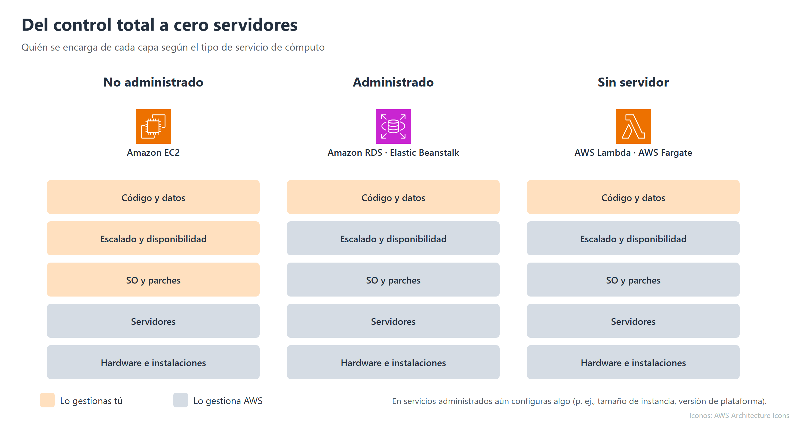

# 3.1 Servicios no administrados, administrados y sin servidor

!!! abstract "En esta lección aprenderás a"
    Describir las diferencias entre los servicios de cómputo no administrados, administrados y sin servidor · describir las responsabilidades del cliente y de AWS en la computación sin servidor.

## 1. Punto de partida: Amazon EC2

EC2 es la base de AWS y conviene entenderlo para cualquier solución en la nube. Son máquinas virtuales que puedes aprovisionar para todo tipo de casos de uso, con un **alto grado de control**. A cambio, **no es administrado**: tú te encargas de los parches, la seguridad, la configuración y los datos.

## 2. Los tres niveles

<figure markdown="span">
  
  <figcaption>Quién se encarga de cada capa en un servicio no administrado, uno administrado y uno sin servidor.</figcaption>
</figure>

### Servicios no administrados

AWS se encarga de la **infraestructura física**, pero tú configuras, proteges y mantienes el **sistema operativo**, la **red** y las **aplicaciones** de tus instancias. Ejemplo: **Amazon EC2**.

### Servicios administrados

Transfieren más **carga operativa a AWS** para que te enfoques en tu aplicación, lo que también ahorra tiempo y dinero. AWS se encarga de gran parte del mantenimiento, aunque tú todavía haces algo de aprovisionamiento o configuración. Ejemplos: **Elastic Load Balancing, Amazon SNS, Amazon SQS**, **Amazon RDS** y **AWS Elastic Beanstalk**.

### Servicios totalmente administrados: sin servidor (serverless)

Suben aún más el nivel de abstracción: **no puedes ver ni acceder a la infraestructura** subyacente. AWS se encarga del aprovisionamiento, el escalado, la disponibilidad y el mantenimiento; tú te enfocas **solo en escribir e implementar código**. Ejemplos: **AWS Lambda** y **AWS Fargate**.

!!! note "Nota rápida"
    "Sin servidor" no significa que no haya servidores. Significa que **tú no los ves ni los administras** y que normalmente **pagas solo cuando tu código se ejecuta**.

## 3. Comparación

|  | No administrado | Administrado | Sin servidor |
| --- | --- | --- | --- |
| Ejemplos | Amazon EC2 | ELB, SNS, SQS, RDS, Elastic Beanstalk | AWS Lambda, AWS Fargate |
| Control | Máximo | Medio | Mínimo |
| Trabajo operativo para ti | Alto | Medio | Bajo |
| Escalado | Lo configuras tú (Auto Scaling) | Asistido o configurable | Automático |
| Cuándo elegirlo | Necesitas control del SO o software especial | Quieres menos mantenimiento pero algo de control | Quieres enfocarte solo en el código |

## 4. Responsabilidades en la computación sin servidor

| AWS se encarga de | El cliente se encarga de |
| --- | --- |
| Servidores, sistema operativo y parches | **Proteger y administrar el código** de la aplicación |
| Entorno de ejecución (runtime) | Los **permisos** de la función (IAM) |
| Escalado y alta disponibilidad | Sus **datos** y su cifrado |
| Infraestructura física y red | La **configuración** (memoria, tiempo de espera, variables) |

## 5. Ventajas y límites de lo sin servidor

- **Ventajas:** sin servidores que mantener, escala automática (incluso a cero), pago por uso real, despliegues rápidos.
- **Límites:** menos control sobre el entorno, límites de ejecución (Lambda: 15 minutos) y diseño basado en eventos que requiere otra forma de pensar.

## Comprueba lo aprendido

**1.** ¿Qué tipo de servicio es Amazon EC2: no administrado, administrado o sin servidor?

**2.** En AWS Lambda, ¿quién aplica los parches del sistema operativo?

**3.** ¿Qué sigue siendo responsabilidad del cliente en un servicio sin servidor?

??? success "Ver respuestas"
    1. **No administrado.**
    2. **AWS.**
    3. Su código, los permisos, los datos y la configuración de la función.
