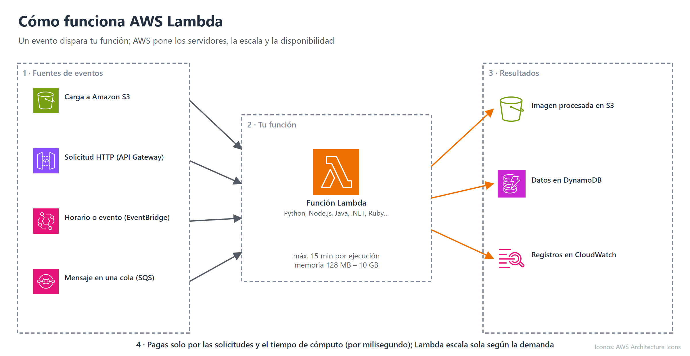

# 3.2 AWS Lambda

!!! abstract "En esta lección aprenderás a"
    Recordar qué es Lambda y su función principal como servicio de cómputo sin servidor · identificar sus componentes clave: desencadenadores, funciones y escalado.

## 1. Qué es AWS Lambda

**AWS Lambda** es un servicio de cómputo **sin servidor** que **ejecuta código en respuesta a eventos**, sin que tengas que aprovisionar ni administrar servidores. Administra la infraestructura, **escala automáticamente** según el volumen de solicitudes y es **altamente disponible**. Solo pagas por el **tiempo de cómputo consumido, medido al milisegundo**, y por la cantidad de solicitudes.

!!! tip "Ejemplo"
    Para una app que clasifica datos, lo tradicional sería instalar servidores y preocuparte por escalarlos. Con Lambda solo **subes el código**, le **asignas un desencadenador** y listo: AWS hace el resto, incluso con desencadenadores complejos como procesar un flujo de datos o redimensionar imágenes.

## 2. Cómo funciona

<figure markdown="span">
  
  <figcaption>Fuentes de eventos → función → resultados, con pago por milisegundo.</figcaption>
</figure>

1. **Subes tu código** como una **función**.
2. **Configuras un desencadenador** (trigger): una carga a S3, una solicitud HTTP con API Gateway, una regla o un horario de EventBridge, un mensaje en una cola de SQS, un cambio en DynamoDB, etc.
3. Cuando ocurre el evento, **Lambda ejecuta tu código** y escala solo: si llegan mil eventos a la vez, ejecuta muchas copias en paralelo.
4. **Pagas solo por el tiempo de ejecución** (al milisegundo) y por las solicitudes. Si no hay eventos, no pagas cómputo.

## 3. Componentes clave

| Componente | Qué es |
| --- | --- |
| **Función** | Tu código más su configuración |
| **Desencadenador (trigger)** | El evento que invoca la función |
| **Entorno de ejecución (runtime)** | El lenguaje: Python, Node.js, Java, .NET y Ruby de forma nativa; otros lenguajes con entornos personalizados o imágenes de contenedor |
| **Rol de ejecución (IAM)** | Los permisos de la función (por ejemplo, leer un bucket o escribir registros) |
| **Memoria** | De 128 MB a 10 GB; la CPU aumenta en proporción. Configurar bien la memoria optimiza el rendimiento |
| **Tiempo de espera** | Máximo **15 minutos** por ejecución |
| **Escalado (concurrencia)** | Cuántas ejecuciones simultáneas hay; Lambda lo ajusta solo |

!!! note "Nota rápida"
    Lambda tiene una capa gratuita permanente de 1 millón de solicitudes y 400 000 GB-segundos de cómputo al mes, así que practicar con ella cuesta muy poco. Revisa las condiciones vigentes en la [página de precios](https://aws.amazon.com/lambda/pricing/).

## 4. Casos de uso del curso

| Caso | Qué hace Lambda | Por qué Lambda |
| --- | --- | --- |
| **Procesamiento de imágenes en una red social** | Cada foto subida dispara una función que la redimensiona, le aplica filtros y la guarda en un formato optimizado | Escala con el volumen de cargas y cobra solo por el tiempo de cada imagen |
| **Contenido personalizado en un agregador de noticias** | Al abrir la app o buscar, funciones recuperan artículos de varias fuentes y aplican la lógica de personalización | Escala con el tráfico de usuarios y solo cuesta cuando alguien interactúa |
| **Eventos en tiempo real en un videojuego** | Cada punto o logro dispara una función que actualiza los datos del jugador, el estado del juego y la tabla de clasificación | Atiende miles de eventos sin gestionar servidores y absorbe los picos de actividad |

## 5. Cuándo NO usar Lambda

- Procesos que duran **más de 15 minutos** → EC2, contenedores o AWS Batch.
- Cargas **constantes y muy altas las 24 horas** → a veces EC2 o contenedores salen más baratos.
- Necesitas **control del sistema operativo** o software especial instalado → EC2.

Lo pruebas tú mismo en el [Laboratorio 3](laboratorio.md).

## Comprueba lo aprendido

**1.** ¿Cuál es el tiempo máximo de una ejecución de Lambda?

**2.** ¿Cómo se cobra Lambda?

**3.** Una app debe redimensionar cada imagen que se sube a un bucket. ¿Qué desencadenador usas?

??? success "Ver respuestas"
    1. **15 minutos.**
    2. Por el **tiempo de cómputo al milisegundo** y por la **cantidad de solicitudes**.
    3. Un evento de **carga de objeto en Amazon S3**.

## Para profundizar

- [AWS Lambda](https://aws.amazon.com/lambda/) · [Guía para desarrolladores](https://docs.aws.amazon.com/lambda/latest/dg/welcome.html) · [Precios](https://aws.amazon.com/lambda/pricing/)
