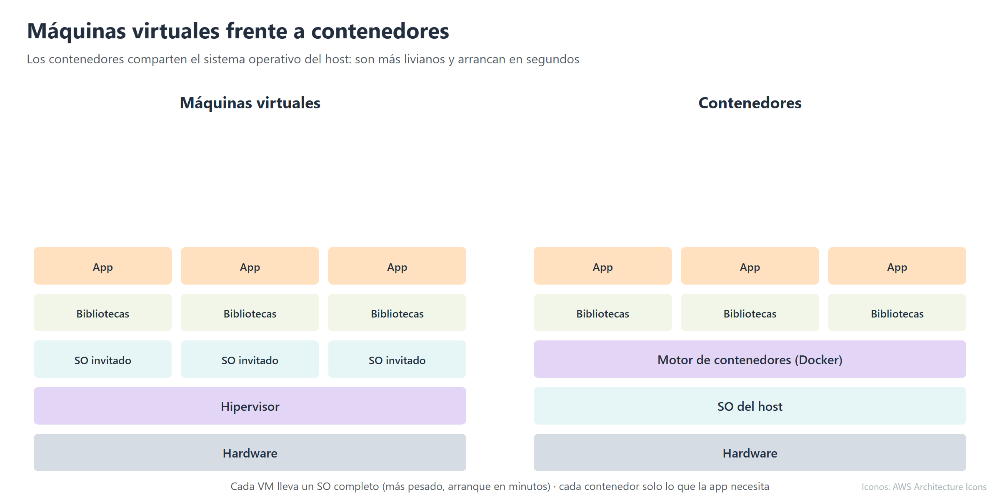
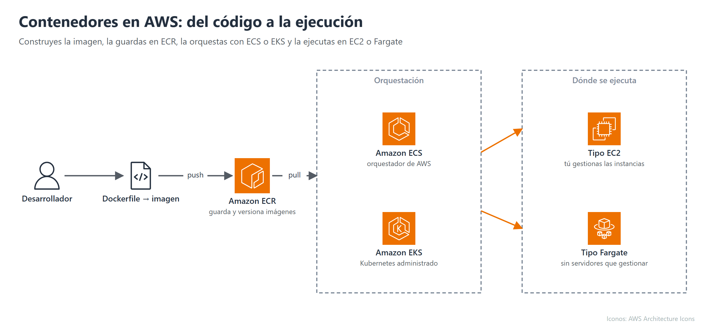

# 3.3 Contenedores y orquestación en AWS

!!! abstract "En esta lección aprenderás a"
    Describir cómo los contenedores crean un entorno de ejecución coherente y portátil · explicar cómo Amazon ECR almacena, administra y versiona imágenes · identificar cómo Amazon ECS y Amazon EKS orquestan contenedores · describir cómo AWS Fargate ejecuta contenedores sin administrar servidores.

## 1. El problema de "en mi máquina funciona"

Una aplicación que funciona en la computadora del desarrollador falla en el servidor porque cambia la versión de una biblioteca, del lenguaje o del sistema. Un **contenedor** empaqueta la aplicación **con todo lo que necesita** para ejecutarse (código, bibliotecas, configuración), aislada del sistema subyacente, de modo que **funciona igual en cualquier equipo**. Además, arranca rápido y aprovecha mejor los recursos.

## 2. Contenedores frente a máquinas virtuales

<figure markdown="span">
  
  <figcaption>Cada VM lleva su propio SO; los contenedores comparten el SO del host.</figcaption>
</figure>

|  | Máquinas virtuales (VM) | Contenedores |
| --- | --- | --- |
| Qué virtualizan | El hardware, con un **hipervisor** | El sistema operativo, con un motor de contenedores |
| Sistema operativo | Cada VM tiene su **SO completo** | **Comparten el SO del host** |
| Tamaño | Gigabytes | Megabytes |
| Arranque | Minutos | Segundos |
| Eficiencia | Menor | Mayor: caben más en el mismo servidor |

## 3. Coherencia en la implementación

Cuando el entorno del desarrollador es distinto del de pruebas o producción, las implementaciones fallan y cuesta depurarlas. Los contenedores mantienen el **mismo entorno en todas partes**, lo que facilita los despliegues y la solución de problemas.

## 4. Orquestación: cuando son cientos o miles

Puedes ejecutar contenedores en un clúster de instancias EC2, pero administrarlos a mano se vuelve tedioso: habría que vigilar, reiniciar y repartir cientos o miles de contenedores en varios hosts. Las herramientas de **orquestación** automatizan el **despliegue, el escalado, el monitoreo, el ciclo de vida y la recuperación de fallos**: si un contenedor se cae, lo reemplazan; si sube la demanda, lanzan más.

## 5. Servicios de contenedores de AWS

<figure markdown="span">
  
  <figcaption>Del código a la ejecución: imagen → ECR → ECS o EKS → EC2 o Fargate.</figcaption>
</figure>

| Servicio | Qué hace |
| --- | --- |
| **Amazon ECR** (Elastic Container Registry) | Registro totalmente administrado para **almacenar, administrar y versionar imágenes** de contenedores de forma segura |
| **Amazon ECS** (Elastic Container Service) | **Orquestador** de contenedores propio de AWS, fácil de usar e integrado con otros servicios de AWS |
| **Amazon EKS** (Elastic Kubernetes Service) | **Kubernetes administrado**: ejecuta clústeres de Kubernetes en AWS (y en tus instalaciones) e integra redes, seguridad y almacenamiento |
| **AWS Fargate** | **Motor de cómputo sin servidor** para contenedores: los ejecuta sin que aprovisiones ni administres instancias. Funciona con ECS y con EKS |

### Tipos de lanzamiento de Amazon ECS

- **ECS con Amazon EC2:** para empresas que necesitan **control total** de la infraestructura, como aplicaciones personalizadas con requisitos específicos de red o hardware. Combina la flexibilidad de EC2 con la simplicidad de ECS.
- **ECS con AWS Fargate:** para startups o equipos pequeños con aplicaciones web de **tráfico variable**. No hay servidores que administrar; ECS se encarga del escalado y la orquestación.

### Tipos de lanzamiento de Amazon EKS

- **EKS con Amazon EC2:** para empresas que necesitan **control total** y personalización profunda de las instancias, junto con la escalabilidad de Kubernetes; ideal para cargas complejas y grandes.
- **EKS con AWS Fargate:** para equipos que quieren la **flexibilidad de Kubernetes sin administrar servidores**.

## 6. Vocabulario básico

- **Imagen:** plantilla de solo lectura con la app y sus dependencias. Se define en un **Dockerfile**.
- **Contenedor:** una imagen en ejecución.
- **Registro:** donde se guardan las imágenes (Amazon ECR, Docker Hub).
- **Clúster:** el grupo de recursos donde corren los contenedores.
- **Tarea (ECS) / pod (Kubernetes):** la unidad que ejecuta uno o varios contenedores juntos.

!!! example "Pruébalo sin costo en CloudShell"
    CloudShell trae Docker. Un contenedor mínimo, sin crear nada en tu cuenta:

    ```bash
    docker run --rm public.ecr.aws/docker/library/hello-world
    ```

    La imagen viene de **Amazon ECR Public**, el registro público de AWS.

## 7. ¿ECS o EKS?

| Si... | Elige |
| --- | --- |
| Quieres la forma más simple y nativa de AWS | Amazon ECS |
| Ya usas Kubernetes o quieres portabilidad entre nubes y centros de datos | Amazon EKS |
| No quieres administrar servidores en ninguno de los dos | Agrega AWS Fargate |

## Comprueba lo aprendido

**1.** ¿Dónde se almacenan y versionan las imágenes de contenedores en AWS?

**2.** ¿Fargate es un orquestador?

**3.** Una empresa ya usa Kubernetes en su centro de datos y quiere llevarlo a AWS. ¿Qué servicio usa?

??? success "Ver respuestas"
    1. En **Amazon ECR**.
    2. **No.** Fargate es el motor de cómputo sin servidor; los orquestadores son ECS y EKS.
    3. **Amazon EKS.**

## Para profundizar

- [Contenedores en AWS](https://aws.amazon.com/containers/services/) · [Amazon ECR](https://aws.amazon.com/ecr/) · [Amazon ECS](https://aws.amazon.com/ecs/) · [Amazon EKS](https://aws.amazon.com/eks/) · [AWS Fargate](https://aws.amazon.com/fargate/)
