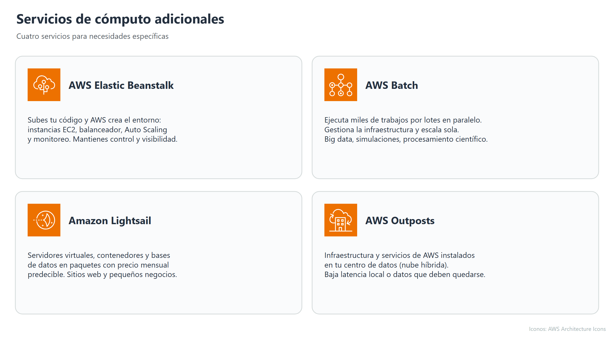

# 3.4 Servicios de cómputo adicionales

!!! abstract "En esta lección aprenderás a"
    Explicar para qué sirven AWS Elastic Beanstalk, AWS Batch, Amazon Lightsail y AWS Outposts · elegir el servicio de cómputo adecuado para cada necesidad.

<figure markdown="span">
  
  <figcaption>Los cuatro servicios de cómputo adicionales del módulo.</figcaption>
</figure>

## 1. AWS Elastic Beanstalk

Servicio para **implementar y escalar aplicaciones web sin diseñar la infraestructura**. Subes tu código, eliges la plataforma (Java, .NET, PHP, Node.js, Python, Ruby, Go o Docker) y Beanstalk **genera el entorno según tus requisitos**.

- **Aprovisionamiento simplificado:** crea por ti instancias EC2, el balanceador de carga, el grupo de Auto Scaling y el monitoreo.
- **Gestión de la configuración:** cambias parámetros del entorno desde un solo lugar.
- **Control y visibilidad:** los recursos quedan en tu cuenta y puedes verlos y ajustarlos.
- **Costo:** Beanstalk no cobra aparte; pagas los recursos que crea.

## 2. AWS Batch

Servicio totalmente administrado para ejecutar **trabajos de cómputo por lotes a gran escala**: procesamiento de big data, simulaciones complejas, renderizado, análisis genómico.

- **Gestión de la infraestructura:** aprovisiona la cantidad y el tipo de recursos adecuados según los trabajos.
- **Procesamiento en paralelo:** reparte miles de trabajos a la vez.
- **Escalado automático:** crece cuando hay trabajos en cola y se reduce cuando terminan. Puede usar instancias Spot para ahorrar.
- **Cómo funciona:** defines el trabajo, lo envías a una **cola de trabajos** y Batch lo ejecuta en un **entorno de cómputo** (EC2, Spot o Fargate).

## 3. Amazon Lightsail

Plataforma en la nube **simplificada** para alojar aplicaciones web. Ofrece servidores privados virtuales (VPS), contenedores, bases de datos administradas, balanceadores y almacenamiento en **paquetes con precio mensual predecible**.

- **Simplicidad:** consola sencilla y plantillas listas (WordPress, LAMP, Node.js).
- **Solución rentable:** sabes cuánto pagarás cada mes.
- **Infraestructura gestionada:** ideal para sitios web, blogs, comercio pequeño y entornos de prueba.

## 4. AWS Outposts

Solución de **nube híbrida** que **extiende la infraestructura y los servicios de AWS a tu propio centro de datos**, con las mismas API, herramientas y consola. Así ejecutas servicios localmente y sigues aprovechando la nube.

- **Cuándo usarlo:** procesamiento local con **baja latencia** (por ejemplo, una fábrica), datos que por ley deben quedarse en el sitio, o migraciones graduales.
- **Formatos:** *racks* de Outposts (instalaciones grandes) y servidores de Outposts (espacios pequeños).
- **Administración:** AWS entrega, instala, monitorea y mantiene el hardware.

## 5. Guía de decisión de todo el módulo

| Si necesitas… | Usa |
| --- | --- |
| Control total del SO o software especial | Amazon EC2 |
| Ejecutar código corto ante eventos, sin servidores | AWS Lambda |
| Contenedores sin administrar servidores | Amazon ECS o EKS con AWS Fargate |
| Ya usas Kubernetes | Amazon EKS |
| Subir el código y que AWS monte el entorno web | AWS Elastic Beanstalk |
| Miles de trabajos por lotes en paralelo | AWS Batch |
| Un servidor simple con precio mensual fijo | Amazon Lightsail |
| Servicios de AWS dentro de tu centro de datos | AWS Outposts |

## Comprueba lo aprendido

**1.** Un desarrollador quiere desplegar su app web sin diseñar la infraestructura, pero viendo los recursos que se crean. ¿Qué usa?

**2.** Un pequeño negocio quiere alojar su WordPress con un costo mensual predecible. ¿Qué usa?

**3.** Una fábrica necesita servicios de AWS en su planta por latencia. ¿Qué usa?

??? success "Ver respuestas"
    1. **AWS Elastic Beanstalk.**
    2. **Amazon Lightsail.**
    3. **AWS Outposts.**

## Para profundizar

- [Elastic Beanstalk](https://aws.amazon.com/elasticbeanstalk/) · [AWS Batch](https://aws.amazon.com/batch/) · [¿Qué es Lightsail?](https://docs.aws.amazon.com/lightsail/latest/userguide/what-is-amazon-lightsail.html) · [¿Qué es Outposts?](https://docs.aws.amazon.com/outposts/latest/server-userguide/what-is-outposts.html)
- [Elegir una estrategia de aplicaciones modernas](https://docs.aws.amazon.com/decision-guides/latest/modern-apps-strategy-on-aws-how-to-choose/modern-apps-strategy-on-aws-how-to-choose.html)
