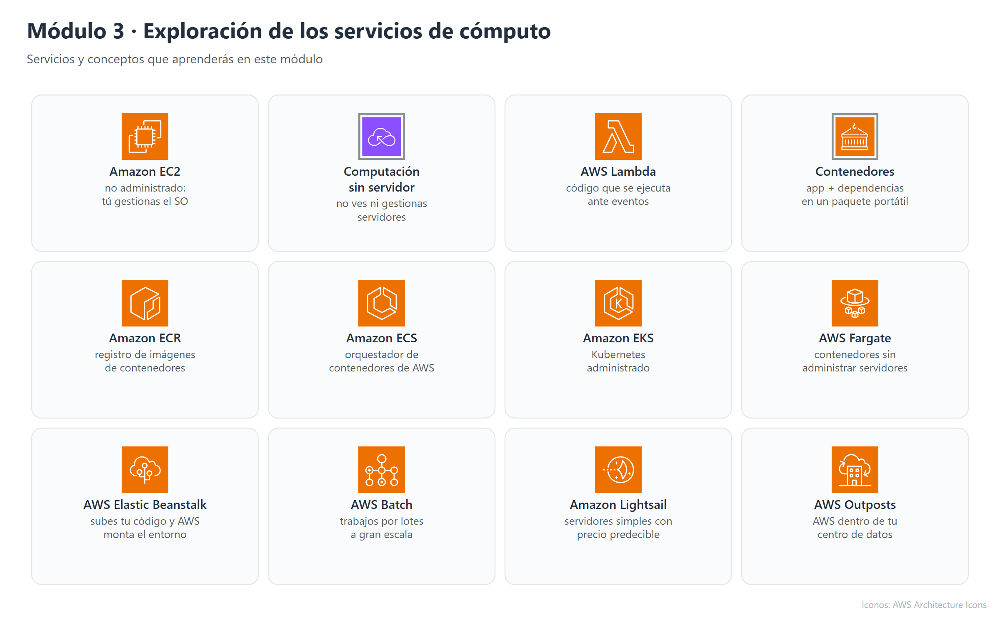

# Módulo 3 · Exploración de los servicios de cómputo

*Exploring Compute Services* · Dominios del examen: **D3 Tecnología y servicios** y **D2 Seguridad y cumplimiento**

!!! abstract "Resumen del módulo"
    Los servicios de cómputo van de **no administrados** (EC2: tú gestionas el SO) a **administrados** (AWS asume gran parte de la operación) y a **sin servidor** (no ves ni gestionas servidores). **AWS Lambda** ejecuta código ante eventos, hasta **15 minutos** por ejecución, y cobra por milisegundo. Los **contenedores** empaquetan la app con todo lo que necesita: **Amazon ECR** guarda las imágenes, **Amazon ECS** y **Amazon EKS** las orquestan y **AWS Fargate** las ejecuta sin servidores. Para necesidades específicas existen **Elastic Beanstalk**, **AWS Batch**, **Amazon Lightsail** y **AWS Outposts**.

## Resultados de aprendizaje

1. Diferenciar servicios de cómputo no administrados, administrados y sin servidor, y quién es responsable de qué en cada uno.
2. Explicar AWS Lambda: funciones, desencadenadores, escalado, límites y casos de uso.
3. Explicar los contenedores frente a las máquinas virtuales y la orquestación con ECR, ECS, EKS y Fargate.
4. Elegir entre Elastic Beanstalk, AWS Batch, Amazon Lightsail y AWS Outposts según el caso.

## Mapa del módulo

<figure markdown="span">
  
  <figcaption>Servicios y conceptos del Módulo 3.</figcaption>
</figure>

## Lecciones

| Lección | Tema |
| --- | --- |
| [3.1](3-1-administrados-sin-servidor.md) | Servicios no administrados, administrados y sin servidor |
| [3.2](3-2-aws-lambda.md) | AWS Lambda |
| [3.3](3-3-contenedores.md) | Contenedores y orquestación en AWS |
| [3.4](3-4-otros-servicios-computo.md) | Servicios de cómputo adicionales |
| [Laboratorio 3](laboratorio.md) | Función Lambda con desencadenador de S3 (+ Elastic Beanstalk) |

## Servicios y conceptos del módulo

| Servicio o concepto | Qué es | Cómo funciona | Ejemplo o caso | Lección |
| --- | --- | --- | --- | --- |
| **No administrado / administrado / sin servidor** | Niveles de cuánto gestiona AWS | Más abstracción = menos trabajo operativo y menos control | EC2 → RDS → Lambda | 3.1 |
| **AWS Lambda** | Cómputo sin servidor ante eventos | Función + desencadenador; escala sola; pago por ms; máx. 15 min | Redimensionar fotos al subirlas | 3.2 |
| **Contenedores** | App + dependencias en un paquete portátil | Comparten el SO del host; arrancan en segundos | Fin del "en mi máquina funciona" | 3.3 |
| **Amazon ECR** | Registro de imágenes | Guarda y versiona imágenes de contenedores | Repositorio privado de imágenes | 3.3 |
| **Amazon ECS** | Orquestador de AWS | Despliega, escala y recupera contenedores | API web en contenedores | 3.3 |
| **Amazon EKS** | Kubernetes administrado | Clústeres de Kubernetes en AWS | Migrar Kubernetes desde un centro de datos | 3.3 |
| **AWS Fargate** | Cómputo sin servidor para contenedores | Ejecuta tareas de ECS/EKS sin instancias | Startup con tráfico variable | 3.3 |
| **AWS Elastic Beanstalk** | Despliegue simplificado (PaaS) | Subes código; crea EC2, ELB, Auto Scaling y monitoreo | App web sin diseñar infraestructura | 3.4 |
| **AWS Batch** | Trabajos por lotes a gran escala | Colas de trabajos + entornos de cómputo que escalan | Simulaciones científicas | 3.4 |
| **Amazon Lightsail** | Servidores simples con precio fijo | Paquetes mensuales con VPS, BD y red | WordPress de un pequeño negocio | 3.4 |
| **AWS Outposts** | AWS en tu centro de datos | Hardware de AWS instalado y gestionado en sitio | Fábrica con baja latencia local | 3.4 |

## Notas rápidas

!!! tip "Para repasar en 2 minutos"
    - **No administrado** (EC2) → tú: SO, parches, red, apps. **Administrado** (RDS, ELB, SNS, SQS, Beanstalk) → AWS hace casi todo. **Sin servidor** (Lambda, Fargate) → tú solo código, permisos y datos.
    - **Lambda:** evento → función → resultado · **máx. 15 min** · 128 MB–10 GB · pago por ms y solicitudes.
    - **Contenedor ≠ VM:** el contenedor comparte el SO del host; la VM lleva su SO completo sobre un hipervisor.
    - **ECR guarda imágenes · ECS/EKS orquestan · Fargate ejecuta sin servidores.**
    - **Beanstalk** = sube tu código (PaaS) · **Batch** = lotes · **Lightsail** = simple y precio fijo · **Outposts** = AWS en tu sitio.

## Evaluación del módulo

**1. ¿Cuál es el tiempo máximo de una ejecución de Lambda?**

- a) 5 minutos
- b) 15 minutos
- c) 1 hora
- d) Sin límite

**2. Quieres ejecutar contenedores sin aprovisionar ni administrar servidores. ¿Qué usas?**

- a) Amazon EC2
- b) AWS Fargate
- c) Amazon ECR
- d) AWS Outposts

**3. Una empresa ya usa Kubernetes y quiere un servicio administrado en AWS. ¿Cuál elige?**

- a) Amazon ECS
- b) Amazon EKS
- c) AWS Batch
- d) Amazon Lightsail

**4. ¿Dónde almacenas y versionas imágenes de contenedores?**

- a) Amazon ECR
- b) Amazon ECS
- c) AWS Lambda
- d) Amazon SQS

**5. Un desarrollador sube su código y quiere que AWS cree la capacidad, el balanceo y el escalado, pero ver esos recursos. ¿Qué servicio usa?**

- a) AWS Elastic Beanstalk
- b) Amazon Lightsail
- c) AWS Batch
- d) AWS Outposts

**6. Un pequeño negocio quiere un servidor virtual simple con precio mensual predecible. ¿Qué usa?**

- a) Amazon EKS
- b) Amazon Lightsail
- c) Hosts dedicados
- d) AWS Fargate

**7. Una empresa necesita servicios de AWS dentro de su propio centro de datos por latencia. ¿Qué usa?**

- a) AWS Outposts
- b) AWS Direct Connect
- c) Amazon ECS
- d) Elastic Beanstalk

**8. Según el modelo de responsabilidad compartida, en Lambda el cliente es responsable de:**

- a) Aplicar parches al sistema operativo
- b) Escalar los servidores
- c) Su código y los permisos de la función
- d) El hardware

**9. ¿Cuál de estos es un servicio de cómputo NO administrado?**

- a) AWS Lambda
- b) AWS Fargate
- c) Amazon EC2
- d) Elastic Beanstalk

**10. Un laboratorio genómico debe procesar 50 000 trabajos en paralelo y apagar todo al terminar. ¿Qué servicio encaja mejor?**

- a) Amazon Lightsail
- b) AWS Batch
- c) Una sola instancia EC2 grande
- d) Amazon ECR

??? success "Ver respuestas y explicaciones"
    1. **b**: 15 minutos; para más tiempo usa EC2, contenedores o Batch.
    2. **b**: Fargate es cómputo sin servidor para contenedores.
    3. **b**: EKS es Kubernetes administrado.
    4. **a**: ECR es el registro de imágenes.
    5. **a**: Beanstalk aprovisiona el entorno a partir de tu código y deja los recursos visibles.
    6. **b**: Lightsail ofrece paquetes con precio mensual predecible.
    7. **a**: Outposts lleva la infraestructura de AWS a tus instalaciones.
    8. **c**: AWS gestiona servidores y SO; tú, el código y sus permisos.
    9. **c**: en EC2 tú gestionas el SO, los parches y la red.
    10. **b**: Batch reparte trabajos por lotes en paralelo y escala hacia abajo al terminar.

## Trampas típicas del examen

!!! warning "No te confundas"
    - Si el proceso dura **más de 15 minutos**, Lambda no es la respuesta.
    - **Fargate no orquesta:** es el motor de cómputo. Los orquestadores son **ECS** y **EKS**.
    - **ECR guarda imágenes**, no ejecuta contenedores.
    - **Beanstalk** (PaaS, sigues viendo los recursos) ≠ **Lightsail** (simplicidad y precio fijo).
    - **Outposts** es AWS en *tu* centro de datos; no lo confundas con Direct Connect, que es una conexión de red.
    - "Sin servidor" no significa que no haya servidores: significa que **tú no los administras**.

## Recursos

- [Contenedores en AWS](https://aws.amazon.com/containers/services/) · [AWS Lambda](https://aws.amazon.com/lambda/) · [AWS Fargate](https://aws.amazon.com/fargate/)
- [Elegir una estrategia de aplicaciones modernas](https://docs.aws.amazon.com/decision-guides/latest/modern-apps-strategy-on-aws-how-to-choose/modern-apps-strategy-on-aws-how-to-choose.html)
