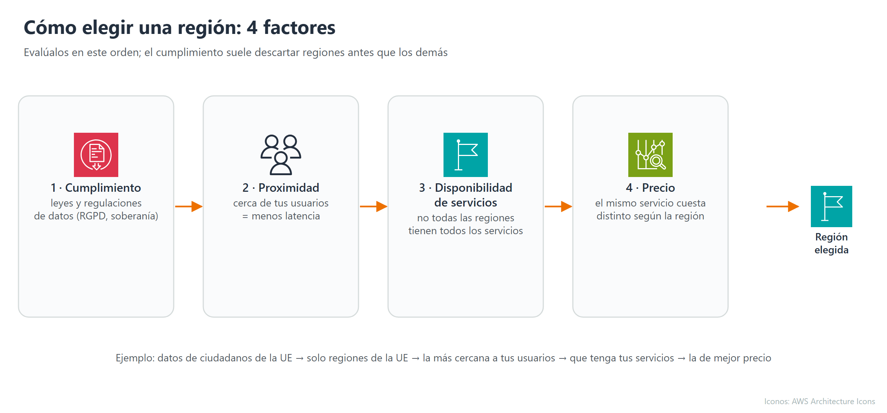

# 4.1 Cómo elegir las regiones de AWS

!!! abstract "En esta lección aprenderás a"
    Repasar los componentes básicos de la infraestructura global · describir cómo elegir una región o un conjunto de regiones según cumplimiento, proximidad, disponibilidad de servicios y precio.

## 1. La cafetería se expande (analogía del módulo)

| Si la cafetería… | En AWS es… |
| --- | --- |
| Abre **nuevas sucursales** pensando en la demanda y el costo de cada ciudad | **Elegir regiones** con criterios claros |
| Usa **carritos de café móviles** más pequeños cerca de los clientes | **Ubicaciones periféricas** que guardan contenido en caché |
| Quiere el **mismo café en todas las sucursales** | **Infraestructura como código** (CloudFormation) para configuraciones uniformes |

## 2. Los 4 factores para elegir una región

<figure markdown="span">
  
  <figcaption>Cumplimiento, proximidad, disponibilidad de servicios y precio.</figcaption>
</figure>

### 1. Cumplimiento

Cada lugar tiene sus propias **leyes de protección de datos y requisitos regulatorios**. Primero define qué requisitos debes cumplir y si tus datos deben quedarse en una región específica.

- **Ejemplo del curso:** el **Reglamento General de Protección de Datos (RGPD)** protege los datos personales de las personas en la Unión Europea. Una tienda en línea que opera en la UE debe cumplirlo: obtener el **consentimiento** adecuado para recopilar datos y dar mecanismos para **acceder** a ellos y **eliminarlos**.
- **Soberanía de datos:** algunas leyes exigen que los datos se guarden dentro del país, lo que afecta tanto al cumplimiento como al costo.
- **En Latinoamérica** también hay leyes de protección de datos, como la LOPDP en Ecuador, la Ley 1581 de 2012 en Colombia o la LFPDPPP en México. Revisa siempre la normativa del país de tus usuarios.

### 2. Proximidad

Las regiones **más cercanas a tus usuarios** reducen el tiempo de viaje de los datos, es decir, la **latencia**, y mejoran la respuesta de la aplicación. Una región lejana provoca demoras que afectan la satisfacción de los usuarios.

- **Ejemplo:** si la mayoría de tus clientes está en América, considera **us-east-1 (Virginia)**, **mx-central-1 (México)** o **sa-east-1 (São Paulo)**.

### 3. Disponibilidad de servicios y características

AWS lanza servicios nuevos cada año, pero **no todas las regiones tienen todas las ofertas**. Muchas novedades llegan primero a regiones como **us-east-1 (Virginia)** o **us-west-2 (Oregón)**.

- **Ejemplo del curso:** las regiones **AWS GovCloud (US)** están diseñadas para agencias del gobierno de EE. UU. y sus contratistas, con controles estrictos de seguridad física, operativa y de personal que solo existen ahí.

### 4. Precio

El **mismo servicio cuesta distinto según la región**. Influyen los costos operativos (energía, infraestructura), los **impuestos e incentivos fiscales** del lugar y las leyes de soberanía de datos.

!!! note "Nota rápida"
    El orden habitual es **cumplimiento → proximidad → servicios → precio**. Si una ley te obliga a una región, los demás factores pasan a segundo plano.

!!! example "Pruébalo en CloudShell"
    ```bash
    # ¿En qué regiones está disponible un servicio? (ejemplo: Amazon Bedrock)
    aws ssm get-parameters-by-path \
      --path /aws/service/global-infrastructure/services/bedrock/regions \
      --query "Parameters[].Value" --output text | tr '\t' '\n' | sort
    ```
    Cambia `bedrock` por otro servicio (`lambda`, `ec2`, `sagemaker`…) y compara.

## 3. Ejemplos resueltos

| Escenario | Factor decisivo | Decisión |
| --- | --- | --- |
| Fintech con clientes europeos sujetos al RGPD | Cumplimiento | Una región de la UE (eu-west-1 o eu-central-1) |
| Videojuego con jugadores en Brasil | Proximidad | sa-east-1 (São Paulo) |
| Startup que necesita un servicio recién lanzado | Disponibilidad | us-east-1 o us-west-2 |
| Procesamiento por lotes sin usuarios finales ni restricciones legales | Precio | La región más económica para ese servicio |
| Contratista del gobierno de EE. UU. | Cumplimiento + disponibilidad | AWS GovCloud (US) |

## Comprueba lo aprendido

**1.** Una ley exige que los datos de los ciudadanos no salgan del país. ¿Qué factor manda?

**2.** ¿Por qué elegir una región cercana a los usuarios?

**3.** ¿El precio de un servicio es el mismo en todas las regiones?

??? success "Ver respuestas"
    1. **Cumplimiento.**
    2. Para **reducir la latencia** y mejorar la experiencia.
    3. **No:** varía según la región.

## Para profundizar

- [Infraestructura global de AWS](https://aws.amazon.com/about-aws/global-infrastructure/) · [Servicios por región](https://aws.amazon.com/about-aws/global-infrastructure/regional-product-services/) · [AWS GovCloud (US)](https://aws.amazon.com/govcloud-us/)
