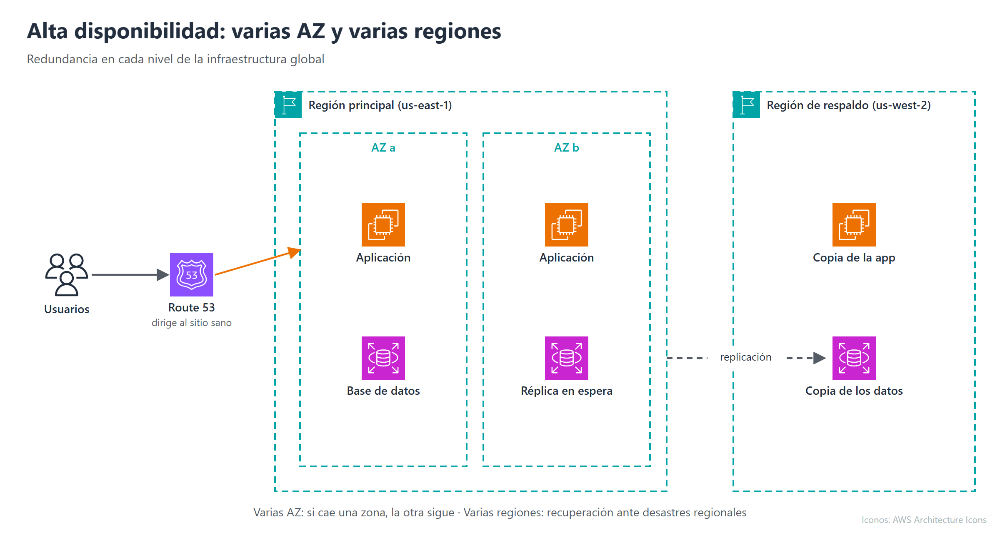
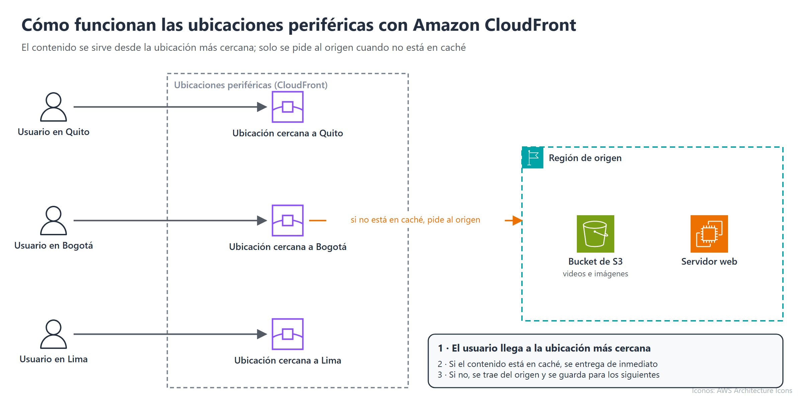

# 4.2 Profundizar en la infraestructura global

!!! abstract "En esta lección aprenderás a"
    Diseñar con varias regiones y varias AZ · diferenciar alta disponibilidad, agilidad y elasticidad · explicar las ubicaciones periféricas y Amazon CloudFront · conocer las extensiones de la infraestructura global.

## 1. Arquitecturas de alta disponibilidad

Además de desplegar en **varias regiones**, se recomienda desplegar en **varias zonas de disponibilidad**. Al crear arquitecturas **redundantes** en varios niveles de la infraestructura, la aplicación sigue disponible cuando los usuarios la necesitan.

<figure markdown="span">
  
  <figcaption>Redundancia en dos AZ de la región principal y copia en una región de respaldo.</figcaption>
</figure>

| Nivel de redundancia | Protege contra | Ejemplo |
| --- | --- | --- |
| Varias instancias en una AZ | Falla de un servidor | Grupo de Auto Scaling |
| **Varias AZ** | Falla de un centro de datos o de una AZ completa | Aplicación y base de datos con réplica en otra AZ |
| **Varias regiones** | Desastre regional, latencia global | Copia de la app y de los datos en otra región |

## 2. Tres beneficios de la infraestructura global

| Beneficio | Definición | Ejemplo |
| --- | --- | --- |
| **Alta disponibilidad** | Capacidad de funcionar de forma continua: la app tolera la falla de componentes sin un tiempo de inactividad significativo | Si cae una AZ, la otra sigue atendiendo |
| **Agilidad** | Capacidad de **adaptarse rápido** a requisitos o condiciones del mercado que cambian; modificas y despliegas servicios rápidamente | Lanzar en otro país en días, no en meses |
| **Elasticidad** | Capacidad de **aumentar o reducir recursos automáticamente** según la demanda | Más instancias en Navidad, menos en enero |

## 3. Ubicaciones periféricas y Amazon CloudFront

Además de las regiones, AWS tiene una **red periférica global**: sitios ubicados estratégicamente (el curso menciona, por ejemplo, Atlanta en EE. UU. y Shanghái en China) que dan acceso de **baja latencia** a usuarios que están fuera de las regiones. Guardan en **caché** datos, videos e imágenes y son parte de la **red de entrega de contenido (CDN)** de AWS.

**Amazon CloudFront** es la CDN de AWS y usa esas ubicaciones para distribuir contenido de forma eficiente.

<figure markdown="span">
  
  <figcaption>El usuario recibe el contenido desde la ubicación más cercana; si no está en caché, se pide al origen.</figcaption>
</figure>

1. El usuario solicita un video y su solicitud llega a la **ubicación periférica más cercana**.
2. Si el video está en **caché**, se entrega de inmediato.
3. Si no, la ubicación lo pide al **origen** (un bucket de S3 o un servidor en una región), lo entrega y lo **guarda** para los siguientes usuarios.

## 4. Elementos clave de la infraestructura global

| Elemento | Qué es |
| --- | --- |
| **Regiones de AWS** | Áreas geográficas con varios centros de datos que dan infraestructura escalable y redundante. Cada región tiene **3 o más AZ** aisladas. |
| **Zonas de disponibilidad** | Uno o más centros de datos con energía, red y conectividad redundantes dentro de una región. |
| **Ubicaciones periféricas** | Sitios que almacenan contenido en caché para entregar datos, videos y aplicaciones con menor latencia y mayor velocidad de transferencia; parte de la CDN de AWS. |

## 5. Extensiones de la infraestructura (complemento para el examen)

| Servicio | Qué aporta |
| --- | --- |
| **AWS Local Zones** | Extienden una región a grandes ciudades para tener latencia de un solo dígito de milisegundos |
| **AWS Wavelength** | Cómputo de AWS dentro de redes 5G de operadores móviles |
| **AWS Outposts** | Infraestructura de AWS en tu propio centro de datos (módulo 3) |
| **AWS Global Accelerator** | Usa la red global de AWS para acelerar el tráfico hacia tus aplicaciones |
| **Amazon Route 53** | Servicio DNS que también opera desde la red periférica |

## Comprueba lo aprendido

**1.** ¿Qué diferencia hay entre agilidad y elasticidad?

**2.** ¿Qué pasa cuando un contenido no está en la caché de una ubicación periférica?

**3.** ¿Qué servicio lleva cómputo a las redes 5G?

??? success "Ver respuestas"
    1. Agilidad es la **rapidez para adaptarse y desplegar**; elasticidad es **crecer y reducir automáticamente** según la demanda.
    2. La ubicación lo pide al **origen**, lo entrega y lo guarda en caché.
    3. **AWS Wavelength.**

## Para profundizar

- [AWS para la periferia](https://aws.amazon.com/edge/) · [Amazon CloudFront](https://aws.amazon.com/cloudfront/) · [AWS Local Zones](https://aws.amazon.com/about-aws/global-infrastructure/localzones/)
