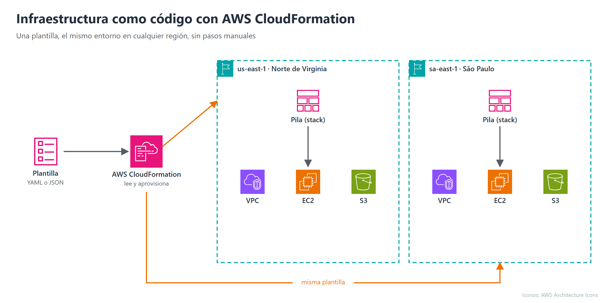

# 4.3 Infraestructura y automatización (IaC y CloudFormation)

!!! abstract "En esta lección aprenderás a"
    Describir las características y beneficios de AWS CloudFormation · identificar los casos de uso del acceso programático, la Consola de administración y la infraestructura como código.

## 1. Infraestructura como código (IaC)

La **IaC** consiste en **describir la infraestructura en archivos de código** en lugar de crearla con clics. Así puedes replicar tus recursos de una ubicación a otra con un esfuerzo mínimo.

| Beneficio | Por qué importa |
| --- | --- |
| **Coherencia** | Cada despliegue crea exactamente lo mismo: adiós a los "olvidé un paso" |
| **Repetibilidad** | El mismo entorno en desarrollo, pruebas, producción o en otra región |
| **Velocidad** | Un entorno completo en minutos |
| **Control de versiones** | La infraestructura se guarda en Git, se revisa y se puede revertir |
| **Documentación viva** | La plantilla describe exactamente qué existe |

## 2. AWS CloudFormation

Servicio que te permite **modelar y configurar tus recursos de AWS** para que dediques menos tiempo a administrarlos y más a tus aplicaciones. Escribes una **plantilla** con los recursos que quieres (por ejemplo, instancias de Amazon EC2) y CloudFormation se encarga de **aprovisionarlos y configurarlos** por ti.

<figure markdown="span">
  
  <figcaption>Una plantilla, la misma pila en dos regiones.</figcaption>
</figure>

| Concepto | Qué es |
| --- | --- |
| **Plantilla** | Archivo YAML o JSON que describe los recursos |
| **Pila (stack)** | El conjunto de recursos creados a partir de una plantilla; se crean, actualizan y eliminan juntos |
| **Conjunto de cambios** | Vista previa de lo que cambiará antes de actualizar una pila |
| **Reversión automática** | Si algo falla al crear, CloudFormation deshace lo que hizo |
| **Detección de desviaciones (drift)** | Avisa si alguien cambió un recurso a mano y ya no coincide con la plantilla |

Ejemplo mínimo de plantilla (es la que usarás en el [Laboratorio 4](laboratorio.md)):

```yaml
--8<-- "labs/modulo-04/lab-bucket.yaml"
```

!!! note "Nota rápida"
    CloudFormation **no tiene costo propio**: pagas solo los recursos que crea. Existe también el **AWS CDK**, que te deja definir la infraestructura con Python o TypeScript y genera plantillas de CloudFormation.

## 3. Formas de interactuar con los recursos de AWS

Para trabajar con AWS siempre invocas sus **API**. Puedes hacerlo de cuatro maneras:

| Forma | Qué es | Caso de uso típico |
| --- | --- | --- |
| **Consola de administración** | Interfaz web visual | Aprender, explorar, tareas puntuales, revisar facturación y monitoreo |
| **AWS CLI** (acceso programático) | Comandos desde la terminal | Automatizar tareas repetitivas con scripts |
| **AWS SDK** (acceso programático) | Bibliotecas para lenguajes de programación | Que tu aplicación use servicios de AWS |
| **IaC (CloudFormation)** | Plantillas de código | Crear entornos completos, repetibles y versionados en varias regiones o cuentas |

## Comprueba lo aprendido

**1.** ¿Qué servicio de AWS permite definir infraestructura como código con plantillas?

**2.** ¿Qué es una pila en CloudFormation?

**3.** ¿Cuál es la mejor forma de crear el mismo entorno en 5 regiones sin errores manuales?

??? success "Ver respuestas"
    1. **AWS CloudFormation.**
    2. El conjunto de recursos creados a partir de una plantilla, que se administran juntos.
    3. Una **plantilla de CloudFormation** (IaC).

## Para profundizar

- [AWS CloudFormation](https://aws.amazon.com/cloudformation/) · [Guía del usuario](https://docs.aws.amazon.com/AWSCloudFormation/latest/UserGuide/Welcome.html) · [AWS CDK](https://aws.amazon.com/cdk/)
