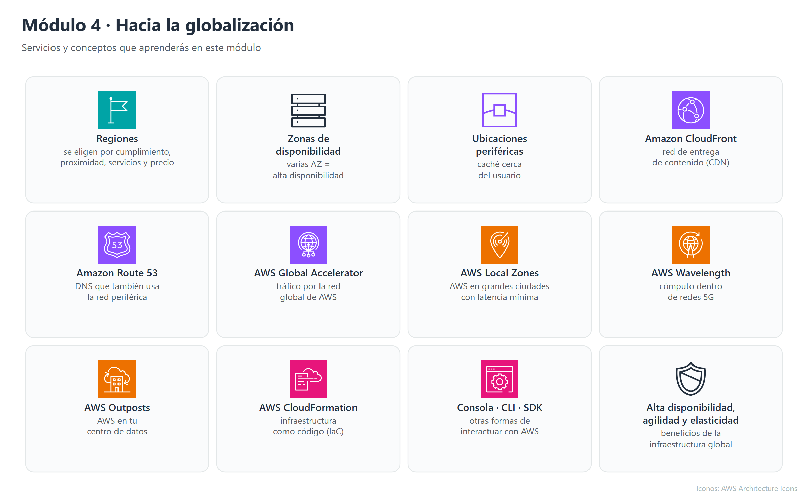

# Módulo 4 · Hacia la globalización

*Going Global* · Dominios del examen: **D1 Conceptos de la nube** y **D3 Tecnología y servicios**

!!! abstract "Resumen del módulo"
    Para elegir una región se evalúan **4 factores**: **cumplimiento**, **proximidad** (latencia), **disponibilidad de servicios** y **precio**. Desplegar en **varias AZ** y **varias regiones** da alta disponibilidad, y la infraestructura global aporta además **agilidad** y **elasticidad**. Las **ubicaciones periféricas** guardan contenido en caché cerca del usuario mediante **Amazon CloudFront**. Con **infraestructura como código** y **AWS CloudFormation** creas entornos idénticos y repetibles en cualquier región.

## Resultados de aprendizaje

1. Elegir una región aplicando los factores de cumplimiento, proximidad, disponibilidad de servicios y precio.
2. Diseñar con varias AZ y varias regiones para lograr alta disponibilidad.
3. Diferenciar alta disponibilidad, agilidad y elasticidad.
4. Explicar las ubicaciones periféricas, Amazon CloudFront y las extensiones de la infraestructura global.
5. Describir la infraestructura como código y los beneficios de AWS CloudFormation.
6. Elegir entre la consola, el acceso programático y la IaC según el caso.

## Mapa del módulo

<figure markdown="span">
  
  <figcaption>Servicios y conceptos del Módulo 4.</figcaption>
</figure>

## Lecciones

| Lección | Tema |
| --- | --- |
| [4.1](4-1-elegir-regiones.md) | Cómo elegir las regiones de AWS |
| [4.2](4-2-infraestructura-global.md) | Profundizar en la infraestructura global |
| [4.3](4-3-iac-cloudformation.md) | Infraestructura y automatización (IaC y CloudFormation) |
| [Laboratorio 4](laboratorio.md) | Infraestructura como código con CloudFormation |

## Servicios y conceptos del módulo

| Servicio o concepto | Qué es | Cómo funciona | Ejemplo o caso | Lección |
| --- | --- | --- | --- | --- |
| **Elección de región** | Decidir dónde desplegar | Cumplimiento → proximidad → servicios → precio | Datos de la UE en una región de la UE (RGPD) | 4.1 |
| **AWS GovCloud (US)** | Regiones aisladas para el gobierno de EE. UU. | Controles estrictos de seguridad y personal | Contratistas del gobierno de EE. UU. | 4.1 |
| **Multi-AZ y multirregión** | Redundancia en varios niveles | Réplicas en otra AZ y copia en otra región | Banco con región de respaldo | 4.2 |
| **Alta disponibilidad · agilidad · elasticidad** | Beneficios de la infraestructura global | Seguir operando · adaptarse rápido · escalar solo | Lanzar en otro país en días | 4.2 |
| **Ubicaciones periféricas** | Sitios con caché cerca del usuario | Entregan el contenido o lo piden al origen | Videos para usuarios en Atlanta o Shanghái | 4.2 |
| **Amazon CloudFront** | Red de entrega de contenido (CDN) | Distribuye datos, videos y apps desde la red periférica | Plataforma de streaming | 4.2 |
| **Local Zones · Wavelength · Global Accelerator** | Extensiones de la infraestructura | Ciudades · redes 5G · red global de AWS | Juegos con latencia mínima | 4.2 |
| **Infraestructura como código (IaC)** | Infraestructura descrita en código | Plantillas versionadas y repetibles | Mismo entorno en 3 regiones | 4.3 |
| **AWS CloudFormation** | Servicio de IaC de AWS | Plantilla → pila → recursos; cambios, reversión y desviaciones | Crear y replicar un bucket con código | 4.3 |

## Notas rápidas

!!! tip "Para repasar en 2 minutos"
    - **4 factores para elegir región:** cumplimiento · proximidad · disponibilidad de servicios · precio. Si hay una ley, manda el **cumplimiento**.
    - El **precio** de un mismo servicio cambia según la región.
    - **Varias AZ** = alta disponibilidad · **varias regiones** = recuperación ante desastres y alcance global.
    - **Agilidad** = adaptarse rápido · **elasticidad** = escalar solo · **alta disponibilidad** = seguir funcionando.
    - **Ubicación periférica + CloudFront** = caché cerca del usuario; si no está en caché, se pide al origen.
    - **CloudFormation** = IaC: plantilla → pila. **No cuesta**: pagas solo los recursos.
    - No confundas: **CloudFormation** (IaC) · **CloudFront** (CDN) · **CloudWatch** (monitoreo) · **CloudTrail** (auditoría).

## Evaluación del módulo

**1. Una ley exige que los datos de los clientes no salgan del país. ¿Qué factor manda al elegir la región?**

- a) Precio
- b) Proximidad
- c) Cumplimiento
- d) Disponibilidad de servicios

**2. ¿Para qué sirven principalmente las ubicaciones periféricas?**

- a) Ejecutar las bases de datos principales
- b) Guardar contenido en caché cerca de los usuarios para bajar la latencia
- c) Reemplazar las zonas de disponibilidad
- d) Guardar copias de seguridad a largo plazo

**3. ¿Qué servicio permite definir infraestructura como código con plantillas?**

- a) Amazon CloudFront
- b) AWS CloudFormation
- c) Amazon CloudWatch
- d) AWS CloudTrail

**4. Quieres que tu app siga disponible si falla un centro de datos dentro de la región. ¿Qué haces?**

- a) Usar una instancia más grande
- b) Desplegar en varias zonas de disponibilidad
- c) Usar más ubicaciones periféricas
- d) Cambiar a la región más barata

**5. Las regiones AWS GovCloud (US) son un ejemplo de:**

- a) Ubicaciones periféricas
- b) Servicios disponibles solo en ciertas regiones por requisitos de cumplimiento
- c) Zonas de disponibilidad de bajo costo
- d) Una CDN

**6. ¿Qué describe mejor la agilidad?**

- a) Escalar automáticamente según la demanda
- b) Adaptarse rápido a requisitos o mercados que cambian
- c) Funcionar sin interrupciones
- d) Pagar menos por recursos

**7. ¿Cuál es la mejor forma de crear el mismo entorno en 5 regiones sin errores manuales?**

- a) La Consola de administración
- b) Copiar capturas de pantalla
- c) Una plantilla de CloudFormation
- d) Amazon CloudFront

**8. ¿El mismo servicio de AWS puede costar distinto según la región?**

- a) Sí
- b) No, el precio es global

**9. Un videojuego necesita latencia de milisegundos para jugadores en una gran ciudad sin región propia. ¿Qué opción encaja?**

- a) AWS Local Zones
- b) AWS GovCloud
- c) AWS CloudFormation
- d) Una sola AZ

**10. ¿Qué afirmación sobre CloudFormation es correcta?**

- a) Cobra una tarifa por cada pila
- b) Solo funciona en us-east-1
- c) Si la creación falla, puede revertir automáticamente los cambios
- d) Reemplaza a CloudWatch

??? success "Ver respuestas y explicaciones"
    1. **c**: el cumplimiento normalmente se evalúa primero.
    2. **b**: almacenan contenido en caché y lo entregan con CloudFront.
    3. **b**: CloudFormation; CloudWatch monitorea y CloudTrail audita.
    4. **b**: varias AZ dan alta disponibilidad dentro de la región.
    5. **b**: no todos los servicios están en todas las regiones.
    6. **b**: agilidad es rapidez de adaptación; la opción a) es elasticidad.
    7. **c**: la IaC hace los despliegues repetibles.
    8. **a**: el precio es uno de los 4 factores.
    9. **a**: Local Zones acercan AWS a grandes ciudades.
    10. **c**: la reversión automática evita dejar recursos a medias; CloudFormation no tiene costo propio.

## Trampas típicas del examen

!!! warning "No te confundas"
    - **Elasticidad** (automática, en tiempo real) ≠ **escalabilidad** (capacidad de crecer) ≠ **agilidad** (rapidez para cambiar).
    - **CloudFormation** (IaC) ≠ **CloudFront** (CDN) ≠ **CloudWatch** (monitoreo) ≠ **CloudTrail** (auditoría de llamadas a la API).
    - Las ubicaciones periféricas **no** reemplazan a las regiones ni a las AZ: sirven para caché y servicios cercanos al usuario.
    - Si la pregunta habla de leyes o soberanía de datos, la respuesta suele ser **cumplimiento**.

## Recursos

- [Infraestructura global de AWS](https://aws.amazon.com/about-aws/global-infrastructure/) · [AWS para la periferia](https://aws.amazon.com/edge/) · [AWS CloudFormation](https://aws.amazon.com/cloudformation/)
