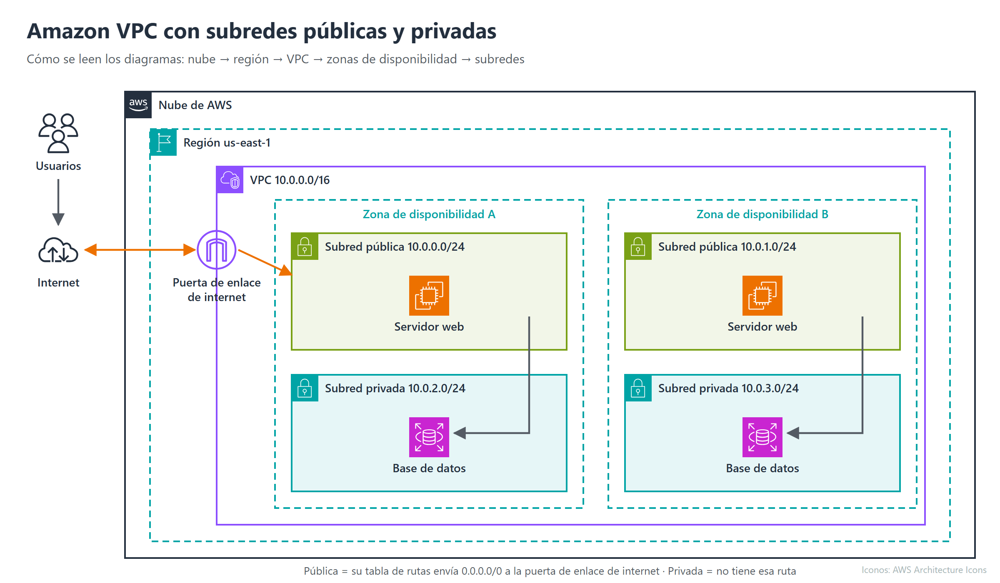

# 5.1 Introducción a las redes: VPC y subredes

!!! abstract "En esta lección aprenderás a"
    Describir qué es una nube virtual privada (VPC) y para qué sirve · describir qué es una subred y para qué sirve · diferenciar una subred pública de una privada · leer un diagrama de arquitectura.

## 1. Redes en la nube

**Redes** son dispositivos interconectados que intercambian datos y recursos. En AWS, las redes son la infraestructura y los servicios que trabajan juntos para alojar tus aplicaciones, datos y demás recursos.

## 2. Amazon VPC (Virtual Private Cloud)

Una **Amazon VPC** te permite aprovisionar una **sección aislada de forma lógica** de la nube de AWS, donde lanzas recursos en una **red virtual que tú defines**: eliges su rango de direcciones IP, sus subredes, sus rutas y sus reglas de seguridad. Es **única y privada** para tu cuenta.

!!! tip "Analogía"
    La nube de AWS es una ciudad enorme; tu VPC es un **terreno cercado** dentro de ella. Dentro del terreno decides dónde va cada edificio (subredes), qué puertas dan a la calle (puertas de enlace) y quién puede entrar (reglas de seguridad).

## 3. Subredes

Las **subredes** dividen la VPC en secciones para **organizar los recursos**. Cada subred es un **rango de direcciones IP** dentro de la VPC y vive en **una sola zona de disponibilidad**.

| Tipo | Para qué | Ejemplo |
| --- | --- | --- |
| **Subred pública** | Recursos que deben ser accesibles desde internet | El sitio web de la tienda |
| **Subred privada** | Recursos que no deben exponerse a internet | La base de datos con información de clientes o transacciones |

!!! note "Nota rápida"
    Lo que hace **pública** a una subred es que su **tabla de rutas** envía el tráfico de internet (`0.0.0.0/0`) a una **puerta de enlace de internet**. Una subred privada no tiene esa ruta.

## 4. Cómo leer un diagrama de arquitectura

Un diagrama es el **mapa de tu red** en AWS: muestra cómo los usuarios o las aplicaciones llegan a los servicios, recursos y datos. De un vistazo se ve si la red tiene redundancia, seguridad y escalabilidad, y sirve como plano para no olvidar conexiones importantes.

<figure markdown="span">
  
  <figcaption>VPC con una subred pública y una privada en cada zona de disponibilidad.</figcaption>
</figure>

Lee el diagrama de afuera hacia adentro:

1. **La nube de AWS** es el cuadro más grande.
2. **La región** es el siguiente cuadro: se elige según la ubicación de los usuarios, el cumplimiento y la residencia de datos, los servicios disponibles y el costo.
3. **La VPC** es tu red aislada y segmentada dentro de AWS.
4. **Las zonas de disponibilidad** son cuadros independientes dentro de la región; usar varias protege contra la falla de una ubicación.
5. **Las subredes** son segmentos de la VPC dentro de cada AZ. En los [iconos oficiales de AWS](https://aws.amazon.com/architecture/icons/), la **subred pública** usa el color verde y la **privada** el turquesa.
6. **Las puertas de enlace** (como la de internet) marcan por dónde entra y sale el tráfico.

## 5. Para profundizar: rangos de IP (CIDR)

El rango de la VPC se escribe en notación **CIDR**, por ejemplo `10.0.0.0/16` (unas 65 000 direcciones). Cada subred toma una parte: `10.0.1.0/24` tiene 256 direcciones (AWS reserva 5 en cada subred). El número después de la barra indica cuántos bits son fijos: cuanto más grande, más pequeño el rango.

!!! example "Pruébalo en CloudShell"
    Toda cuenta trae una **VPC predeterminada** en cada región, con una subred pública por AZ:
    ```bash
    aws ec2 describe-vpcs --filters Name=is-default,Values=true \
      --query "Vpcs[].[VpcId,CidrBlock]" --output table
    aws ec2 describe-subnets --filters Name=default-for-az,Values=true \
      --query "Subnets[].[AvailabilityZone,CidrBlock,MapPublicIpOnLaunch]" --output table
    ```

## Pregunta tipo examen

**¿Para qué sirve una subred? (elige tres)**

- a) Para compartir recursos públicos
- b) Para dar alta disponibilidad por sí sola
- c) Para organizar los recursos
- d) Para aislar recursos y mantenerlos privados
- e) Para administrar los servicios desde una interfaz centralizada

??? success "Ver explicación"
    **a, c y d.** Una subred sirve para **organizar los recursos**, para **compartir recursos públicos** (subred pública) y para **aislar recursos y mantenerlos privados** (subred privada). La alta disponibilidad viene de usar **varias zonas de disponibilidad**, y la interfaz centralizada para administrar servicios es la **Consola de administración**.

## Comprueba lo aprendido

**1.** ¿En qué subred pondrías la base de datos de clientes?

**2.** ¿Qué convierte a una subred en pública?

??? success "Ver respuestas"
    1. En una **subred privada**.
    2. Que su tabla de rutas tenga una ruta hacia una **puerta de enlace de internet**.

## Para profundizar

- [Amazon VPC](https://aws.amazon.com/vpc/) · [¿Qué es Amazon VPC?](https://docs.aws.amazon.com/vpc/latest/userguide/what-is-amazon-vpc.html) · [Iconos de arquitectura de AWS](https://aws.amazon.com/architecture/icons/)
