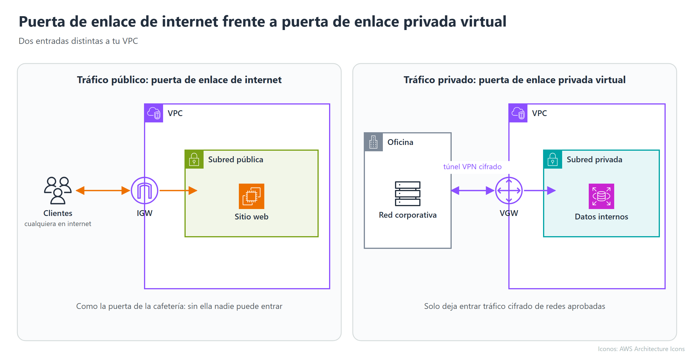

# 5.2 Organización de los recursos: VPC, puertas de enlace y VPN

!!! abstract "En esta lección aprenderás a"
    Definir qué es una puerta de enlace privada virtual y para qué sirve · identificar los componentes principales de una VPC · definir una puerta de enlace de internet y para qué sirve.

## 1. Por qué hacen falta límites

Imagina los millones de clientes de AWS y los millones de recursos que crearon, como instancias de EC2. Sin límites, el tráfico podría fluir entre ellos sin restricciones. Para organizar tus recursos necesitas dos piezas: **Amazon VPC** (para poner límites) y **puertas de enlace** (para decidir qué tráfico entra y sale).

## 2. Amazon VPC y sus beneficios

Con Amazon VPC aprovisionas una sección aislada de la nube de AWS y lanzas recursos en una red virtual que tú defines.

| Beneficio | Qué significa |
| --- | --- |
| **Mayor seguridad** | Proteges y supervisas las conexiones, controlas el tráfico y restringes el acceso a las instancias |
| **Control total** | Decides la ubicación de tus recursos, su conectividad y su seguridad |
| **Conveniencia** | Configurar, administrar y validar la red virtual lleva menos tiempo que una red en tus instalaciones |

**Subredes:** dentro de la VPC organizas los recursos en subredes, que son fragmentos del rango de direcciones IP de la VPC y controlan qué recursos son públicos y cuáles privados ([lección 5.1](5-1-vpc-subredes.md)). Para darles alcance y controlar el acceso necesitas una **puerta de enlace (gateway)**.

## 3. Puerta de enlace de internet (IGW)

Para que el tráfico público de internet llegue a tu VPC, **adjuntas una puerta de enlace de internet** a la VPC. Es la conexión entre la VPC e internet.

!!! tip "Analogía del curso"
    La puerta de enlace de internet es como **la puerta por la que entran los clientes a la cafetería**. Sin ella, nadie puede acceder a los recursos de tu VPC.

## 4. Puerta de enlace privada virtual y VPN

¿Y si tu VPC solo tiene recursos privados? Internet es como el camino entre tu casa y la cafetería: está abierto y cualquiera puede usarlo. Para que nadie (el público, el proveedor de internet u otras personas) intercepte lo que envías, usas una **conexión de red privada virtual (VPN)**.

- Una **VPN** crea algo parecido a un **túnel seguro a través de internet**: con **cifrado** oculta y protege todo lo que envías y recibes.
- La **puerta de enlace privada virtual** es el componente de AWS que permite que ese tráfico protegido **entre a la VPC**.
- Con ella estableces una VPN entre tu VPC y una red privada (un centro de datos o una red corporativa), y solo deja pasar tráfico que viene de una **red aprobada**.

<figure markdown="span">
  
  <figcaption>Tráfico público por la IGW frente a tráfico cifrado por la puerta de enlace privada virtual.</figcaption>
</figure>

## 5. No confundas estas siglas

| Término | Qué hace |
| --- | --- |
| **VPC** (nube virtual privada) | Establece **límites** para tus recursos de AWS |
| **Puerta de enlace privada virtual** | Permite que el **tráfico protegido** entre en la VPC |
| **VPN** (red privada virtual) | **Cifra** el tráfico por internet para que nadie lo intercepte o supervise |
| **Puerta de enlace de internet** | Permite el tráfico **público** entre internet y la VPC |

!!! note "Nota rápida"
    Para una conexión aún más confiable existe **AWS Direct Connect**: una conexión de fibra **dedicada** desde tu centro de datos hasta AWS, como una línea física hasta tu VPC. La ves en detalle en la [lección 5.3](5-3-conectividad.md).

## Pregunta tipo examen

**Una empresa quiere conectar su centro de datos con AWS por internet de forma segura, y mantener sus recursos en AWS aislados del público. ¿Qué combinación usa?**

- a) Puerta de enlace de internet y subred pública
- b) Puerta de enlace privada virtual, conexión VPN y subred privada
- c) Puerta de enlace de internet, VPN y subred privada
- d) Solo una subred pública con un grupo de seguridad

??? success "Ver explicación"
    **b.** La **VPN** cifra el tráfico, la **puerta de enlace privada virtual** solo acepta redes aprobadas y la **subred privada** mantiene los recursos fuera del alcance de internet. Las opciones con **puerta de enlace de internet** exponen los recursos al público, que es justo lo que se quiere evitar.

## Comprueba lo aprendido

**1.** ¿Qué componente necesitas para que los clientes entren desde internet a tu sitio web en la VPC?

**2.** ¿Qué diferencia hay entre una VPN y una puerta de enlace privada virtual?

??? success "Ver respuestas"
    1. Una **puerta de enlace de internet**.
    2. La **VPN** es la conexión cifrada (el túnel); la **puerta de enlace privada virtual** es el componente de AWS por donde ese túnel entra a la VPC.

## Para profundizar

- [Puertas de enlace de internet](https://docs.aws.amazon.com/vpc/latest/userguide/VPC_Internet_Gateway.html) · [AWS Site-to-Site VPN](https://aws.amazon.com/vpn/site-to-site-vpn/)
