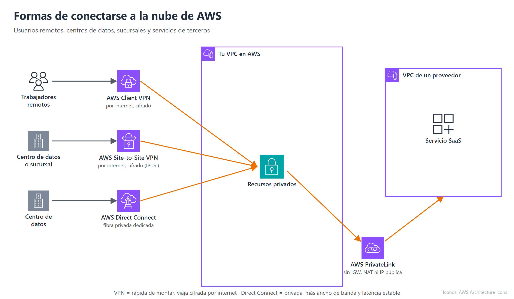
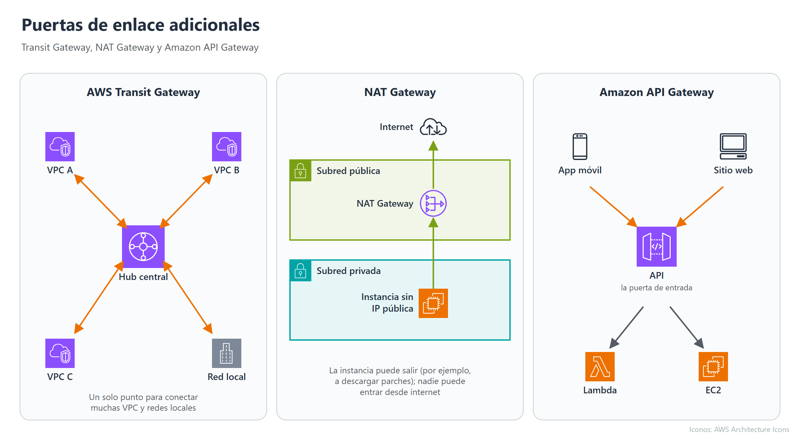

# 5.3 Más formas de conectarse a la nube de AWS

!!! abstract "En esta lección aprenderás a"
    Describir AWS Client VPN, AWS Site-to-Site VPN, AWS PrivateLink y AWS Direct Connect, y cuándo usar cada uno · conocer las puertas de enlace adicionales: Transit Gateway, NAT Gateway y Amazon API Gateway.

## 1. Panorama

Las empresas tienen redes distintas, centros de datos propios y trabajadores remotos, así que necesitan varias formas de conectarse a AWS.

<figure markdown="span">
  
  <figcaption>Usuarios remotos, centros de datos, sucursales y servicios de terceros conectados a tu VPC.</figcaption>
</figure>

## 2. AWS Client VPN: trabajadores remotos

**Caso del curso:** una empresa que acaba de adquirir otra debe conectar a su personal remoto a los recursos en la nube de forma segura, y escalar rápido aunque tenga trabajadores en todo el mundo.

- **Qué es:** un servicio de VPN **elástico y totalmente administrado** para conectar trabajadores remotos y redes locales a la nube. Escala automáticamente según la cantidad de usuarios.
- **Ventaja clave:** al ser una VPN en la nube, no instalas ni administras hardware ni calculas cuántos usuarios simultáneos tendrás.
- **Beneficios:** autenticación avanzada y acceso remoto; elástico y totalmente administrado.
- **Caso de uso:** escalar rápidamente el acceso de trabajadores remotos.

## 3. AWS Site-to-Site VPN: sedes completas

- **Qué es:** una conexión **segura y cifrada** entre tu centro de datos o tus sucursales y los recursos de tu VPC.
- **Beneficios:** alta disponibilidad, sesiones seguras y privadas y aceleración de las aplicaciones.
- **Casos de uso:** migración de aplicaciones y comunicación segura entre ubicaciones remotas.

## 4. AWS PrivateLink: servicios como si estuvieran en tu VPC

- **Qué es:** tecnología escalable y de alta disponibilidad para conectar **de forma privada** tu VPC a servicios y recursos (de AWS, de otros proveedores o de otras VPC) **como si estuvieran dentro de tu VPC**.
- **Lo que no necesitas:** puerta de enlace de internet, dispositivo NAT, IP pública, Direct Connect ni Site-to-Site VPN.
- **Control:** tú decides qué puntos de conexión de API, servicios y recursos se pueden alcanzar desde tu VPC.
- **Caso de uso:** consumir un servicio de un proveedor (por ejemplo, de pagos) sin que el tráfico pase por internet.

## 5. AWS Direct Connect: conexión privada dedicada

- **Qué es:** una **conexión privada dedicada** entre tu red y tu VPC; como una línea de fibra física que **no pasa por internet**.
- **Beneficios:** **reduce los costos de red** y **aumenta el ancho de banda**, con una latencia más estable.
- **Para profundizar:** se instala en una ubicación de Direct Connect y puede tardar semanas; no cifra por defecto, así que para cifrar o como respaldo se combina con una VPN.

## 6. Comparación de las cuatro opciones

| Servicio | Conecta | Por dónde viaja | Elegirlo cuando… |
| --- | --- | --- | --- |
| **AWS Client VPN** | Personas (cada usuario) | Internet, cifrado | Tienes trabajadores remotos que deben entrar de forma segura |
| **AWS Site-to-Site VPN** | Redes completas (centro de datos, sucursal) | Internet, cifrado | Necesitas una conexión segura rápida de montar |
| **AWS PrivateLink** | Tu VPC con servicios | Red privada de AWS | Quieres consumir un servicio sin exponerte a internet |
| **AWS Direct Connect** | Tu centro de datos con AWS | Línea privada dedicada | Mueves grandes volúmenes, quieres latencia estable o bajar costos de transferencia |

## 7. Puertas de enlace adicionales

<figure markdown="span">
  
  <figcaption>Transit Gateway como hub, NAT Gateway para salir desde subredes privadas y API Gateway como puerta de entrada a tus servicios.</figcaption>
</figure>

| Servicio | Para qué sirve | Ejemplo |
| --- | --- | --- |
| **AWS Transit Gateway** | Un **punto central (hub)** que conecta muchas VPC y redes locales, en lugar de decenas de conexiones punto a punto | Una corporación con 40 VPC y 3 oficinas |
| **NAT Gateway** | Permite que recursos de una **subred privada salgan a internet** (por ejemplo, para descargar parches) sin que nadie pueda entrar desde afuera | Servidores de base de datos que necesitan actualizaciones |
| **Amazon API Gateway** | Crear, publicar, proteger y monitorear **API** a cualquier escala; es la puerta de entrada a tus servicios (no conecta redes) | Una app móvil que llama a funciones Lambda |

!!! danger "Ojo con la factura"
    El **NAT Gateway** se cobra por hora y por GB procesado, aunque no lo uses. Si lo creas para practicar, elimínalo el mismo día.

## Preguntas tipo examen

**1. Una empresa migrará gran parte de su centro de datos a AWS y mantendrá otra parte en sus instalaciones, con transferencias constantes de datos. Necesita mucho ancho de banda. ¿Qué usa?**

- a) AWS Client VPN
- b) AWS Site-to-Site VPN
- c) AWS Direct Connect
- d) AWS PrivateLink

**2. Se necesita una puerta de enlace que solo deje entrar tráfico protegido de una red aprobada hacia una subred privada. ¿Cuál es?**

- a) Puerta de enlace de internet
- b) Puerta de enlace privada virtual
- c) NAT Gateway
- d) Amazon API Gateway

??? success "Ver explicaciones"
    1. **c.** Una migración grande en una **nube híbrida** necesita **alto ancho de banda** y latencia estable: una línea dedicada de **Direct Connect**. Client VPN es para usuarios individuales, Site-to-Site VPN viaja por internet con menos ancho de banda y PrivateLink sirve para acceder a servicios, no para conectar un centro de datos.
    2. **b.** La **puerta de enlace privada virtual** acepta tráfico VPN de redes aprobadas. Una puerta de enlace de internet dejaría entrar tráfico público.

## Comprueba lo aprendido

**1.** Cientos de empleados remotos necesitan acceso seguro a AWS. ¿Qué usas?

**2.** ¿Qué servicio permite que instancias privadas descarguen parches sin ser accesibles desde internet?

**3.** ¿Qué servicio conecta 30 VPC y dos centros de datos desde un único punto?

??? success "Ver respuestas"
    1. **AWS Client VPN.**
    2. Un **NAT Gateway**.
    3. **AWS Transit Gateway.**

## Para profundizar

- [AWS Client VPN](https://aws.amazon.com/vpn/client-vpn/) · [AWS Site-to-Site VPN](https://aws.amazon.com/vpn/site-to-site-vpn/) · [AWS PrivateLink](https://aws.amazon.com/privatelink/) · [AWS Direct Connect](https://aws.amazon.com/directconnect/)
- [AWS Transit Gateway](https://aws.amazon.com/transit-gateway/) · [NAT Gateways](https://docs.aws.amazon.com/vpc/latest/userguide/vpc-nat-gateway.html) · [Amazon API Gateway](https://aws.amazon.com/api-gateway/)
