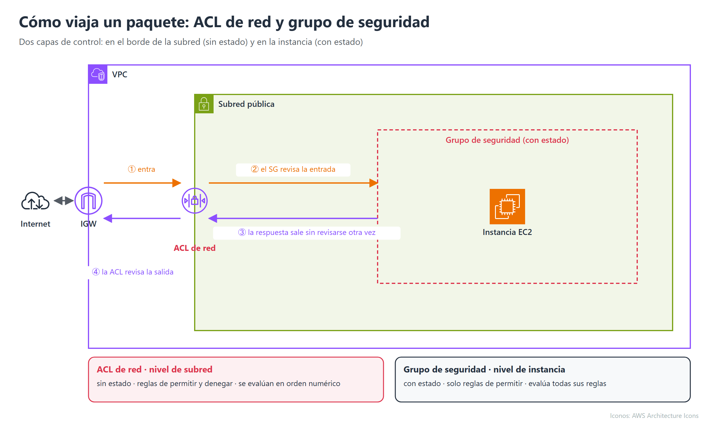

# 5.4 Subredes, grupos de seguridad y ACL de red

!!! abstract "En esta lección aprenderás a"
    Describir cómo viaja el tráfico de red en una VPC · explicar cómo funcionan los grupos de seguridad (con estado) y las ACL de red (sin estado) · identificar quién es responsable de proteger las subredes según el modelo de responsabilidad compartida.

## 1. Dos capas de seguridad de red

AWS ofrece muchas formas de proteger tus recursos. Dos de las más eficaces y flexibles para controlar el tráfico dentro de la VPC son los **grupos de seguridad** y las **listas de control de acceso de red (ACL de red)**. Usarlas bien en el diseño de tu red cubre los requisitos de cada aplicación y garantiza la seguridad básica.

## 2. Subredes

Una **subred** es una sección de la VPC donde agrupas recursos según necesidades **operativas o de seguridad**.

- **Públicas:** recursos que el público debe poder usar, como el sitio web de una tienda en línea.
- **Privadas:** recursos accesibles solo por una red privada, como la base de datos con información personal de clientes e historiales de pedidos.
- Puedes definir reglas para que subredes distintas se comuniquen. Ejemplo: instancias EC2 en una subred pública que consultan una base de datos en una subred privada.

## 3. Cómo viaja el tráfico en una VPC

Cuando un cliente pide datos a tu aplicación, la solicitud viaja como **paquetes** (unidades de datos que se envían por la red).

1. El paquete **entra a la VPC por la puerta de enlace de internet**.
2. Antes de entrar o salir de una subred pasa varias comprobaciones; una es la **ACL de red** de la subred, que indica qué está permitido o denegado según quién envía el paquete y cómo intenta comunicarse.
3. Ya dentro de la subred, el **grupo de seguridad** decide si el paquete puede llegar a la instancia.

<figure markdown="span">
  
  <figcaption>El paquete pasa por la ACL de red (borde de la subred) y por el grupo de seguridad (instancia).</figcaption>
</figure>

## 4. ACL de red: el control de pasaportes

Una **ACL de red** es un **firewall virtual** que controla el tráfico **entrante y saliente a nivel de subred**.

!!! tip "Analogía del curso"
    En un aeropuerto, los viajeros son los paquetes y el **oficial de control de pasaportes** es la ACL de red. Revisa las credenciales de cada viajero **al entrar y otra vez al salir** del país.

- **ACL predeterminada:** cada cuenta tiene una; **permite todo** el tráfico entrante y saliente, aunque puedes modificarla.
- **ACL personalizada:** **deniega todo** el tráfico entrante y saliente hasta que agregues reglas.
- **Regla de denegación explícita:** todas las ACL tienen una regla final que deniega cualquier paquete que no coincida con las demás.
- **Reglas numeradas:** se evalúan en orden, de menor a mayor número, y gana la primera que coincide.

### Filtrado de paquetes sin estado

Las ACL de red **no recuerdan nada**: revisan cada paquete que cruza el borde de la subred **en ambos sentidos**. Si una instancia envía una solicitud a internet, cuando vuelve la respuesta la ACL **no recuerda** la solicitud y vuelve a comparar el paquete con sus reglas para decidir si lo permite.

## 5. Grupos de seguridad: el portero del edificio

Un **grupo de seguridad** es un **firewall virtual** que controla el tráfico entrante y saliente **de recursos específicos**, como las instancias de EC2.

- **Por defecto:** **deniega todo el tráfico entrante** y **permite todo el saliente**.
- **Reglas personalizadas:** agregas qué tráfico permitir; lo demás se deniega. Las reglas de entrada y de salida se configuran por separado. **Solo hay reglas de permitir.**
- Varias instancias de la misma VPC pueden compartir un grupo de seguridad o usar grupos distintos.

!!! tip "Analogía del curso"
    En un edificio de departamentos, los invitados son los paquetes y el **portero** es el grupo de seguridad. Revisa la lista cuando llegan, pero **no vuelve a revisarla cuando salen**.

### Filtrado de paquetes con estado

Los grupos de seguridad **recuerdan** las decisiones anteriores. Si una instancia envía una solicitud a internet, cuando vuelve la respuesta el grupo de seguridad **recuerda la solicitud** y deja pasar la respuesta, sin importar las reglas de entrada.

## 6. Comparación

| Característica | Grupos de seguridad | ACL de red |
| --- | --- | --- |
| **Alcance** | Nivel de instancia (se asocian a instancias de EC2) | Nivel de subred (se asocian a subredes) |
| **Estado** | Con estado: recuerda | Sin estado: no recuerda |
| **Tipos de reglas** | Solo **permitir** | **Permitir** y **denegar** |
| **Tráfico de retorno** | Se permite automáticamente si se permitió la entrada | Debe permitirse explícitamente en ambos sentidos |
| **Evaluación** | Todas las reglas | En orden numérico; gana la primera que coincide |
| **Por defecto** | Niega toda entrada, permite toda salida | La predeterminada permite todo; una personalizada nueva niega todo |
| **Uso** | Control detallado de cada instancia | Control amplio del tráfico que entra y sale de las subredes |

## 7. Responsabilidad compartida

Proteger las subredes y los recursos de tu VPC con **ACL de red y grupos de seguridad es responsabilidad del cliente**. Son defensas fundamentales para proteger tus aplicaciones **EN** la nube.

!!! note "Notas rápidas"
    - Para bloquear una IP específica necesitas una **ACL de red** (los grupos de seguridad no tienen reglas de denegar).
    - Las respuestas que vuelven a un cliente usan **puertos efímeros** (1024-65535): en una ACL personalizada debes permitirlos en la salida.
    - Un grupo de seguridad puede usar **otro grupo de seguridad como origen** (por ejemplo, "solo los servidores web pueden hablar con la base de datos").

Compruebas todo esto con tus propias manos en el [Laboratorio 5](laboratorio.md).

## Preguntas tipo examen

**1. Un cliente necesita reglas de tráfico detalladas para cada instancia de EC2 de su aplicación, que está en una subred pública. ¿Qué usa?**

- a) ACL de red
- b) Grupos de seguridad
- c) Convertir todas las subredes en privadas
- d) Una puerta de enlace privada virtual

**2. ¿Qué componente hace filtrado de paquetes sin estado?**

- a) Grupo de seguridad
- b) ACL de red
- c) La VPC
- d) Una subred privada

??? success "Ver explicaciones"
    1. **b.** Los **grupos de seguridad** actúan a nivel de instancia. Las ACL de red actúan a nivel de **subred**, y volver privadas todas las subredes no sirve para una aplicación que debe estar en una subred pública.
    2. **b.** La **ACL de red** revisa cada paquete al entrar y al salir sin recordar decisiones anteriores. Los grupos de seguridad son **con estado**, y la VPC y la subred privada no son filtros de paquetes.

## Para profundizar

- [Grupos de seguridad](https://docs.aws.amazon.com/vpc/latest/userguide/vpc-security-groups.html) · [ACL de red](https://docs.aws.amazon.com/vpc/latest/userguide/vpc-network-acls.html)
