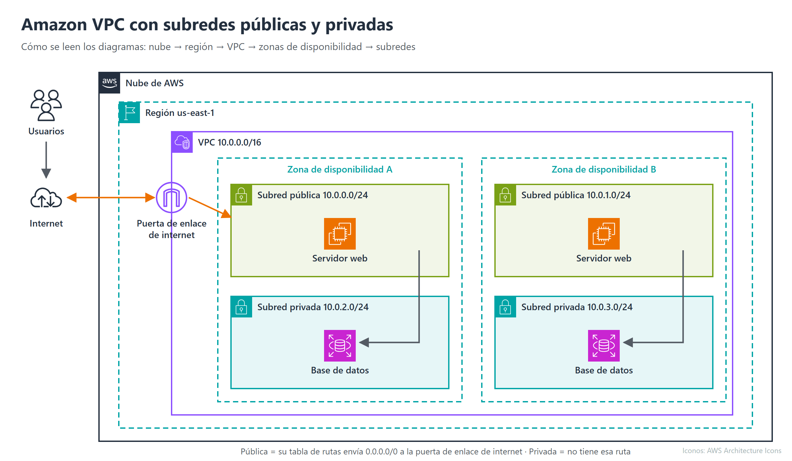

# 5.5 Demostración de Amazon VPC

!!! abstract "En esta lección aprenderás a"
    Acceder a la Consola de administración · revisar los pasos para crear una VPC · crear subredes públicas y privadas · crear y adjuntar una puerta de enlace de internet · crear una tabla de rutas, agregar rutas y asociar las subredes públicas.

## 1. Qué se construye en la demostración

Una VPC con **subredes públicas y privadas en dos zonas de disponibilidad**, una **puerta de enlace de internet** y **tablas de rutas**. Es la misma arquitectura del diagrama de la [lección 5.1](5-1-vpc-subredes.md).

<figure markdown="span">
  
  <figcaption>La arquitectura que se construye: dos AZ con subred pública y privada cada una.</figcaption>
</figure>

## 2. Paso a paso

| Paso | Qué se hace en la consola | Por qué |
| --- | --- | --- |
| 1 | **VPC → Sus VPC → Crear VPC** (solo VPC) con un rango CIDR, por ejemplo `10.0.0.0/16` | Define el espacio de direcciones de tu red |
| 2 | **Subredes → Crear subred**: dos públicas (`10.0.0.0/24`, `10.0.1.0/24`) y dos privadas (`10.0.2.0/24`, `10.0.3.0/24`), una de cada tipo en cada AZ | Separar lo público de lo privado y tener redundancia entre AZ |
| 3 | **Puertas de enlace de internet → Crear** y luego **Acciones → Adjuntar a la VPC** | Sin IGW no hay salida ni entrada desde internet |
| 4 | **Tablas de rutas → Crear tabla de rutas** para la VPC | Las subredes públicas necesitan su propia tabla |
| 5 | En esa tabla: **Editar rutas → Agregar ruta** `0.0.0.0/0` → destino la **IGW** | Es la ruta que hace pública a una subred |
| 6 | **Asociaciones de subred → Editar** y asociar las **dos subredes públicas** | Las privadas se quedan con la tabla principal, que solo tiene la ruta `local` |

!!! note "Nota rápida"
    Toda tabla de rutas tiene una ruta **local** (el rango de la VPC) que permite que las subredes se comuniquen entre sí. La diferencia entre pública y privada es solo la ruta hacia la IGW.

## 3. Atajo: el asistente "VPC y más"

Al crear una VPC puedes elegir **VPC y más**: el asistente crea en un solo paso la VPC, las subredes en varias AZ, la IGW y las tablas de rutas ya asociadas. Es lo que usarás en el [laboratorio de este módulo](laboratorio.md).

!!! danger "Ojo con el costo"
    El asistente puede proponer **NAT Gateways**, que se cobran por hora aunque no los uses. Para practicar, elige **Ninguno**.

## Comprueba lo aprendido

**1.** ¿Qué ruta necesita la tabla de rutas de una subred pública?

**2.** ¿Qué se hace con la puerta de enlace de internet después de crearla?

??? success "Ver respuestas"
    1. `0.0.0.0/0` con destino la **puerta de enlace de internet**.
    2. **Adjuntarla a la VPC.**

## Para profundizar

- [Tablas de rutas](https://docs.aws.amazon.com/vpc/latest/userguide/VPC_Route_Tables.html) · [Crear una VPC](https://docs.aws.amazon.com/vpc/latest/userguide/create-vpc.html)
