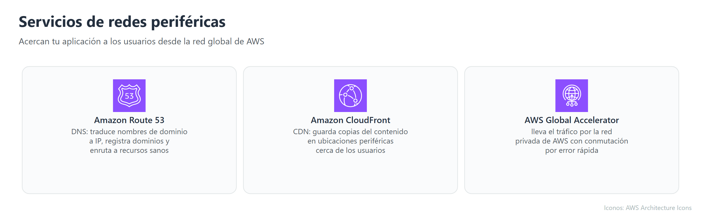
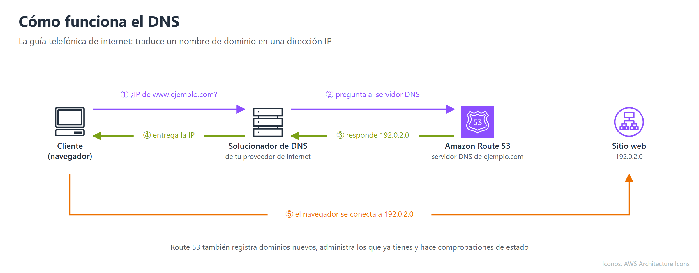
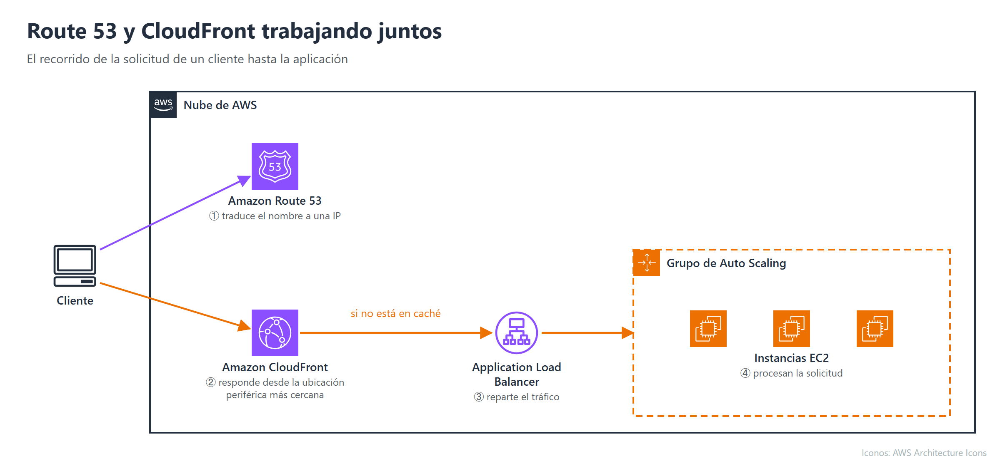
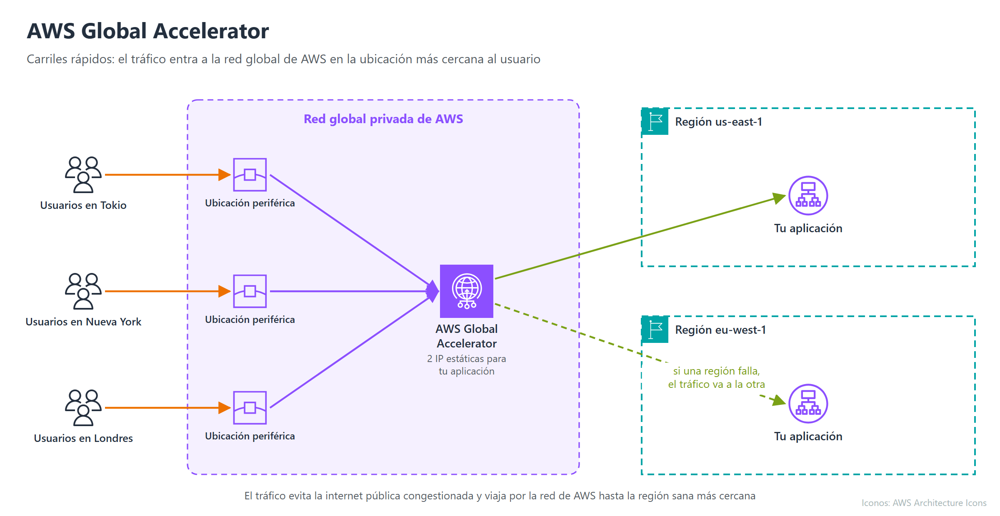

# 5.6 Redes globales: DNS, Route 53, CloudFront y Global Accelerator

!!! abstract "En esta lección aprenderás a"
    Definir qué es el sistema de nombres de dominio (DNS) y para qué sirve · describir los beneficios y casos de uso de Amazon Route 53 · describir los beneficios y casos de uso de Amazon CloudFront · explicar qué hace AWS Global Accelerator y en qué se diferencia de CloudFront.

## 1. Redes periféricas: acercar la nube al usuario

Las **redes periféricas** (edge networking) acercan la capacidad de cómputo y de almacenamiento a los dispositivos que producen la información y a los usuarios que la consumen. Importan porque las organizaciones necesitan **menor latencia**: si una tarea se ejecuta o un contenido se guarda en caché cerca del usuario, la experiencia es más rápida y la empresa mantiene el control de su infraestructura. En la [lección 4.2](../modulo-04/4-2-infraestructura-global.md) viste las **ubicaciones periféricas**; ahora verás los tres servicios que más las usan.

<figure markdown="span">
  
  <figcaption>Los tres servicios de redes periféricas del módulo.</figcaption>
</figure>

## 2. DNS: la guía telefónica de internet

Cuando escribes `www.empresax.com` en el navegador, tu computadora necesita la **dirección IP** del servidor, no su nombre. El **sistema de nombres de dominio (DNS)** hace esa traducción: convierte nombres fáciles de recordar en direcciones IP que entienden las máquinas. A ese proceso se le llama **resolución de DNS**.

<figure markdown="span">
  
  <figcaption>La resolución de DNS paso a paso.</figcaption>
</figure>

1. El **cliente** quiere visitar el sitio de EmpresaX y pregunta por su dirección.
2. El **solucionador de DNS** (normalmente de tu proveedor de internet) consulta al **servidor DNS de la empresa**.
3. El servidor DNS responde con la IP, por ejemplo `192.0.2.0`.
4. El navegador se conecta a esa IP y carga el sitio.

| Registro DNS (complemento) | Qué indica | Ejemplo |
| --- | --- | --- |
| **A** | Nombre → dirección IPv4 | `www.ejemplo.com → 192.0.2.10` |
| **AAAA** | Nombre → dirección IPv6 | `www.ejemplo.com → 2001:db8::10` |
| **CNAME** | Nombre → otro nombre | `blog.ejemplo.com → ejemplo.github.io` |
| **MX** | Servidores de correo del dominio | `ejemplo.com → mail.ejemplo.com` |

!!! example "Pruébalo en CloudShell"
    ```bash
    # Resolución de DNS: qué IP tiene un nombre de dominio
    getent ahosts aws.amazon.com | head -3
    ```

## 3. Amazon Route 53

**Route 53** es el servicio de **DNS** de AWS: una forma fiable y rentable de dirigir a los usuarios finales hacia las aplicaciones de internet. Su nombre viene del **puerto 53**, el que usa el DNS.

- **Red global:** sus servidores DNS están repartidos por todo el mundo y escalan solos.
- **Dentro y fuera de AWS:** conecta a los usuarios con recursos de AWS (balanceadores de carga, instancias de EC2, buckets de S3) y también con infraestructura fuera de AWS.
- **Registro de dominios:** puedes **registrar dominios nuevos** o **transferir** los que tienes en otros registradores, para administrarlos todos en un solo lugar.
- **Comprobaciones de estado:** vigila tus recursos y deja de enviar tráfico a los que fallan (conmutación por error, [lección 5.7](5-7-arquitecturas-globales.md)).
- **Políticas de enrutamiento** (complemento): simple, ponderada (por ejemplo, 90 % a una versión y 10 % a otra), por **latencia** (a la región que responde más rápido), por **geolocalización** (según el país del usuario) y de **conmutación por error**.

!!! note "Nota rápida"
    Route 53 es un servicio **global** (en la consola el selector de región dice *Global*) y es de los pocos servicios de AWS con un acuerdo de nivel de servicio del 100 % de disponibilidad.

## 4. Amazon CloudFront

**CloudFront** es la **red de entrega de contenido (CDN)** de AWS: entrega tu contenido con tiempos de carga más rápidos, menor costo y más fiabilidad.

!!! tip "Analogía del curso"
    CloudFront es como una red global de **camiones de reparto**. En vez de que cada pedido vuelva al almacén central (tu **servidor de origen**), guarda copias del contenido en ubicaciones cercanas a los usuarios, así que sitios, videos, imágenes y aplicaciones cargan mucho más rápido donde sea que estén.

- **Cómo funciona:** si el contenido está en la caché de la ubicación periférica (*cache hit*), se entrega de inmediato; si no (*cache miss*), CloudFront lo pide al origen (S3, un balanceador, EC2 o un servidor fuera de AWS), lo entrega y lo guarda para los siguientes usuarios.
- **Beneficios:** menor latencia, menos carga y costo de transferencia en el origen, HTTPS y protección integrada con AWS Shield y AWS WAF (módulo 9).

!!! example "Pruébalo en CloudShell"
    Las respuestas que entrega CloudFront traen cabeceras que lo delatan. `X-Cache` dice si fue un acierto de caché y `X-Amz-Cf-Pop` indica la ubicación periférica que respondió:
    ```bash
    curl -sI https://d1.awsstatic.com/ | grep -iE "^(x-cache|via|x-amz-cf-pop)"
    ```

### Casos del curso

| Caso | Cómo ayuda CloudFront |
| --- | --- |
| **Streaming de video** | Una empresa de videos de ejercicio mantiene la reproducción fluida y sin búfer aunque miles de usuarios se conecten a la misma hora. |
| **Comercio electrónico** | Una tienda entrega imágenes de productos y páginas con agilidad en temporada alta, lo que mantiene el interés y reduce los carritos abandonados. |
| **Aplicación móvil** | Una app de viajes envía mapas e imágenes rápido a los teléfonos para que los viajeros naveguen ciudades nuevas sin demoras. |

## 5. Route 53 y CloudFront trabajando juntos

<figure markdown="span">
  
  <figcaption>El recorrido de una solicitud: DNS, caché, balanceo y cómputo.</figcaption>
</figure>

1. El **cliente** escribe la dirección del sitio.
2. **Route 53** resuelve el nombre y lo dirige a la distribución de CloudFront.
3. **CloudFront** responde desde la ubicación periférica más cercana; si el contenido no está en caché, lo pide al origen.
4. El origen es un **Application Load Balancer** que reparte la solicitud entre las **instancias de EC2** de un grupo de **Auto Scaling** ([módulo 2](../modulo-02/index.md)).

## 6. AWS Global Accelerator

**Global Accelerator** usa la **red global de AWS** para mejorar la **disponibilidad, el rendimiento y la seguridad** de las aplicaciones, con **enrutamiento inteligente** y **conmutación por error rápida** si una ubicación de la aplicación tiene problemas.

!!! tip "Analogía del curso"
    Crea **carriles rápidos** para el tráfico de tu aplicación en la autopista de internet. En lugar de usar las rutas habituales, a veces congestionadas, el tráfico entra a la red privada de AWS en la ubicación más cercana al usuario y viaja por ella hasta la aplicación.

<figure markdown="span">
  
  <figcaption>Los usuarios entran por la ubicación más cercana y el tráfico viaja por la red de AWS hasta la región sana.</figcaption>
</figure>

- Te da **dos direcciones IP estáticas** (anycast) que no cambian aunque muevas la aplicación de región.
- Funciona con tráfico **TCP y UDP** (juegos, voz, IoT, API) y **no guarda contenido en caché**.
- Revisa la salud de los destinos y redirige el tráfico a otra región en segundos si una falla.

| Caso del curso | Cómo ayuda Global Accelerator |
| --- | --- |
| **Videojuego global** | Jugadores de Tokio, Nueva York y Londres tienen una experiencia igual de fluida porque sus conexiones se optimizan. |
| **Aplicación bancaria** | Los clientes consultan saldos y hacen transacciones sin demoras, incluso en horas pico o si la red de una zona falla. |

## 7. ¿Cuál uso?

|  | Amazon Route 53 | Amazon CloudFront | AWS Global Accelerator |
| --- | --- | --- | --- |
| Qué es | DNS | CDN | Acelerador de red |
| Qué hace | Traduce nombres a IP y enruta | Guarda contenido en caché cerca del usuario | Lleva el tráfico por la red de AWS con 2 IP estáticas |
| Guarda caché | No | **Sí** | **No** |
| Tráfico típico | Consultas DNS | HTTP/HTTPS: sitios, videos, imágenes, API | TCP/UDP: juegos, voz, IoT, API |
| Pregunta típica del examen | "Registrar o administrar dominios" | "Entregar contenido con baja latencia a nivel global" | "IP estáticas y conmutación por error rápida entre regiones" |

!!! tip "Notas rápidas"
    DNS = nombre → IP · **Route 53** = DNS de AWS + registro de dominios + comprobaciones de estado · **CloudFront** = CDN con caché en ubicaciones periféricas · **Global Accelerator** = red de AWS + IP estáticas + conmutación por error, sin caché.

## Preguntas tipo examen

**1. Una empresa con un equipo de ventas en todo el mundo quiere que sus vendedores accedan a una biblioteca de videos de capacitación con baja latencia y menor costo. ¿Qué servicio encaja mejor?**

- a) Amazon VPC
- b) Amazon Route 53
- c) Amazon CloudFront
- d) AWS Global Accelerator

**2. Una empresa de medios tiene sus dominios repartidos entre varios registradores y quiere registrar dominios nuevos y administrarlos todos en un solo servicio. ¿Qué usa?**

- a) Amazon VPC
- b) Amazon Route 53
- c) Amazon CloudFront
- d) AWS Global Accelerator

??? success "Ver explicaciones"
    1. **c.** Los vendedores necesitan **archivos multimedia** con **baja latencia y menor costo**: **CloudFront** guarda copias del contenido en ubicaciones periféricas cerca de cada uno. Route 53 solo resuelve nombres, Global Accelerator no guarda caché y una VPC es una red privada, no un sistema de entrega de contenido.
    2. **b.** **Route 53** permite registrar dominios y transferir los existentes para gestionarlos en un solo lugar. Los demás servicios no administran nombres de dominio.

## Comprueba lo aprendido

**1.** ¿Qué hace el DNS?

**2.** ¿Qué servicio guarda copias de tus videos cerca de los usuarios?

**3.** ¿Qué servicio te da dos IP estáticas y acelera tráfico TCP/UDP por la red de AWS?

??? success "Ver respuestas"
    1. Traduce nombres de dominio a direcciones IP.
    2. **Amazon CloudFront.**
    3. **AWS Global Accelerator.**

## Para profundizar

- [¿Qué es el DNS?](https://aws.amazon.com/route53/what-is-dns/) · [Amazon Route 53](https://aws.amazon.com/route53/) · [Amazon CloudFront](https://aws.amazon.com/cloudfront/) · [AWS Global Accelerator](https://aws.amazon.com/global-accelerator/)
