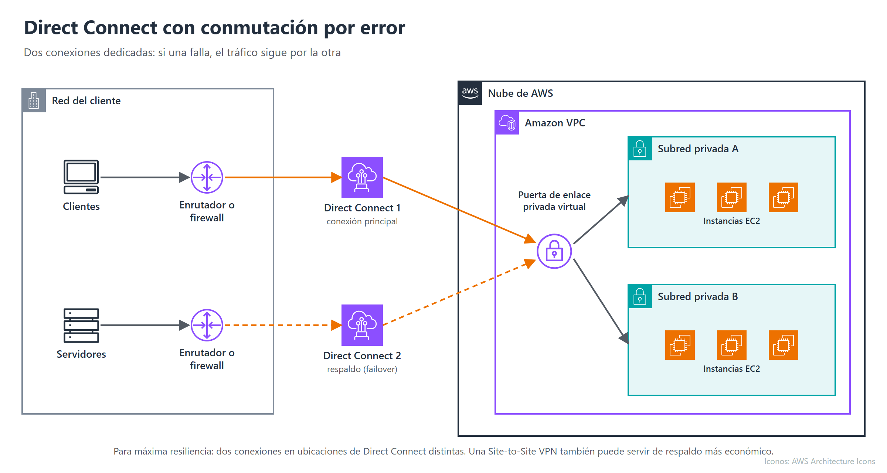
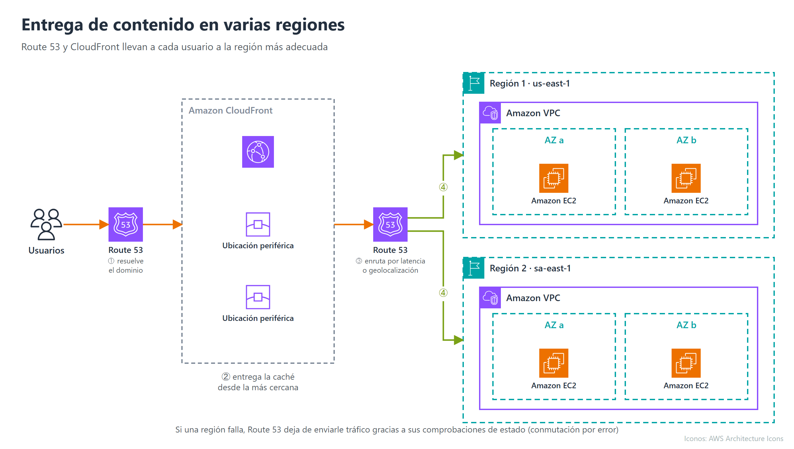

# 5.7 Arquitecturas globales: VPN, Direct Connect y varias regiones

!!! abstract "En esta lección aprenderás a"
    Identificar cuándo usar una VPN o Direct Connect · describir cómo funcionan juntas una VPC, una VPN y Direct Connect · explicar la conmutación por error · describir una arquitectura multirregión con CloudFront y Route 53.

## 1. ¿VPN o Direct Connect?

Las dos conectan tu red con tu VPC, pero resuelven necesidades distintas ([lección 5.3](5-3-conectividad.md)).

|  | AWS Site-to-Site VPN | AWS Direct Connect |
| --- | --- | --- |
| Por dónde viaja | Internet pública, dentro de un túnel **cifrado** | Línea **privada dedicada**, no pasa por internet |
| Tiempo para tenerla | Minutos | Semanas (instalación física en una ubicación de Direct Connect) |
| Ancho de banda | Limitado por internet | Alto (de 1 a 100 Gbps) |
| Latencia | Variable | Estable y predecible |
| Cifrado | Sí, por defecto | No por defecto (se combina con una VPN o MACsec) |
| Cuándo elegirla | Conexión rápida, económica, cargas moderadas, respaldo | Grandes volúmenes de datos, aplicaciones críticas, requisitos de cumplimiento |

!!! tip "Combinación frecuente"
    Direct Connect como conexión principal y una Site-to-Site VPN como **respaldo** más barato; o una VPN **sobre** Direct Connect cuando además se necesita cifrado.

## 2. Caso del curso: Direct Connect con conmutación por error

Una empresa tiene clientes y servidores que exigen conexiones de **gran ancho de banda** para transferir muchos datos y mantener el rendimiento de aplicaciones críticas. Para acceder a AWS de forma segura usa **varias conexiones de Direct Connect**, de modo que si una falla, la otra mantiene el servicio.

<figure markdown="span">
  
  <figcaption>Dos conexiones de Direct Connect llegan a la puerta de enlace privada virtual de la VPC.</figcaption>
</figure>

1. **Red del cliente:** sus clientes y servidores en su centro de datos.
2. **Enrutador o firewall:** cada grupo sale por su propio equipo de red.
3. **Dos conexiones de AWS Direct Connect:** una principal y otra de respaldo; también suman ancho de banda.
4. **Puerta de enlace privada virtual:** recibe ambas conexiones y da acceso a las instancias de EC2 en las **subredes privadas** de la VPC.

## 3. Conmutación por error (failover)

La **conmutación por error** es el mecanismo que permite que un sistema siga funcionando cuando falla un componente principal: el tráfico pasa **automáticamente** a un componente de respaldo.

**Ejemplo sencillo:**

1. Un servidor principal atiende la página web de una empresa.
2. Se produce una avería.
3. AWS detecta el problema (comprobaciones de estado).
4. El tráfico se redirige solo a otro servidor disponible, y los usuarios siguen usando el servicio con poca o ninguna interrupción.

| Servicio | Cómo hace la conmutación por error |
| --- | --- |
| **Amazon Route 53** | Deja de responder con la IP de un recurso que falla sus comprobaciones de estado y envía a los usuarios al de respaldo |
| **Elastic Load Balancing** | Solo envía tráfico a instancias sanas |
| **Amazon RDS Multi-AZ** | Si falla la base de datos principal, pasa a la réplica de otra AZ (módulo 7) |
| **AWS Global Accelerator** | Redirige el tráfico a otra región en segundos |
| **AWS Direct Connect** (dos conexiones) | Si una línea cae, el tráfico sigue por la otra |

!!! note "Definición corta para el examen"
    La conmutación por error es el proceso automático de cambiar a un recurso, sistema o componente de respaldo cuando el principal falla, para mantener la disponibilidad del servicio.

## 4. Caso del curso: entrega de contenido en varias regiones

Una empresa con oficinas en todo el mundo quiere entregar contenido con **baja latencia** en varias regiones.

<figure markdown="span">
  
  <figcaption>Route 53 y CloudFront dirigen a cada usuario a la región más adecuada.</figcaption>
</figure>

1. **Route 53** resuelve el dominio cuando un usuario visita la aplicación.
2. **CloudFront** entrega el contenido desde la ubicación periférica más cercana.
3. Si el contenido no está en caché, **Route 53** dirige la solicitud al origen más adecuado según la **latencia** o la **geolocalización**.
4. Cada **región** tiene su VPC con instancias de EC2 repartidas en **varias AZ**: si una región falla, Route 53 envía el tráfico a la otra.

!!! tip "Notas rápidas"
    VPN = rápida, cifrada, por internet · Direct Connect = dedicada, alto ancho de banda, latencia estable · dos Direct Connect (o DX + VPN) = conmutación por error · varias regiones + Route 53 + CloudFront = baja latencia global y recuperación ante desastres.

## Pregunta tipo examen

**Una empresa de salud necesita una conexión de red dedicada a AWS para enviar grandes volúmenes de datos, y tiene requisitos de cumplimiento por la información confidencial de sus pacientes. ¿Qué tipo de conexión es la mejor?**

- a) Una conexión estándar a internet hacia una puerta de enlace de internet en su VPC
- b) Una VPN desde su centro de datos hacia AWS
- c) Una VPN desde su centro de datos hacia una puerta de enlace privada virtual en su VPC
- d) AWS Direct Connect desde su centro de datos hacia una puerta de enlace privada virtual en su VPC

??? success "Ver explicación"
    **d.** Piden una conexión **dedicada** para **grandes volúmenes** con **requisitos de cumplimiento**: Direct Connect es una línea privada, con alto ancho de banda, que no comparte la internet pública. Las VPN viajan por internet (no son dedicadas) y una puerta de enlace de internet expone el tráfico al público.

## Comprueba lo aprendido

**1.** Necesitas conectar tu oficina con AWS hoy mismo y con cifrado. ¿VPN o Direct Connect?

**2.** ¿Cómo mantienes la conexión si tu única línea de Direct Connect falla?

**3.** ¿Qué servicio envía a los usuarios a la región de respaldo cuando la principal falla sus comprobaciones de estado?

??? success "Ver respuestas"
    1. **Site-to-Site VPN**: se configura en minutos y viaja cifrada.
    2. Con una **segunda conexión de Direct Connect** o una **VPN de respaldo**.
    3. **Amazon Route 53** (también Global Accelerator).

## Para profundizar

- [Opciones de conectividad de Amazon VPC (whitepaper)](https://docs.aws.amazon.com/whitepapers/latest/aws-vpc-connectivity-options/introduction.html) · [Resiliencia de Direct Connect](https://aws.amazon.com/directconnect/resiliency-recommendation/) · [Conmutación por error con Route 53](https://docs.aws.amazon.com/Route53/latest/DeveloperGuide/dns-failover.html)
