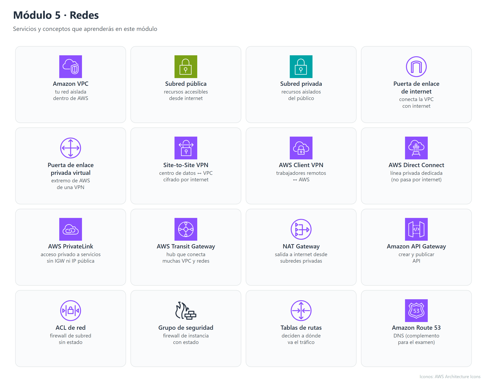

# Módulo 5 · Redes

*Networking* · Dominios del examen: **D3 Tecnología y servicios** y **D2 Seguridad y cumplimiento**

!!! abstract "Resumen del módulo"
    Una **Amazon VPC** es tu red privada y aislada dentro de AWS. Se divide en **subredes**: las **públicas** tienen una ruta a la **puerta de enlace de internet** y las **privadas** no. Para conectar oficinas y personas usas **VPN** (cifrada por internet: **Client VPN** para personas, **Site-to-Site VPN** para sedes) o **Direct Connect** (línea privada dedicada); para consumir servicios en privado, **PrivateLink**. **Transit Gateway**, **NAT Gateway** y **API Gateway** completan el panorama. La seguridad de red tiene dos capas: **ACL de red** (subred, sin estado) y **grupos de seguridad** (instancia, con estado), y configurarlas es responsabilidad del cliente.

!!! info "Módulo en desarrollo"
    Están publicadas las lecciones 5.1 a 5.5 del curso. Las lecciones 6 a 9 del módulo se agregarán pronto.

## Resultados de aprendizaje

1. Describir qué es una VPC y una subred, y diferenciar subredes públicas y privadas.
2. Leer un diagrama de arquitectura de red de AWS.
3. Explicar la puerta de enlace de internet, la puerta de enlace privada virtual y la VPN.
4. Elegir entre Client VPN, Site-to-Site VPN, PrivateLink y Direct Connect.
5. Explicar Transit Gateway, NAT Gateway y API Gateway.
6. Diferenciar grupos de seguridad (con estado) y ACL de red (sin estado), y quién es responsable de configurarlos.
7. Crear una VPC con subredes, IGW y tablas de rutas.

## Mapa del módulo

<figure markdown="span">
  
  <figcaption>Servicios y conceptos del Módulo 5.</figcaption>
</figure>

## Lecciones

| Lección | Tema |
| --- | --- |
| [5.1](5-1-vpc-subredes.md) | Introducción a las redes: VPC y subredes |
| [5.2](5-2-puertas-enlace-vpn.md) | Organización de los recursos: VPC, puertas de enlace y VPN |
| [5.3](5-3-conectividad.md) | Más formas de conectarse a la nube de AWS |
| [5.4](5-4-grupos-seguridad-acl.md) | Subredes, grupos de seguridad y ACL de red |
| [5.5](5-5-demostracion-vpc.md) | Demostración de Amazon VPC |
| [Laboratorio 5](laboratorio.md) | VPC con subred pública y privada, grupos de seguridad y ACL de red |

## Servicios y conceptos del módulo

| Servicio o concepto | Qué es | Cómo funciona | Ejemplo o caso | Lección |
| --- | --- | --- | --- | --- |
| **Amazon VPC** | Red virtual aislada de forma lógica | Defines rango IP, subredes, rutas y seguridad | Tu "terreno cercado" en AWS | 5.1 |
| **Subred pública / privada** | Rango de IP dentro de la VPC, en una sola AZ | Pública = ruta a la IGW; privada = sin esa ruta | Web pública, base de datos privada | 5.1 |
| **Puerta de enlace de internet** | Conexión entre la VPC e internet | Se adjunta a la VPC | La puerta de la cafetería | 5.2 |
| **Puerta de enlace privada virtual + VPN** | Entrada cifrada para redes aprobadas | Túnel cifrado por internet | Conectar la oficina con la VPC | 5.2 |
| **AWS Client VPN** | VPN administrada para personas | Escala según los usuarios | Empresa recién adquirida con trabajo remoto | 5.3 |
| **AWS Site-to-Site VPN** | VPN entre sedes y la VPC | Cifrado IPsec por internet | Migraciones y sucursales | 5.3 |
| **AWS PrivateLink** | Acceso privado a servicios | Sin IGW, NAT ni IP pública | Consumir un SaaS sin internet | 5.3 |
| **AWS Direct Connect** | Línea privada dedicada | No pasa por internet; más ancho de banda | Migración a gran escala | 5.3 |
| **Transit Gateway · NAT Gateway · API Gateway** | Hub de redes · salida privada · puerta de entrada de API | Conectar muchas VPC · parches sin exposición · publicar API | Corporación con 40 VPC | 5.3 |
| **ACL de red** | Firewall de subred | Sin estado; permitir y denegar; orden numérico | Control de pasaportes | 5.4 |
| **Grupo de seguridad** | Firewall de instancia | Con estado; solo permitir | El portero del edificio | 5.4 |
| **Tablas de rutas** | Deciden a dónde va el tráfico | Ruta local + ruta a la IGW en las públicas | Demostración de VPC | 5.5 |

## Notas rápidas

!!! tip "Para repasar en 2 minutos"
    - **VPC** = red aislada · **subred** = rango de IP en **una sola AZ** · pública si su tabla de rutas apunta a una **IGW**.
    - **IGW** = entrada y salida pública · **puerta de enlace privada virtual** = extremo de la VPN · **NAT Gateway** = solo salida desde subredes privadas.
    - **Client VPN** → personas · **Site-to-Site VPN** → sedes (por internet, cifrado) · **Direct Connect** → línea privada dedicada (no cifra por defecto) · **PrivateLink** → servicios sin internet.
    - **Transit Gateway** = hub de muchas VPC y redes locales · **API Gateway** = puerta de entrada a tus API.
    - **Grupo de seguridad** = instancia · con estado · solo permitir · niega toda entrada y permite toda salida por defecto.
    - **ACL de red** = subred · sin estado · permitir y denegar · orden numérico · la predeterminada permite todo; una personalizada nueva niega todo.
    - Configurar grupos de seguridad y ACL es responsabilidad **del cliente**.

## Evaluación del módulo

**1. ¿Qué componente necesita una VPC para recibir tráfico público de internet?**

- a) Puerta de enlace privada virtual
- b) Puerta de enlace de internet
- c) AWS Direct Connect
- d) ACL de red

**2. ¿En qué tipo de subred pones una base de datos con información de clientes?**

- a) Pública
- b) Privada
- c) En ninguna, fuera de la VPC
- d) En una ubicación periférica

**3. ¿Cuál es sin estado y trabaja a nivel de subred?**

- a) Grupo de seguridad
- b) ACL de red
- c) Puerta de enlace de internet
- d) AWS PrivateLink

**4. Una empresa necesita una conexión privada y dedicada, que no pase por internet, entre su centro de datos y AWS. ¿Qué usa?**

- a) AWS Site-to-Site VPN
- b) AWS Client VPN
- c) AWS Direct Connect
- d) Amazon API Gateway

**5. Cientos de empleados que trabajan desde casa necesitan acceso seguro a recursos en AWS. ¿Qué servicio encaja?**

- a) AWS Client VPN
- b) AWS Direct Connect
- c) AWS Transit Gateway
- d) NAT Gateway

**6. Instancias en una subred privada deben descargar actualizaciones sin ser accesibles desde internet. ¿Qué necesitas?**

- a) Una puerta de enlace de internet en la subred privada
- b) Un NAT Gateway
- c) AWS PrivateLink
- d) Una IP pública en cada instancia

**7. Quieres acceder de forma privada al servicio de otro proveedor sin IGW ni IP pública. ¿Qué usas?**

- a) AWS PrivateLink
- b) AWS Site-to-Site VPN
- c) Amazon CloudFront
- d) Elastic Load Balancing

**8. Necesitas bloquear explícitamente una dirección IP maliciosa. ¿Dónde lo haces?**

- a) En un grupo de seguridad
- b) En una ACL de red
- c) En la puerta de enlace de internet
- d) En la AMI

**9. Según el modelo de responsabilidad compartida, ¿quién configura los grupos de seguridad?**

- a) AWS
- b) El cliente
- c) El proveedor de internet
- d) Nadie, vienen fijos

**10. Una empresa quiere conectar 30 VPC y 2 centros de datos desde un único punto central. ¿Qué usa?**

- a) AWS Transit Gateway
- b) Puerta de enlace de internet
- c) AWS Client VPN
- d) Amazon Route 53

??? success "Ver respuestas y explicaciones"
    1. **b**: la IGW conecta la VPC con internet.
    2. **b**: los datos sensibles van en subredes privadas.
    3. **b**: la ACL de red es sin estado y actúa sobre la subred.
    4. **c**: Direct Connect es una línea privada dedicada.
    5. **a**: Client VPN es para usuarios remotos individuales.
    6. **b**: el NAT Gateway solo permite tráfico de salida iniciado desde adentro.
    7. **a**: PrivateLink da conectividad privada sin exponerse a internet.
    8. **b**: los grupos de seguridad solo permiten; las ACL también pueden denegar.
    9. **b**: configurar la red es seguridad EN la nube.
    10. **a**: Transit Gateway funciona como hub central.

## Trampas típicas del examen

!!! warning "No te confundas"
    - **Grupo de seguridad = instancia, con estado, solo permitir.** **ACL de red = subred, sin estado, permitir y denegar.**
    - **VPN** (por internet, cifrada, rápida de montar) ≠ **Direct Connect** (física, privada, más ancho de banda, tarda semanas en instalarse).
    - **Client VPN** (personas) ≠ **Site-to-Site VPN** (redes completas).
    - **IGW** (entrada y salida pública) ≠ **NAT Gateway** (solo salida desde privadas) ≠ **puerta de enlace privada virtual** (extremo de la VPN).
    - Una subred pertenece a **una sola AZ**; la VPC abarca todas las AZ de su región.

## Recursos

- [Amazon VPC](https://aws.amazon.com/vpc/) · [Grupos de seguridad](https://docs.aws.amazon.com/vpc/latest/userguide/vpc-security-groups.html) · [ACL de red](https://docs.aws.amazon.com/vpc/latest/userguide/vpc-network-acls.html)
