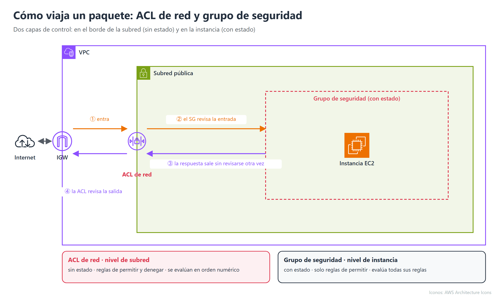

# Laboratorio 5 · VPC con subred pública y privada, grupos de seguridad y ACL de red

!!! example "Ficha del laboratorio"
    **Objetivo:** construir una red real, comprobar qué hace pública a una subred y demostrar la diferencia entre un firewall **con estado** (grupo de seguridad) y uno **sin estado** (ACL de red).

    **Costo:** dentro de la capa gratuita o de tus créditos si **no creas NAT Gateway** y terminas las instancias al final · **Tiempo:** 45 minutos · **Servicios:** VPC, EC2, CloudShell.

## Arquitectura

<figure markdown="span">
  
  <figcaption>Lo que vas a probar: el paquete pasa por la ACL de red y por el grupo de seguridad.</figcaption>
</figure>

## Configuración previa

- Usuario administrador, región **us-east-1**.
- Ten a mano el script de [datos de usuario del Laboratorio 2](../modulo-02/laboratorio.md#parte-a-servidor-web) (servidor web).
- **No crees NAT Gateway**: cobra por hora aunque no lo uses.

## Valores a usar

| Ajuste | Valor |
| --- | --- |
| VPC (asistente *VPC y más*) | Prefijo `lab` · CIDR `10.0.0.0/16` · **1 AZ** · **1 subred pública** · **1 privada** · NAT: **Ninguna** · Puntos de enlace: **Ninguno** |
| Subredes | Las que proponga el asistente |
| EC2 pública | `lab-publica` · t3.micro · subred pública · **Asignar IP pública: Habilitar** · grupo `lab-web-sg` con HTTP 80 desde `0.0.0.0/0` · etiqueta `Proyecto = lab-clf` |
| EC2 privada | `lab-privada` · t3.micro · subred privada · **IP pública: Deshabilitar** |
| ACL de red | `lab-nacl` (personalizada) |

## Paso a paso

1. **VPC → Crear VPC → VPC y más** con los valores de la tabla. Mira el **mapa de recursos** que muestra el asistente.
2. Abre la tabla de rutas pública (`lab-rtb-public`): tiene `0.0.0.0/0 → igw-…`. La privada solo tiene la ruta `local`.
3. Lanza `lab-publica` con los valores de la tabla y los datos de usuario del laboratorio 2. Abre `http://<IP pública>`.
4. Lanza `lab-privada`: no tiene IP pública, así que no se puede alcanzar desde internet.
5. **Experimentos** (anota el resultado de cada uno):

| # | Acción | Resultado esperado | Qué demuestra |
| --- | --- | --- | --- |
| 1 | Quita la regla HTTP de `lab-web-sg` | La página deja de cargar | El grupo de seguridad niega lo que no está permitido |
| 2 | Vuelve a agregarla (sin tocar reglas de salida) | La página carga | Grupo de seguridad **con estado**: la respuesta sale sola |
| 3 | Crea `lab-nacl` y asóciala a la subred pública, sin reglas | La página deja de cargar | Una ACL personalizada **niega todo** por defecto |
| 4 | Agrega solo entrada 100: permitir TCP 80 desde `0.0.0.0/0` | **Sigue sin cargar** | ACL **sin estado**: falta permitir la salida |
| 5 | Agrega salida 100: permitir TCP `1024-65535` hacia `0.0.0.0/0` | La página carga | Las respuestas usan puertos efímeros |

## Pruebas de verificación

**Automáticas:** el script revisa la VPC, la ruta a la IGW, que no haya NAT Gateway, la IP de cada instancia, el servidor web y las reglas de `lab-nacl`. Solo consulta.

```bash
curl -s https://raw.githubusercontent.com/CesarLoor/aws-cloud-practitioner-es/main/labs/modulo-05/verificar-lab5.sh | bash
```

**Manuales** en CloudShell:

```bash
# ID de la VPC del laboratorio (el asistente la llama lab-vpc)
VPC=$(aws ec2 describe-vpcs --filters "Name=tag:Name,Values=lab-vpc" --query "Vpcs[0].VpcId" --output text)

# Rutas: la tabla pública tiene 0.0.0.0/0 hacia la IGW; la privada no
aws ec2 describe-route-tables --filters "Name=vpc-id,Values=$VPC" \
  --query "RouteTables[].[Tags[?Key=='Name']|[0].Value, Routes[?DestinationCidrBlock=='0.0.0.0/0']|[0].GatewayId]" \
  --output table

# Instancias: la pública tiene IP pública; la privada no
aws ec2 describe-instances --filters "Name=vpc-id,Values=$VPC" "Name=instance-state-name,Values=running" \
  --query "Reservations[].Instances[].[Tags[?Key=='Name']|[0].Value, PrivateIpAddress, PublicIpAddress]" \
  --output table

# Probar la web (reemplaza la IP); -m 5 corta a los 5 segundos si está bloqueada
curl -s -m 5 http://IP_PUBLICA || echo "Sin respuesta (bloqueado)"

# Reglas de la ACL de red
aws ec2 describe-network-acls --filters "Name=vpc-id,Values=$VPC" \
  --query "NetworkAcls[].Entries[].[Egress,RuleNumber,Protocol,PortRange.From,PortRange.To,RuleAction]" \
  --output table
```

??? info "Ver el contenido del script de verificación"
    ```bash
    --8<-- "labs/modulo-05/verificar-lab5.sh"
    ```

## Errores comunes

- **La instancia pública no tiene IP:** no habilitaste *Asignar IP pública*; termínala y lánzala de nuevo.
- **Lanzaste en la VPC predeterminada por error:** revisa el campo VPC al lanzar.
- **No puedes eliminar la VPC:** aún hay instancias o interfaces de red; termina todo y espera a que digan *terminated*.
- **Creaste un NAT Gateway por error:** elimínalo ya y libera su IP elástica.

## Limpieza verificada

1. Termina `lab-publica` y `lab-privada`.
2. Elimina la VPC `lab-vpc`: se borran sus subredes, tablas de rutas, IGW y ACL.
3. Comprueba:

```bash
aws ec2 describe-nat-gateways --filter "Name=state,Values=pending,available" --query "NatGateways[].NatGatewayId"   # []
aws ec2 describe-addresses --query "Addresses[].PublicIp"                                                       # []
aws ec2 describe-vpcs --filters "Name=tag:Name,Values=lab-vpc" --query "Vpcs[].VpcId"                           # []
```

Y termina con la [verificación global](../entorno/04-limpieza.md#2-verificacion-global-en-cloudshell).

## Qué demuestra este laboratorio

- Qué hace pública a una subred: la ruta a la IGW ([lecciones 5.1](5-1-vpc-subredes.md) y [5.5](5-5-demostracion-vpc.md)).
- El grupo de seguridad es con estado y la ACL de red sin estado ([lección 5.4](5-4-grupos-seguridad-acl.md)).
- Configurar la seguridad de red es responsabilidad del cliente ([lección 5.4](5-4-grupos-seguridad-acl.md)).
